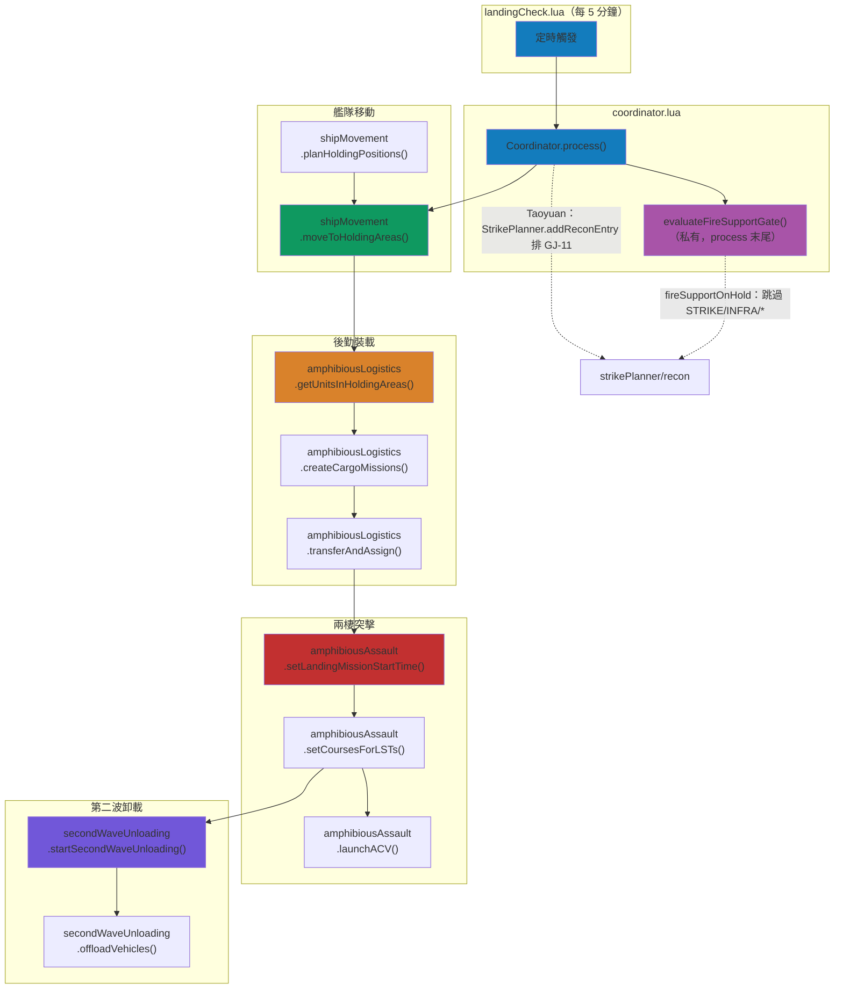
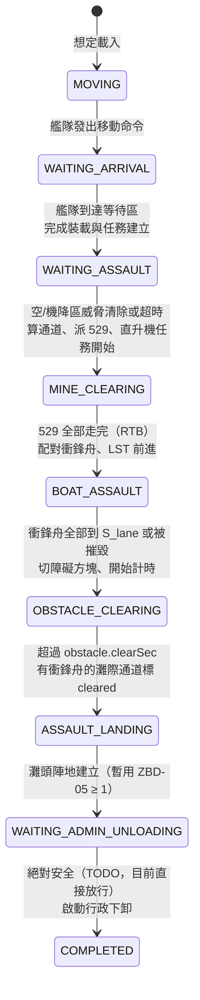
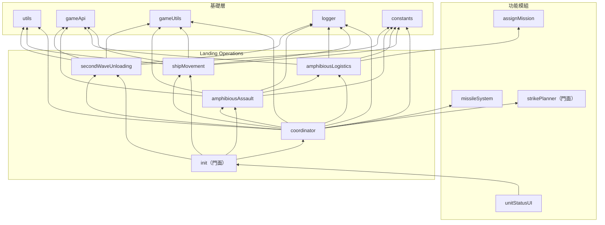

# Landing Operations 系統架構

本文件說明 `src/modules/landingOps/` 的整體設計架構、模組間協作關係及資料流。各模組的詳細說明請參閱對應文件。

---

## 概述

Landing Operations 是解放軍陣營的兩棲登陸作戰系統，模擬從艦隊集結到灘頭建立的完整登陸流程。系統分為四個核心階段：

- **艦隊移動**：登陸艦從集結區移動至等待區，依艦型分層佈置陣形
- **後勤裝載**：貨物轉移至登陸載具（直升機、氣墊船），建立運輸任務
- **兩棲突擊**：LST 航至泛水編波區、ACV 兩棲步兵戰鬥車釋放、直升機空中突擊
- **第二波卸載**：駁船與 RORO 船組成後勤橋樑，卸載重型裝備

### 登陸作戰階段對應

| 作戰階段 | 對應模組 | 說明 |
|:-:|---|---|
| **集結** | [shipMovement](shipMovement.md) | 各型登陸艦從集結區航向等待區 |
| **裝載** | [amphibiousLogistics](amphibiousLogistics.md) | 貨物轉移、運輸任務建立、單位指派 |
| **突擊** | [amphibiousAssault](amphibiousAssault.md) | ACV 釋放、LST 航至泛水編波區、任務時序設定 |
| **卸載** | [secondWaveUnloading](secondWaveUnloading.md) | 駁船/RORO 船後勤鏈、車輛卸載 |

---

## 模組一覽

| 模組 | 原始碼 | 職責 |
|---|---|---|
| [coordinator](coordinator.md) | `coordinator.lua` | 主流程編排、各 zone 階段推進、火力支援暫停閘門 |
| [shipMovement](shipMovement.md) | `shipMovement.lua` | 登陸艦隊移動至等待區與 SAG 護航編隊佈陣 |
| [amphibiousLogistics](amphibiousLogistics.md) | `amphibiousLogistics.lua` | 貨物操作、平台裝載與任務指派 |
| [amphibiousAssault](amphibiousAssault.md) | `amphibiousAssault.lua` | ACV 釋放、LST 航向設定與兩棲突擊協調 |
| [secondWaveUnloading](secondWaveUnloading.md) | `secondWaveUnloading.lua` | 駁船-RORO 後勤鏈建立與車輛卸載（行政下卸） |
| [assaultTimeline](assaultTimeline.md) | `laneGeometry.lua` | 通道幾何（純函式）：水際／灘際通道、弓字型、障礙方塊、相交判斷 |
| [assaultTimeline](assaultTimeline.md) | `routePlanner.lua` | 走通道的航線：選通道、排隊入口點、停車位 |
| [assaultTimeline](assaultTimeline.md) | `mineClearing.lua` | 開場佈雷、Type 529 掃雷 |
| [assaultTimeline](assaultTimeline.md) | `assaultBoat.lua` | 衝鋒舟配對、放出、到達追蹤 |
| [assaultTimeline](assaultTimeline.md) | `obstacleClearing.lua` | 岸上障礙方塊與破障計時 |
| [assaultTimeline](assaultTimeline.md) | `acvWave.lua` | 兩棲車存活上限與分波 |
| [assaultTimeline](assaultTimeline.md) | `hovercraft.lua` | 氣墊船走通道、到點標記 |

### 門面 API（`init.lua`）

套件外的程式碼（事件腳本、`unitStatusUI` 等模組）只 `require("src.modules.landingOps.init")`，不直接 require 套件內部模組：

| 函式 | 說明 | 外部呼叫端 |
|---|---|---|
| `init(amphibOpsConfig, landingState)` | 開局初始化兩棲作戰狀態 | `src/core/init.lua` |
| `process(config, landingState, params)`（`params`：`contacts`、`currentTime`、`filteredShips`） | 轉交 [`Coordinator.process`](coordinator.md) | `landingCheck.lua` |
| `launchACV(config, saveData, ship)` | ACV 釋放（`ASSAULT_LANDING` 起；額度 0 暫停、艙內空 RTB） | `launchACV.lua` |
| `offloadVehicles(amphibOpsConfig, landingState, ship)` | 重裝備下卸 | `offloadVehicles.lua` |
| `neutralizeAirlandingZone(amphibOpsConfig, ship, contacts)` | SAG 壓制空/機降區 | `neutralizeAirlandingZone.lua` |
| `countUnitsInEachArea(config)` | 純轉發 [`AmphibiousAssault.countUnitsInEachArea`](amphibiousAssault.md) | `src/modules/unitStatusUI.lua` |

---

## 系統架構圖

### 整體作戰流程



### 狀態機流程



`ASSAULT_LANDING` 起（含之後的 phase），兩棲車分波泛水、氣墊船走通道。流程細節見 [assaultTimeline](assaultTimeline.md)。

每個作戰區（Taoyuan、Sishu、Penghu）各自維護獨立的 `zoneState.phase`，透過 `constants.AMPHIBIOUS_PHASES` 列舉值推進。

---

## 核心資料結構

### 兩棲作戰狀態

```
saveData.red.amphibOps
├── startTime: string                    -- 作戰開始時間
├── isTesting: boolean                   -- 測試模式（瞬間移動）
├── fireSupportOnHold?: boolean          -- 火力支援暫停旗標（coordinator 維護）
├── zoneStates: table<string, SBJ__ZoneState>
│   └── [zoneName]                       -- 以區域名稱索引（Taoyuan / Sishu / Penghu）
│       ├── phase: string                -- 當前階段（constants.AMPHIBIOUS_PHASES 值）
│       ├── amphibiousAssaultStartTime: number|nil  -- 突擊開始時間戳
│       └── airlandingMissionStartTime: number|nil  -- 空/機降任務開始時間
├── calculationResult: table<string, SBJ__OperationZoneCalculationState>
│   └── OperationZoneCalculationResult
│       ├── name: string                 -- 作戰名稱
│       └── result: table<string, SBJ__ShipCalculationState>
│           └── ShipCalculationResult
│               ├── locations: CMO__Location[]  -- 預算位置陣列
│               ├── locationIndex: number       -- 目前分配索引
│               └── dbid: number                -- 平台 DBID
└── barges: table<string, SBJ__BargeContext>
    └── BargeContext
        ├── guid: string                 -- 駁船 GUID
        ├── bridgeGUID: string|nil       -- 後勤橋 GUID
        └── roros: string[]              -- 配對的 RORO 船 GUID
```

---

## 模組依賴關係



---

## 設定檔參考

### config.lua（運行期配置）

| 設定路徑 | 用途 |
|---|---|
| `config.red.amphibOps.periodSec` | 突擊等待超時時間（秒） |
| `config.red.amphibOps.fireSupportHoldThreshold` | SRBM 總彈量百分比下限；低於此值且各 zone 尚未到位即啟動火力支援暫停閘門 |
| `config.red.amphibOps.cargo` | 各艦型貨物清單（依艦型索引） |
| `config.red.amphibOps.transferCargo` | 轉移用貨物清單（依作戰群組索引） |
| `config.red.amphibOps.missionStartTime` | 各載具類型任務延遲時間 |
| `config.red.amphibOps.formationSettings` | 編隊設定（間距、速度、航向） |
| `config.red.amphibOps.zones` | 作戰區設定：`fleet`（集結區→等待區）、`sags`（SAG 護航編隊）、`movement`（基地、母艦乘載區、展開線、抵達門檻）、`air`（空降區、直升機任務）、`landing`（登陸艇、LST、ACV、灘頭） |
| `config.red.amphibOps.tuning` | 共用參數：`route`、`mineClearing`、`assaultBoat`、`obstacle`、`acvWave` |
| `config.red.amphibOps.transportAircraft` | 運輸機配置（空降部隊） |
| `config.red.triggers.amphibiousOps.startTime` | 兩棲作戰觸發開始時間 |

### constants.lua（不可變常數）

| 常數路徑 | 用途 |
|---|---|
| `constants.PLATFORMS.TYPE_075` | 075 型兩棲攻擊艦 DBID |
| `constants.PLATFORMS.TYPE_076` | 076 型兩棲攻擊艦 DBID |
| `constants.PLATFORMS.TYPE_071` | 071 型船塢登陸艦 DBID |
| `constants.PLATFORMS.TYPE_072III` | 072III 型戰車登陸艦 DBID |
| `constants.PLATFORMS.TYPE_072A` | 072A 型戰車登陸艦 DBID |
| `constants.PLATFORMS.TYPE_073A` | 073A 型登陸艦 DBID |
| `constants.PLATFORMS.FERRY` | 民用渡輪 DBID |
| `constants.PLATFORMS.BARGE` | 駁船 DBID |
| `constants.PLATFORMS.ZBD05` | ZBD-05 兩棲步兵戰車 DBID |
| `constants.PLATFORMS.ZTD05` | ZTD-05 兩棲突擊車 DBID |
| `constants.PLATFORMS.TYPE_052D` | 052D 型驅逐艦 DBID |
| `constants.PLATFORMS.TYPE_054A` | 054A 型護衛艦 DBID |
| `constants.PLATFORMS.BRIDGE` | 後勤浮橋設施 DBID |
| `constants.PLATFORMS.HPJ_38` | H/PJ-38 130mm 艦砲武器 ID |
| `constants.AMPHIBIOUS_PHASES.*` | 作戰階段列舉（MOVING / WAITING_ARRIVAL / WAITING_ASSAULT / MINE_CLEARING / BOAT_ASSAULT / OBSTACLE_CLEARING / ASSAULT_LANDING / WAITING_ADMIN_UNLOADING / COMPLETED） |
| `constants.SIDES.RED` | 中國陣營名稱 |
| `constants.CONTACT_TYPES.FACILITY_MOBILE` | 可移動設施接觸類型 |
| `constants.PLATFORM_TYPES.AIRCRAFT` | 航空器平台類型 |
| `constants.PLATFORM_TYPES.BOATS` | 氣墊船平台類型 |

---

## 相關檔案

| 檔案 | 說明 |
|---|---|
| `src/scripts/china/amphibiousOps/landingCheck.lua` | 主排程腳本（每 5 分鐘觸發），驅動整體狀態機 |
| `src/scripts/china/amphibiousOps/launchACV.lua` | ACV 釋放事件腳本（單位進入區域觸發） |
| `src/scripts/china/amphibiousOps/offloadVehicles.lua` | 重裝備下卸事件腳本（單位進入區域觸發） |
| `src/scripts/china/amphibiousOps/neutralizeAirlandingZone.lua` | 空/機降區壓制腳本（SAG 進入區域觸發） |
| `src/modules/assignMission.lua` | 任務指派模組 |
| `src/modules/strikePlanner/attackManager.lua` | 打擊管理（SAG 艦砲射擊） |
| `src/modules/unitStatusUI.lua` | 單位狀態面板；經門面 `LandingOps.countUnitsInEachArea` 顯示各區登陸單位數 |
| `src/core/config.lua` | 運行期配置 |
| `src/core/constants.lua` | 不可變常數 |
| `src/core/saveData.lua` | 持久化狀態管理 |
