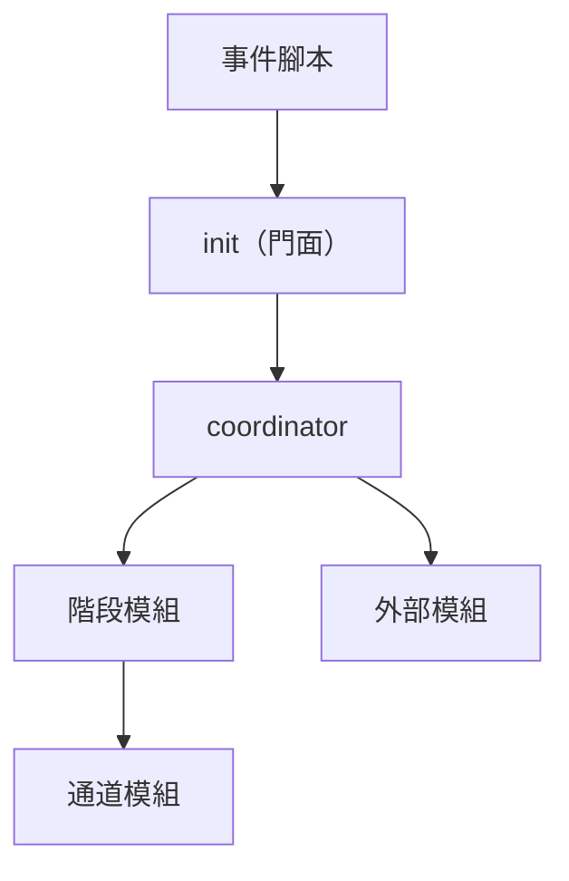

# Landing Operations 系統架構

> 原始碼：`src/modules/landingOps/`

解放軍陣營的兩棲登陸作戰系統，模擬從艦隊集結到灘頭建立的完整流程。三個作戰區（Taoyuan、Sishu、Penghu）各自維護獨立的 `zoneState.phase`，由 [coordinator](coordinator.md) 每 5 分鐘推進一次。

套件是 **package**：套件外（事件腳本、`core/init`、`unitStatusUI`）只 `require("src.modules.landingOps.init")`，套件內檔案彼此直接呼叫，不繞過自己的門面。`spec/moduleBoundary_spec.lua` 守門。

---

## 作戰階段與模組對應

| 作戰階段 | 對應模組 | 說明 |
|---|---|---|
| 集結 | [shipMovement](shipMovement.md) | 各型登陸艦從集結區航向等待區 |
| 裝載 | [amphibiousLogistics](amphibiousLogistics.md) | 貨物轉移 |
| 反水雷 | [mineClearing](mineClearing.md) | 算通道、派 Type 082 掃雷 |
| 空降 | [heliWave](heliWave.md) | 運輸直升機機波與攻擊直升機護航 |
| 突擊 | [assaultBoat](assaultBoat.md)、[obstacleClearing](obstacleClearing.md)、[amphibiousAssault](amphibiousAssault.md)、[acvWave](acvWave.md)、[hovercraft](hovercraft.md) | 衝鋒舟破障，之後兩棲車分波、氣墊船走通道 |
| 卸載 | [adminOffloading](adminOffloading.md) | 駁船與 RORO 後勤鏈 |

階段機的轉換條件與每個 tick 的執行順序見 [coordinator](coordinator.md)。階段設計的來源與取捨見 [assaultTimeline](assaultTimeline.md)。

---

## 模組一覽

| 模組 | 原始碼 | 職責 |
|---|---|---|
| [init（門面）](#門面-api) | `init.lua` | 對外入口，並組合 persistent state 與 config 後轉交內部模組 |
| [coordinator](coordinator.md) | `coordinator.lua` | 逐區階段推進、貨物補運 |
| [fireSupportGate](fireSupportGate.md) | `fireSupportGate.lua` | 火力支援暫停閘門 |
| [shipMovement](shipMovement.md) | `shipMovement.lua` | 預算等待位置、艦隊與 SAG 移動 |
| [amphibiousLogistics](amphibiousLogistics.md) | `amphibiousLogistics.lua` | 貨物轉移 |
| [amphibiousAssault](amphibiousAssault.md) | `amphibiousAssault.lua` | LST 就位、ACV 釋放 |
| [heliWave](heliWave.md) | `heliWave.lua` | 直升機機波：放飛、左右翼航線、卸貨、返航 |
| [adminOffloading](adminOffloading.md) | `adminOffloading.lua` | 駁船-RORO 後勤鏈、下卸車輛 |
| [laneGeometry](laneGeometry.md) | `laneGeometry.lua` | 通道幾何（純函式） |
| [routePlanner](routePlanner.md) | `routePlanner.lua` | 走通道的航線與停車位 |
| [mineClearing](mineClearing.md) | `mineClearing.lua` | 佈雷（除錯用）、Type 082 掃雷 |
| [assaultBoat](assaultBoat.md) | `assaultBoat.lua` | 衝鋒舟配對、放出、到達追蹤 |
| [obstacleClearing](obstacleClearing.md) | `obstacleClearing.lua` | 岸上障礙方塊與破障計時 |
| [acvWave](acvWave.md) | `acvWave.lua` | 兩棲車生成、航線、存活上限與分波 |
| [hovercraft](hovercraft.md) | `hovercraft.lua` | 氣墊船走通道、到點標記 |
| [cargoRun](cargoRun.md) | `cargoRun.lua` | 載運階段：找有貨的載具、到點卸貨、返航 |
| [trackedUnits](trackedUnits.md) | `trackedUnits.lua` | 被擊殺的單位從所有登記表刪掉 |
| [sagFireSupport](sagFireSupport.md) | `sagFireSupport.lua` | 052D 所屬 SAG 壓制空/機降區 |
| [debugFlow](debugFlow.md) | `debugFlow.lua` | 實測用的快轉與瞬移開關 |

---

## 系統架構圖

- **事件腳本**：`landingCheck.lua`（每 5 分鐘）呼叫 `process`；`launchACV.lua`、`offloadVehicles.lua`、`attackAirlandingZone.lua` 由單位進入區域觸發。
- **階段模組**：shipMovement、amphibiousLogistics、mineClearing、assaultBoat、obstacleClearing、amphibiousAssault、acvWave、hovercraft、adminOffloading、sagFireSupport。
- **通道模組**：[laneGeometry](laneGeometry.md) 與 [routePlanner](routePlanner.md)，被 mineClearing、assaultBoat、obstacleClearing、hovercraft 和 acvWave 共用；它們不碰遊戲 API。
- **外部模組**：coordinator 把 `missileSystem` 的 SRBM 庫存查詢交給 fireSupportGate、用 `strikePlanner` 排 GJ-11 偵察；sagFireSupport 用 `attackManager` 指揮 SAG 射擊。
- 除錯開關 [debugFlow](debugFlow.md) 被多數階段模組讀取，圖上省略。

---

## 門面 API

| 函式 | 說明 | 呼叫端 |
|---|---|---|
| `init(config, saveData)` | 開局預算各區艦隊等待位置，結果寫入 `calculationResult` | `src/core/init.lua` |
| `process(config, saveData)` | 取得接觸與艦船清單後轉交 `Coordinator.process`，並記錄耗時 | `landingCheck.lua` |
| `launchACV(config, saveData, ship)` | 轉交 [amphibiousAssault](amphibiousAssault.md) 的 `launchACV`，在 `ASSAULT_LANDING` 起釋放 ACV | `launchACV.lua` |
| `offloadVehicles(config, saveData, ship)` | 轉交 [adminOffloading](adminOffloading.md) 的 `handleShipArrival`：駁船架橋、RORO 下卸 | `offloadVehicles.lua` |
| `attackAirlandingZone(config, ship)` | 轉交 sagFireSupport：052D 所屬 SAG 壓制空/機降區的可移動設施 | `attackAirlandingZone.lua` |
| `countUnitsInEachArea(config)` | 各區已登陸單位統計 | `unitStatusUI.lua` |

門面函式都收 `config`、`saveData` 並自行解析 persistent state（`PersistentState.landingOps(saveData)`），所以呼叫端不用知道內部切片。門面只做這件事，流程都在內部模組。

---

## 核心型別導覽

型別定義在 `src/core/schema.lua`，這裡只列名稱。

| 型別 | 用途 |
|---|---|
| `SBJ__LandingOpsState` | persistent state 切片：`amphibOps`、recon、ground |
| `SBJ__AmphibOpsState` | `zoneStates`、`calculationResult`、`barges`、`fireSupportOnHold` |
| `SBJ__ZoneState` | 單一作戰區的階段與通道、衝鋒舟、ACV、氣墊船狀態 |
| `SBJ__LanePlanState` | 水際／灘際通道 |
| `SBJ__LandingTickContext`、`SBJ__PhaseStep` | coordinator 每 tick 的上下文與階段函式簽名 |
| `SBJ__OperationalZoneDescriptor`、`SBJ__AmphibOpsConfig` | 作戰區與整體 config 描述 |

---

## 設定與常數

各模組用到的 `config.red.amphibOps.*` 路徑寫在各自文件。跨模組共用的有：

| 路徑 | 用途 |
|---|---|
| `config.red.amphibOps.debug` | 實測快轉開關，見 [debugFlow](debugFlow.md)；**正式跑必須 `enabled = false`** |
| `config.red.amphibOps.zones[]` | 作戰區描述：`fleet`、`sags`、`movement`、`air`、`landing` |
| `config.red.amphibOps.tuning` | 通道與波次參數：`route`、`mineClearing`、`assaultBoat`、`obstacle`、`acvWave` |
| `config.red.triggers.amphibiousOps.startTime` | 艦隊開始移動的時間 |
| `constants.AMPHIBIOUS_PHASES`、`AMPHIBIOUS_PHASE_ORDER`、`AMPHIBIOUS_LANDING_PHASES` | 階段列舉、順序、「已進入登陸」集合 |
| `constants.AREAS` | `.scen` 參考點名稱，清單見 [assaultTimeline](assaultTimeline.md) |

---

## 相關檔案

| 檔案 | 說明 |
|---|---|
| `src/scripts/china/amphibiousOps/` | 四個事件腳本 |
| `src/modules/attackManager.lua` | SAG 艦砲射擊 |
| [hovercraftCapacity](hovercraftCapacity.md) | 兵力規模與氣墊船運量推算 |
