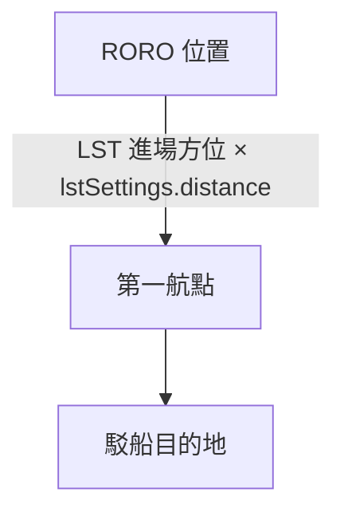

# adminOffloading — 行政下卸作業

> 原始碼：`src/modules/landingOps/adminOffloading.lua`

**職責**：建立駁船-RORO 後勤鏈、查詢浮橋狀態、把 RORO 的重裝備下卸到灘頭

---

## 概述

行政下卸是登陸作戰的最後階段：灘頭建立後，駁船（Barge）搶灘並架設後勤浮橋，RORO 船跟著駁船前進，重型裝備經 RORO → 駁船 → 灘頭卸下。

模組由兩個入口驅動：

- [coordinator](coordinator.md) 在 `WAITING_ADMIN_OFFLOADING` 呼叫 `startAdminOffloading`，派出駁船與 RORO
- 事件腳本 `offloadVehicles.lua`（單位進入 ACV 區域）經門面 `LandingOps.offloadVehicles` 執行架橋與下卸；浮橋的建立與下卸的流程編排寫在**門面**，本模組只提供查詢與 `offloadVehicles` 動作

駁船與 RORO 的對應存在 `amphibOps.barges`（`SBJ__BargeContext`，見 `schema.lua`）：駁船 GUID、`bridgeGUID`、配對的 RORO GUID 清單。

---

## 啟動：航線與配對

`startAdminOffloading(zone, barges, filteredUnits)` 掃描在 `holdingAreas.deployLine` 內、型別為 Ship 的單位（以名稱 `Barge`／`RORO` 分辨）：

1. 每艘駁船經 `processBarge` 算航線、以 `lstSettings.speed` 出發，並登記到 `barges`
2. 每艘 RORO 與**同一條展開線內**的每艘駁船配對（`pairROROWithBarge`）：RORO 的 GUID 加入駁船的 `roros`，RORO 的航線是兩個航點

函式永遠回 `true`：個別駁船或 RORO 失敗只記 SKIP，不阻擋階段推進。

### 為什麼駁船航線用投影？

`buildCourseForBarge` 取 `landing.offloadArea` 的球面中心點，算駁船到它的距離 d1 與方位 b1，再把 d1 投影到 LST 進場方位線：`d2 = d1 × cos(|heading − b1|)`，終點是沿 `zone.heading` 前進 d2 的位置。這讓駁船沿與 LST 平行的進場線到達卸載區，而不是斜切過去。

---

## 下卸

`offloadVehicles(params)`（`SBJ__VehicleOffloadParams`）從船的貨艙取出最多 `num` 個項目，依 `buildLocations` 算出的位置逐個生成單位：

- 先 `deleteUnitCargo` 再 `AddUnit`，單一項目失敗即停止
- 貨物 `Type == 2` 生成 `Ground unit`，其餘一律當 `Facility`（對應表 `CARGO_TYPE_MAP`）
- 回傳實際下卸數；船不存在或已被摧毀回 `nil`

### 下卸何時才會發生？

門面用 `getBargeROROZone` 決定某對 RORO 能否下卸：兩者都要在同一個 `landing.acv.area`，且距離小於 `bargeRoroPairingRangeNm`。`roros` 名單只記錄出發時的配對，下卸與否每次都以當下位置重新判斷。

---

## 公開 API

| 函式 | 說明 |
|---|---|
| `startAdminOffloading(zone, barges, filteredUnits)` | 單一作戰區的駁船出發與 RORO 配對 |
| `offloadVehicles(params)` | 下卸車輛到灘頭 |
| `hasExtendedBridge(barges, ship)` | 駁船是否已有 `bridgeGUID` |
| `isBridgeDestroyed(barges, ship)` | 沒有 `bridgeGUID`，或浮橋單位已不存在，都回 `true` |
| `getBargeROROZone(zones, barge, roro, pairingRangeNm)` | 配對的 RORO 能否下卸，回傳所屬作戰區或 `nil` |

注意 `isBridgeDestroyed` 對「從未架橋」也回 `true`，呼叫端要先用 `hasExtendedBridge` 區分。`hasExtendedBridge` 假設 `barges[ship.guid]` 存在，對沒登記的駁船會報錯。

---

## 設定

| 路徑 | 用途 |
|---|---|
| `config.red.amphibOps.bargeRoroPairingRangeNm` | RORO 與駁船可下卸的最大距離 |
| `zones[].landing.offloadArea` | 駁船目的地參考點 |
| `zones[].landing.lstSettings` | `speed`、`distance` |
| `constants.PLATFORMS.BRIDGE` | 浮橋設施 DBID（門面建橋用） |

---

## 相關模組

- [amphibiousAssault](amphibiousAssault.md) — 前置：灘頭由 ACV 建立
- [coordinator](coordinator.md) — 啟動時機
- [系統架構](README.md)
