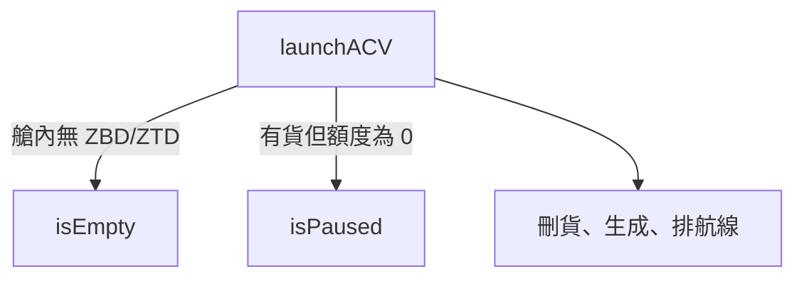

# amphibiousAssault — 兩棲突擊協調

> 原始碼：`src/modules/landingOps/amphibiousAssault.lua`

**職責**：LST 與 SAG 就位、ACV 釋放、記錄機降開始時間、空/機降區威脅與登陸單位統計

---

## 概述

amphibiousAssault 是突擊階段的動作集合，本身不決定「何時」做，時機由 [coordinator](coordinator.md) 與事件腳本決定。它處理五件事：

1. **記錄機降開始時間**：`recordLandingStartTime` 在 `WAITING_ASSAULT` 離開時，把現在時間存進 `airlandingMissionStartTime`，作為貨物補運的計時起點
2. **LST 就位**：`moveToLaunchStations` 把展開線上的 LST 移到離岸 2～4 nm 的就位帶，SAG 移到兩棲載具集結區
3. **ACV 釋放**：`launchACV` 從艦艙刪除貨物，在船側生成兩棲車並交給 `routeACV` 回呼排航線
4. **威脅評估**：`countContactsInArea` 數空/機降區內的敵方可移動設施
5. **登陸統計**：`countUnitsInEachArea` 數各區 `air.attackHelicopter.zone` 內已登陸的紅方單位

通道與航線不在這裡處理，見 [laneGeometry](laneGeometry.md)、[routePlanner](routePlanner.md)。

---

## 記錄機降開始時間

直升機不再靠 CMO 任務的開始時間起飛（改由 [heliWave](heliWave.md) 手動放飛），所以這裡只剩記錄 `airlandingMissionStartTime`。它是貨物補運（`processRemainingCargoTransfer`）的計時起點。

---

## LST 就位

`moveToLaunchStations` 的流程：

1. 以 `landing.laneCenter` 和 `zone.heading` 建座標系
2. 找展開線上的 LST（Ship 型別、非 RORO、非 Barge、非 Type 082，見 `isLST`）
3. 保持隊形，整體沿進場方位平移，讓隊形縱深中心落在 `launchStationNearNm ~ launchStationFarNm` 的正中
4. 設航點與 `lstSettings.speed`

隊形縱深大於就位帶寬度時回 FAIL（`formation_exceeds_station_band`），**不改任何航線**，階段停在 `MINE_CLEARING`，下個 tick 重試。

### 為什麼 082 與 RORO 不跟著走？

Type 082 在反水雷階段已經 RTB，RORO 與駁船要留在展開線等 [adminOffloading](adminOffloading.md)。`isLST` 因此用名稱與 DBID 排除它們。

### 為什麼先掃雷再移 LST？

通道的橫向位置取自展開線上 LST 之間的空隙（`findDeployLineLSTLaterals`），讓通道不穿過船體。LST 一旦前進，這個參考就變了，所以順序是先算通道、掃完、再移 LST。

---

## ACV 釋放

回傳 `SBJ__LaunchACVResult`（`count`、`isEmpty`、`isPaused`）；船不存在或已被摧毀時回 `nil`。

- `isEmpty`：由門面讓船掛回基地並 RTB
- `isPaused`：船留在泛水出發線，等 [acvWave](acvWave.md) 補下一波
- 一般情況：`removeCargoByPriority` 依 `ACV_TYPES` 的順序（ZBD-05、ZTD-05）分配，每型最多取自己剩餘額度，再逐輛 `createSingleACV`，遇到第一個失敗即停

單輛生成後設 `throttle = "Full"` 與關閉自動迴避，航線由 `routeACV` 回呼決定。

---

## 公開 API

| 函式 | 說明 |
|---|---|
| `recordLandingStartTime(zoneState)` | 記錄 `airlandingMissionStartTime` |
| `moveToLaunchStations(amphibOps, zone, units)` | LST 與 SAG 就位；任一失敗回 `false` |
| `findDeployLineLSTLaterals(zone, frame, units)` | 展開線 LST 的橫向位置，供 [mineClearing](mineClearing.md) 排通道 |
| `launchACV(params)` | 釋放兩棲車，`params` 為 `SBJ__ACVDeploymentParams` |
| `isFerryOrLST(ship)` | 071／072／073 或名稱為 Ferry |
| `getShipZone(zones, ship)` | 以 `landing.acv.area` 判斷船所屬作戰區 |
| `countContactsInArea(contacts, area)` | 只數 `FACILITY_MOBILE` |
| `countUnitsInEachArea(zones)` | 單位類別清單在程式碼的 `LANDED_UNIT_TYPES` |

`countUnitsInEachArea` 有兩個用途：coordinator 用 ZBD-05 數量判定灘頭，`unitStatusUI` 經門面顯示。

---

## 設定

| 路徑 | 用途 |
|---|---|
| `config.red.amphibOps.tuning.route.launchStationNearNm`、`launchStationFarNm` | LST 就位帶 |
| `zones[].landing.lstSettings.speed` | LST 速度 |
| `zones[].landing.acv` | `area`（判斷船所屬區）、`distance`、`destination` |
| `zones[].air.attackHelicopter.zone` | 登陸單位統計範圍 |
| `zones[].air.landingZone`、`contactThreshold` | 威脅評估範圍與門檻 |

---

## 相關模組

- [amphibiousLogistics](amphibiousLogistics.md) — `removeCargo`
- [acvWave](acvWave.md) — 額度與分波
- [shipMovement](shipMovement.md) — `teleportSagToFormation`
- [adminOffloading](adminOffloading.md) — 後續階段
- [系統架構](README.md)
