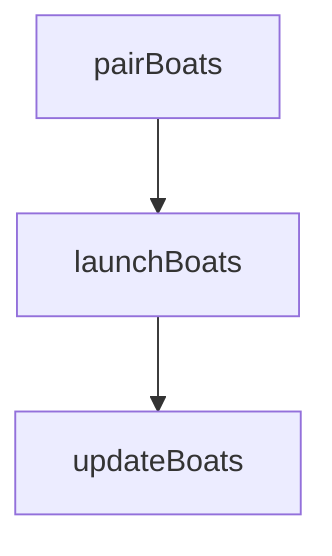

# assaultBoat — 衝鋒舟

> 原始碼：`src/modules/landingOps/assaultBoat.lua`

**職責**：把衝鋒舟與灘際通道配對、在載艦進入泛水區時放出、追蹤到達與損失

---

## 概述

衝鋒舟對應原文圖 37 的第一波（先遣突擊群），任務是先上岸破障（見 [obstacleClearing](obstacleClearing.md)）。Type 072A、072III 每艘搭載 2 艘（`DBID = PLATFORMS.ASSAULT_BOAT`）。

- `pairBoats`：`MINE_CLEARING` 結束那一 tick 算一次
- `launchBoats`：`BOAT_ASSAULT` 每 tick 呼叫
- `updateBoats`：每 tick 呼叫，全部完成才換階段

每艘衝鋒舟的狀態記在 `zoneState.boats[guid]`（`SBJ__AssaultBoatState`）：`pending` → `launched` → `arrived`，被摧毀為 `lost`。

---

## 配對

1. 找展開線上的 072A／072III，取各艘艙內的衝鋒舟，依載艦橫向位置排序（`findCarriers`）
2. `selectBoats`：先取每艘的第一艘舟，不夠灘際通道再取第二艘舟；某一輪超過所需數量時用 `selectEvenly` 在左右均勻挑選
3. `selectBeachLanes`：舟比通道少時要丟掉最外側的通道。比較「丟左側」與「丟右側」兩種保留方式的橫向位移總和，取較小者
4. 舟與通道依橫向順序一對一配對

舟不足時只記 WARN（`boats_short`），沒配到舟的灘際通道之後不會破障，也就**不會 cleared，不能走**。配對函式永遠回 `true`，沒有舟的區沒有東西可放。

### 為什麼丟外側而不是隨機？

未配對的通道會變成死路，丟在同一側最外側，其餘通道連續配對，航線最短。例如第二組獵雷艦開滿 16 條通道但只有 12 艘舟，就丟最外側的 4 條。

---

## 放出與到達

`launchBoats` 對 `pending` 的舟，載艦進入 `zone.landing.acv.area` 且舟 `readytime_v == 0` 才放：

1. `RoutePlanner.buildBoatRoute` 算航線（走配對的灘際通道，見 [routePlanner](routePlanner.md)）
2. `boat.course = 航線`，`manualSpeed = tuning.assaultBoat.speed`，再 `boat:Launch(true)` — **先 course 再 Launch**
3. 狀態改 `launched`，記 `finalPoint`（S_lane）

`updateBoats` 判斷：單位不存在 → `lost`；離 `finalPoint` 小於 `arrivalNm` → `arrived`。沒有任何舟處於 `pending` 或 `launched` 時回 `true`。

`findLandedLaneIdSet` 回傳「舟已到達且仍存活」的灘際通道，[obstacleClearing](obstacleClearing.md) 只對這些通道破障。

---

## 公開 API

| 函式 | 說明 |
|---|---|
| `pairBoats(zone, zoneState, ships)` | 配對並寫入 `zoneState.boats` |
| `launchBoats(amphibOps, zone, zoneState)` | 放出已配對的舟 |
| `updateBoats(amphibOps, zoneState)` | 更新狀態，全部完成回 `true` |
| `findLandedLaneIdSet(zoneState)` | 已登岸且存活的舟所在的灘際通道 |

---

## 設定

| 路徑 | 用途 |
|---|---|
| `tuning.assaultBoat.speed` | 衝鋒舟速度 |
| `tuning.route.arrivalNm` | 到達判斷 |
| `zones[].landing.acv.area` | 載艦進入此區才放出 |

---

## 相關模組

- [mineClearing](mineClearing.md) — 前置：通道已掃出
- [obstacleClearing](obstacleClearing.md) — 下一階段
- [routePlanner](routePlanner.md) — 航線
- [系統架構](README.md)
