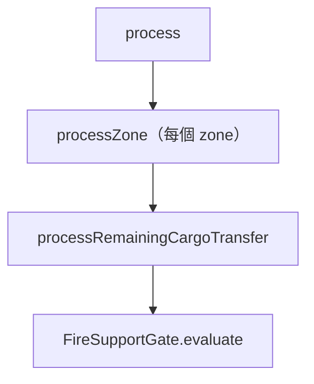
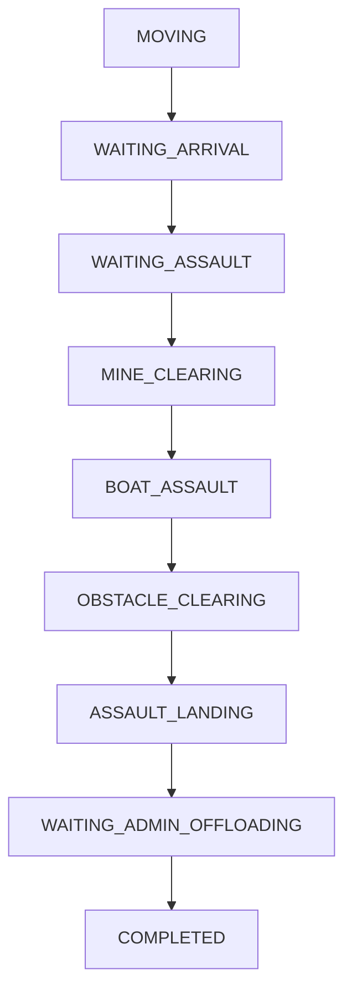

# coordinator — 兩棲作戰流程協調

> 原始碼：`src/modules/landingOps/coordinator.lua`

**職責**：驅動各作戰區（zone）的階段機推進、貨物補運、火力支援暫停閘門

---

## 概述

coordinator 是 Landing Operations 的主流程引擎。[門面](README.md#門面-api)的 `process` 每 5 分鐘呼叫一次 `Coordinator.process`，傳入 `config`、`SBJ__LandingOpsState` 與 `{ contacts, currentTime, filteredShips }`。coordinator 只做編排與判斷，實際動作委派給各階段模組。

三條主線：

1. **逐區階段推進**：對每個 zone 依當前 `phase` 執行對應的 step 函式
2. **貨物補運**：已啟動空/機降任務的 zone，定期重新裝載
3. **火力支援暫停閘門**：依 SRBM 庫存與各 zone 到位狀況，暫停／恢復偵察驅動的 SRBM 打擊

---

## 階段機

每個階段是一個 `SBJ__PhaseStep` 函式，登記在 `PHASE_STEPS` 表。`processZone` 依表的順序走一遍，phase 吻合的 step 才執行。

| 階段 | 離開條件 | 離開時的動作 |
|---|---|---|
| `MOVING` | 到達 `triggers.amphibiousOps.startTime` | `ShipMovement.moveToHoldingAreas` 發出全部命令 |
| `WAITING_ARRIVAL` | 等待區艦數 > `arrivalThreshold` 且沒有艦在動 | 轉移貨物；Taoyuan 另有特例 |
| `WAITING_ASSAULT` | 接觸數 < `contactThreshold`，或等待達 `periodSec` | `MineClearing.startMineClearing` + 記錄機降開始時間 |
| `MINE_CLEARING` | `updateMineClearing` 回報 082 全部完成 | `AssaultBoat.pairBoats` + `AmphibiousAssault.moveToLaunchStations` + `HeliWave.schedule`（估第一波放飛時間） |
| `BOAT_ASSAULT` | `updateBoats` 回報衝鋒舟全部到達或被摧毀 | `ObstacleClearing.startObstacleClearing` |
| `OBSTACLE_CLEARING` | `updateObstacleClearing` 回報計時結束 | 有衝鋒舟的灘際通道標為 cleared |
| `ASSAULT_LANDING` | `air.attackHelicopter.zone` 內 ZBD-05 ≥ 1（暫代的灘頭條件，TODO） | — |
| `WAITING_ADMIN_OFFLOADING` | 無條件放行（TODO：絕對安全） | `AdminOffloading.startAdminOffloading` |

`HeliWave.update` 每區每 tick 執行（計畫建立後），不隨階段結束而停，見 [heliWave](heliWave.md)。

`BOAT_ASSAULT` 每 tick 先 `launchBoats` 再檢查到達。`ASSAULT_LANDING`、`WAITING_ADMIN_OFFLOADING`、`COMPLETED`（`constants.AMPHIBIOUS_LANDING_PHASES`）每 tick 另跑氣墊船，見 [hovercraft](hovercraft.md)。

### 為什麼一個 tick 能跨好幾個階段？

step 之間**不互斥**：前一個 step 推進 phase 後，表中下一個 step 在同一 tick 立刻吻合並執行。這是刻意的，除錯快轉時（見 [debugFlow](debugFlow.md)）一個區可以在單一 tick 內從 `MOVING` 衝到 `BOAT_ASSAULT`。順序依賴表的排列，新增階段時要照作戰順序插入。

### 為什麼氣墊船的放出要等第一波車？

氣墊船載的是重裝備，不能搶在兩棲車之前佔住通道。`stepHovercraft` 只在 `AcvWave.isFirstWaveFull` 成立後才呼叫 `launchHovercraft`；但 `updateHovercraft` 每 tick 都跑，因為已出發的船要持續追蹤到達。

### 灘頭條件為什麼暫用 ZBD-05？

`stepAssaultLanding` 用 `AmphibiousAssault.countUnitsInEachArea` 查 `air.attackHelicopter.zone` 內有沒有 ZBD-05。這是占位邏輯，程式碼內標了 TODO；真正的條件（站穩灘頭、絕對安全）還沒設計，所以 `WAITING_ADMIN_OFFLOADING` 目前也不檢查任何條件。

---

## 各區空中設定

`startZoneAirSetup` 在每個 zone 離開 `WAITING_ARRIVAL` 時依該區 `zone.air` 設定觸發：

1. `zone.air.transportAircraft` 有值時，`AmphibiousLogistics.transferTransportAircraftCargo` 對陸基運輸機隊轉貨並指派任務
2. `zone.air.reconTemplate` 有值時，經 [strikePlanner 門面](../strikePlanner/README.md) 的 `StrikePlanner.addReconEntry` 排入一架 GJ-11 偵察（轉發至 [`Recon.addEntry`](../strikePlanner/recon.md)）

`addEntry` 未傳 `startTime` 時以當前遊戲時間為起飛錨點。插入是**有條件**的：偵察佇列沒有可錨定的衛星空窗，或同 `templateId` 的 UAV 已覆蓋該空窗時就不插入，兩棲流程不受影響。

---

## 貨物補運

`processRemainingCargoTransfer` 對 `airlandingMissionStartTime` 已設定的 zone，距上次裝載達 `remainingCargoTransferSec` 就呼叫 `AmphibiousLogistics.transferRemainingCargos`，成功才重設計時器。失敗時下個 tick 會再試。

---

## 火力支援暫停閘門

`process` 末尾呼叫 [fireSupportGate](fireSupportGate.md) 的 `evaluate`，防止 SRBM 在艦隊抵達之前耗盡彈藥。coordinator 只負責傳入 `MissileSystem.getAmmoInventory`，並在閘門切換時寫 log。

---

## 公開 API

| 函式 | 說明 |
|---|---|
| `process(config, landingState, params)` | 唯一入口。`params` 為 `SBJ__LandingTickParams`（`contacts`、`currentTime`、`filteredShips`） |

---

## 設定

| 路徑 | 用途 |
|---|---|
| `config.red.amphibOps.periodSec` | `WAITING_ASSAULT` 的等待上限（秒） |
| `config.red.amphibOps.remainingCargoTransferSec` | 補運貨物的間隔 |
| `config.red.amphibOps.zones[].movement.arrivalThreshold` | 認定艦隊抵達的艦數門檻 |
| `config.red.amphibOps.zones[].air.contactThreshold` | 空/機降區可接受的最大接觸數 |

---

## 相關模組

- 各階段模組見 [README](README.md#模組一覽)
- [fireSupportGate](fireSupportGate.md) — 火力支援暫停閘門
- [missileSystem/init](../missileSystem/init.md) — `getAmmoInventory` 提供閘門所需的庫存報告
- [strikePlanner/recon](../strikePlanner/recon.md) — 反向讀取 `fireSupportOnHold`
