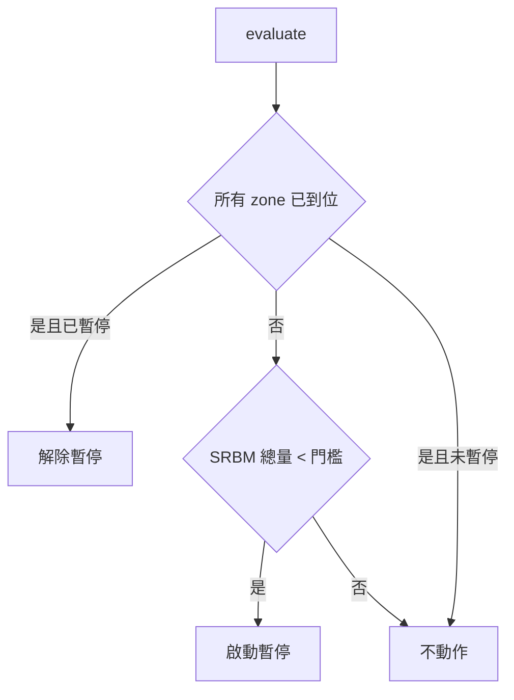

# fireSupportGate — 火力支援暫停閘門

> 原始碼：`src/modules/landingOps/fireSupportGate.lua`

**職責**：SRBM 彈量過低且艦隊尚未全部到位時，暫停對地火力支援

---

## 概述

`FireSupportGate.evaluate` 由 [coordinator](coordinator.md) 在 `process` 末尾執行，防止 SRBM 在艦隊抵達之前耗盡彈藥。旗標存於 `amphibOps.fireSupportOnHold`，由 [strikePlanner/recon](../strikePlanner/recon.md) 在排程偵察驅動打擊時讀取，用來跳過 `STRIKE/INFRA/*`。

圖上省略兩個提早 return：已暫停且未到位時直接略過；`landingState.ground` 缺失或查不到庫存報告時靜默略過（測試存檔或部分初始化的情境）。

### 為什麼釋放後不會再暫停？

phase 機只往前走，「所有 zone 到位」一旦成立就永遠成立，所以閘門是單調的：HOLD → RESUME 之後不會再 toggle。已暫停或已到位時不再查庫存，省一次 `getAmmoInventory`。

「到位」由模組內 local 的 `ARRIVED_PHASES` 定義：`WAITING_ASSAULT` 以及之後的所有階段。

---

## 公開 API

| 函式 | 說明 |
|---|---|
| `evaluate(config, landingState, getAmmoInventory)` | 更新 `amphibOps.fireSupportOnHold`。切換時回傳 `{ tag, fields }`（`HOLD` 或 `RESUME`）供呼叫端寫 log，否則回傳 `nil`。`getAmmoInventory` 由呼叫端傳入（實際為 `MissileSystem.getAmmoInventory`），閘門自己帶 `SRBM` 與紅方 |

---

## 設定

| 路徑 | 用途 |
|---|---|
| `config.red.amphibOps.fireSupportHoldThreshold` | SRBM 總彈量百分比下限 |
| `config.red.amphibOps.zones[]` | 判斷「所有 zone 已到位」的範圍 |

---

## 相關模組

- [coordinator](coordinator.md) — 呼叫端
- [missileSystem/init](../missileSystem/init.md) — `getAmmoInventory` 提供庫存報告
- [strikePlanner/recon](../strikePlanner/recon.md) — 反向讀取 `fireSupportOnHold`
