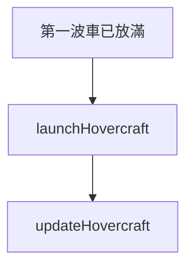

# hovercraft — 氣墊船走通道

> 原始碼：`src/modules/landingOps/hovercraft.lua`

**職責**：把母艦上已裝貨的 Type 726A 氣墊船送進 cleared 通道，到停車位後指定貨運任務

---

## 概述

氣墊船從 075、076、071（`MOTHERSHIP_DBIDS`，須在 `holdingAreas.mothership` 內）放出，載重裝備到灘頭。它**只走一次通道**，到了停車位就交給貨運任務。

[coordinator](coordinator.md) 的 `stepHovercraft` 在 `ASSAULT_LANDING` 起的每個 tick 執行：`launchHovercraft` 受 [acvWave](acvWave.md) 的 `isFirstWaveFull` 把關，`updateHovercraft` 每 tick 都跑。

---

## 放出

`launchHovercraft` 對每艘母艦找「可放」的氣墊船（`findReadyHovercraft`）：還沒登記在 `zoneState.hovercraft`、DBID 是 `TYPE_726A`、`readytime_v == 0`、艙內有貨。

對每艘：

1. `RoutePlanner.buildRoute(..., { isFromDeployLine = true })` 算航線並預約停車位（與兩棲車共用 `zoneState.laneSlots`）
2. 成功：設 `course`、`manualSpeed`，再 `Launch(true)`（**先 course 再 Launch**），登記 `zoneState.hovercraft[guid] = { missionName, finalPoint, phase = "enroute" }`
3. 沒有可用通道或停車位：記 SKIP（`no_cleared_lane_slot`）。這艘不會登記，**下個 tick 再試**

沒有 `zoneState.lanes` 時整個函式直接返回。

### 貨運任務怎麼分配？

每區只有一個氣墊船任務，放出時直接記入 `zone.landing.hovercraft.missionName`，到達停車位後才設到單位上。

### 為什麼等待區不指派氣墊船任務？

氣墊船必須先走 cleared 通道到停車位，才能開始運貨。所以 [amphibiousLogistics](amphibiousLogistics.md) 只替氣墊船裝貨，通道走完才在這裡設任務。

---

## 到達

`updateHovercraft` 依 `entry.phase` 推進每艘氣墊船：

| phase | 動作 | 下一個 phase |
|---|---|---|
| `enroute` | 離 `finalPoint` 小於 `tuning.route.arrivalNm` 時 `ScenEdit_UnloadCargo` | `unloading` |
| `unloading` | `GameUtils.isCargoUnloaded`（`condition` 是 `"Underway"` 且不是 `"Transfering Cargo"`）成立時 `RTB(true)` | `returning` |
| `returning` | 不再處理 | — |

流程與直升機一致，見 [heliWave](heliWave.md)。卸貨後直接返航，所以不再設 `unit.mission`；`missionName` 欄位目前沒有用到。舊存檔沒有 `phase` 的氣墊船不會被推進。

---

## 公開 API

| 函式 | 說明 |
|---|---|
| `launchHovercraft(amphibOps, zone, zoneState, ships)` | 放出可放的氣墊船 |
| `updateHovercraft(amphibOps, zoneState)` | 追蹤到達並設任務 |

---

## 設定

| 路徑 | 用途 |
|---|---|
| `zones[].landing.hovercraft` | `speed`、`missionName` |
| `tuning.route.arrivalNm` | 到達判斷 |
| `tuning.acvWave.hovercraftWaitSec` | 等第一波的上限，見 [acvWave](acvWave.md) |

運量與航行時間推算見 [hovercraftCapacity](hovercraftCapacity.md)。

---

## 相關模組

- [routePlanner](routePlanner.md) — 航線與停車位
- [amphibiousLogistics](amphibiousLogistics.md) — 裝貨
- [debugFlow](debugFlow.md) — `teleportLanding` 時直接瞬移到停車位
- [系統架構](README.md)
