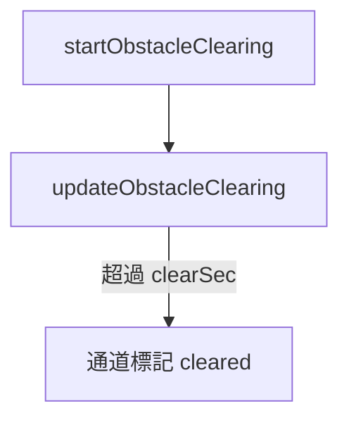

# obstacleClearing — 岸上障礙與破障計時

> 原始碼：`src/modules/landingOps/obstacleClearing.lua`

**職責**：在衝鋒舟全部到達後鋪設障礙方塊、計時，時間到把有舟登岸的灘際通道標為 cleared

---

## 概述

CMO 沒有破障機制，所以用「障礙方塊」表示。玩家事先在 control panel 的藍方參考點畫出障礙範圍（`landing.obstacleArea`），一定畫在預定登陸點，用來阻止敵方裝甲車輛前進；灘際通道就是為了穿越這片障礙。方塊只存在 state 裡（`zoneState.obstacle.cells`），不畫在 CMO 地圖上。

方塊的鋪設與碰撞判斷見 [laneGeometry](laneGeometry.md)。每塊方塊有三種狀態（`constants.OBSTACLE_CELL_STATES`）：`intact`、`clearing`、`cleared`，並記所屬灘際通道 `beachLaneId`。

---

## 流程

1. `startObstacleClearing`（`BOAT_ASSAULT` 結束時）：以 `tuning.obstacle.cellSizeM` 鋪滿障礙範圍，把「有舟登岸的灘際通道」內陸線（A_lane 到 E_lane）碰到的方塊設為 `clearing`，記下開始時間 `obstacleStartedAt`。沒有 `zoneState.lanes` 時回 `false`
2. `updateObstacleClearing`（`OBSTACLE_CLEARING` 每 tick）：距開始超過 `tuning.obstacle.clearSec`（快轉時略過）就把這些方塊設為 `cleared`，通道的 `isCleared = true`，回傳 `true`

### 為什麼只有「有舟登岸」的通道才放行？

破障由衝鋒舟執行。舟被摧毀或根本沒有配到的通道，方塊維持 `intact`，通道不會 `isCleared`，[routePlanner](routePlanner.md) 不會選它。舟在登岸後、計時結束前被摧毀，`findLandedLaneIdSet` 也會把它排除。因此兵力不足時實際可用的通道數少於 16 條。

### 為什麼只標通道內陸線碰到的方塊？

一條通道只需要通過自己的那條線，不需要清掉整片障礙。兩棲車與氣墊船的航線會再用 `isRouteClear` 檢查一次，碰到任何非 `cleared` 的方塊就換通道。

---

## 公開 API

| 函式 | 說明 |
|---|---|
| `startObstacleClearing(amphibOps, zone, zoneState, currentTime)` | 鋪方塊並開始計時 |
| `updateObstacleClearing(amphibOps, zoneState, currentTime)` | 時間到回 `true` |

---

## 設定

| 路徑 | 用途 |
|---|---|
| `tuning.obstacle.cellSizeM` | 方塊邊長 |
| `tuning.obstacle.clearSec` | 破障耗時 |
| `zones[].landing.obstacleArea` | 障礙範圍（藍方參考點） |

---

## 相關模組

- [assaultBoat](assaultBoat.md) — 提供登岸的舟
- [laneGeometry](laneGeometry.md) — 方塊與碰撞
- [acvWave](acvWave.md)、[hovercraft](hovercraft.md) — 下一階段使用 cleared 通道
- [系統架構](README.md)
