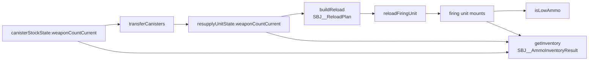

# ammo.lua

彈藥轉運、重裝與低彈量判斷模組。

> Source: `src/modules/missileSystem/ammo.lua`

責任摘要：維護彈藥補給車/彈箱庫存的存量，並將彈藥實際裝填到機動發射車。

---

## 概觀

`ammo.lua` 同時處理三件事：

- `transferCanisters`：彈箱庫存 → 彈藥補給車
- `buildReload` / `reloadFiringUnit`：彈藥補給車 → 機動發射車（含 group），先算後裝
- `getInventory`：跨整個飛彈系統聚合彈藥庫存（firing / resupply / 彈箱庫存）並產生百分比報告，供火力支援暫停閘門等上層判斷使用

模組支援 `weaponDBID` 為單值或陣列，會先用 `Shared.normalizeWeaponDBIDs` 做一致化，再逐一計算缺額與實際補入數量。

---

## 主要機制

- `buildReload` 遍歷 group 裡的 GUID 與每種武器，依 `max - available` 算缺口，依序填到存量用完為止，回傳 `SBJ__ReloadPlan`（`entries` 與 `count`）。只讀 CMO，所以 Rules 能在裝填前就知道裝完剩多少。
- `reloadFiringUnit` 照計畫逐筆 `ScenEdit_AddReloadsToUnit`，再從補給車扣掉 `count`。
- `isLowAmmo` 將group與所有 `weaponDBID` 的 `available/max` 比率，比對門檻百分比。
- `getInventory` 聚合三個子總和：firing 由 `ScenEdit_GetUnit` + `getWeaponInfo` 即時查詢，resupply / canisterStocks 由 context 中的 `weaponCountCurrent` / `weaponCountDefault` 累加；缺單位（找不到 unit）會被略過，max=0 時百分比固定 0 以避免除零。

---

## Public API

| 函式 | 參數 | 回傳 | 說明 |
|---|---|---|---|
| `transferCanisters` | `resupplyUnitState, canisterStockState` | `nil` | 從彈箱庫存補滿彈藥補給車（受庫存限制）；不改狀態，呼叫端接著 `Transitions.finishReload` |
| `buildReload` | `firingUnit, weaponDBID, stock` | `SBJ__ReloadPlan` | 算出 group 要裝的每一筆，總數不超過 `stock`；只讀不寫 |
| `reloadFiringUnit` | `resupplyUnitState, plan` | `integer` | 照計畫裝填並扣補給車存量，回傳總裝填量；不改狀態，呼叫端接著 `Transitions.finishReload` |
| `isLowAmmo` | `firingUnit, percentage, weaponDBID` | `boolean` | 低彈量判定 |
| `getInventory` | `systemState, sideName` | `SBJ__AmmoInventoryResult` | 聚合 firing / resupply / canisterStock 三類子總和並算出整體百分比 |

---

## 相關模組

- [shared](shared.md)
- [cycle](cycle.md)
- [meeting](meeting.md)
- [init](init.md)
