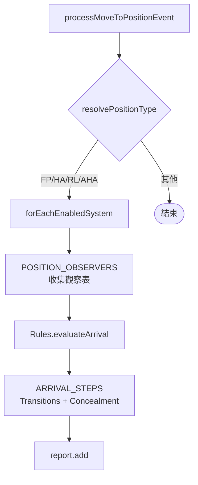

# arrival.lua

機動車組進入 FP / HA / RL / AHA 陣地時的反應。

> Source: `src/modules/missileSystem/arrival.lua`

責任摘要：解析 `UnitEntersArea` 的 trigger，觀察抵達的單位，向 [rules](rules.md) 要步驟並執行，輸出一份批次日誌。

---

## 概觀

外部只經 [init](init.md) 的 `processUnitEntersArea` 進來；它依觸發單位陣營組出 `moveCtx`（`isAuto`、`hideOnEnterHA`、`hideResupplyOnRLNoMeeting`、`firingUnitLookupSide`），再呼叫 `Arrival.processMoveToPositionEvent`。

對每個啟用中的飛彈系統（`forEachEnabledSystem`）走同一個模式：

1. **觀察**：`POSITION_OBSERVERS` 依陣地挑一個 observer（`observeFiringPoint`、`observeHideArea`、`observeReloadPoint`、`observeAmmoHoldingArea`），收集觀察表，並把後面步驟要用的單位放進 `stepCtx`。
2. **判斷**：`Rules.evaluateArrival(positionType, params)` 回傳步驟清單，條件見 [rules](rules.md#抵達陣地evaluatearrival)。
3. **執行**：依步驟呼叫 `ARRIVAL_STEPS` 的 handler，每個 handler 經 [transitions](transitions.md) 記錄狀態、需要時呼叫 `Concealment.hideUnit`，回傳一列 log。

---

## 主要機制

1. 由 `resolvePositionType(event)` 從 trigger description（`Arrive in (FP|HA|RL|AHA) ` 前綴）解析位置代碼；不認得的代碼直接結束，不丟接觸、不輸出 log。
2. 非 FP 事件會先 `dropUnitContact`，降低非必要接觸資訊。
3. RL 沒會合時 `STOP_IN_MANUAL_MODE` 一律以手動模式（`isAuto=false`）呼叫 `Transitions.settle`，避免短暫經過 RL 的機動發射車（例如重定位中途）被卡停。



---

## Public API

| 函式 | 參數 | 回傳 | 說明 |
|---|---|---|---|
| `processMoveToPositionEvent` | `params: SBJ__MoveToPositionEventParams` | `nil` | 解析位置、分派 handler、輸出日誌；只由 `init.lua` 的 `processUnitEntersArea` 呼叫 |

---

## 日誌輸出

`position` 來自 event trigger，整批相同，因此放在 header 而非每一行：

```
[missileSystem] side=China: Position event mode=auto position=RL | total=2 ok=1 warn=1
  [OK]   system=SRBM unit=SRBM-FU-1 state=RELOAD action=reload_started startedAt=3600 triggerUnit=SRBM-RU-1
  [WARN] system=SRBM unit=SRBM-RU-2 action=resupply_concealment_failed pairedFiringUnit=SRBM-FU-2
         area=OPAREA-1 reason=no_buildings_in_mask
```

**行為變更：**此函式原本只要批次中出現任何 `WARN`／`FAIL`／`ERROR`，就把**整份** summary（含成功行）送 `Logger.warn`。改成 per-row 之後三個 WARN（`concealment_failed`／`resupply_concealment_failed`／`reload_not_started`）落在 info log，因此受 `config.logging.modules[missileSystem].verbose` 管控（目前為 `true`）。

---

## 相關模組

- [rules](rules.md)
- [init](init.md)
- [transitions](transitions.md)
- [meeting](meeting.md)
- [ammo](ammo.md)
- [concealment](concealment.md)
