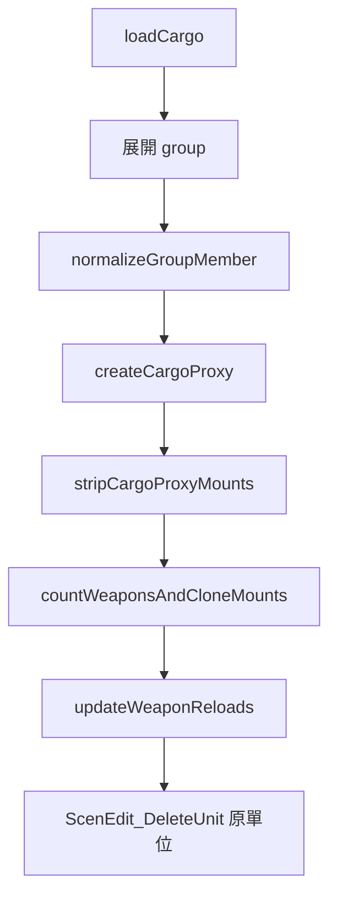

# cargoProxy.lua

地面單位轉 cargo proxy 模組。

> Source: `src/modules/missileSystem/cargoProxy.lua`

責任摘要：把機動車組（含整個 group）轉成載具或建築上的 cargo proxy，並同步保留指定武器的彈量。

---

## 概觀

CMO 沒有「把地面單位塞進建築」的原生操作，`cargoProxy.lua` 以 `add_cargo` 在目標（建築或載具）上建立同 DBID 的 cargo 單位，把來源單位的 mounts 與彈量搬過去後刪除原單位，模擬進入掩體。

唯一呼叫端是 [concealment](concealment.md) 的 `hideUnit`：挑好未占用建築後呼叫 `CargoProxy.loadCargo` 把 TEL / 補給車載入。出掩蔽（`moveFromHideArea`）走 `ScenEdit_UnloadCargo`，不經本模組。

此函式原本住在 `landingOps/amphibiousLogistics.lua`，但兩棲後勤從未使用，已搬到 missileSystem 套件內，log tag 也改為 `constants.TAGS.MISSILE_SYSTEM`。

---

## 主要機制

`loadCargo(base, unitName, weaponDBID, sideName)` 的流程：

1. 依 `unitState.name` 取得來源單位，並展開 group member 清單（無 group 時只處理自身）
2. 透過 `createCargoProxy` 在目標載具或建築物上建立對應 cargo proxy
3. 對 cargo proxy 執行 `stripCargoProxyMounts`：清空彈匣並移除原有 mounts
4. 將來源單位的 mounts 複製到 cargo proxy（`countWeaponsAndCloneMounts`），並根據 `weaponDBID`（發射車 config descriptor 的武器；補給車為 nil）統計需要保留的武器數量
5. 執行 `updateWeaponReloads`：先清除 cargo proxy 現有 mount weapon 的 reload，再依統計結果回填實際彈量
6. 複製群組名稱與單位名稱後，刪除原始來源單位

步驟 2–6 由私有函式 `normalizeGroupMember` 對每個 group member 執行；除 `loadCargo` 外所有 helper 皆為 module-local。



`createCargoProxy` 取不到新建的 cargo 時，該 member 記為 `FAIL` 並保留原單位，不做後續步驟；group member 查不到則記 `SKIP`。

### 武器同步規則

| 步驟 | 行為 |
|---|---|
| 清除既有 reload | 掃描 cargo proxy 目前 `mounts[].mount_weapons[]`，若 `wpn_default > 0` 則以 `remove = true` 清除 reload |
| 回填目標 reload | 僅針對 `weaponDBID` 指定的武器，依來源單位實際 `wpn_current` 回填數量 |

這表示 `weaponDBID` 控制的是「哪些武器要保留並回填」，而不是「哪些武器要先被清除」。

---

## Public API

| 函式 | 參數 | 回傳 | 說明 |
|---|---|---|---|
| `loadCargo` | `base, unitState, sideName` | `nil` | 將地面單位（含 group）轉為 cargo proxy 並載入目標載具或建築物；`unitState` 為 `SBJ__FiringUnitState` 或 `SBJ__ResupplyUnitState` |

---

## 日誌輸出

每次呼叫輸出一份 `LogFormat.report`，scope 為目標名稱：

```
[missileSystem] ship="Building #3": Load cargo | total=2 ok=1 skip=1
  [OK]   unit="PHL-16 #1" index=1
  [SKIP] guid=U-4471 index=2 reason=unit_not_found
```

| `reason` | tag | 情境 |
|---|---|---|
| `unit_not_found` | `SKIP` | group member GUID 查不到單位 |
| `cargo_proxy_creation_failed` | `FAIL` | `add_cargo` 後在目標上取不到對應 cargo 單位 |

來源單位本身（`unitState.name`）查不到時直接 return，不輸出 report。

---

## constants 參考

| 常數路徑 | 用途 |
|---|---|
| `constants.TAGS.MISSILE_SYSTEM` | report log tag |
| `constants.SENSOR_ARCS` | 複製 mount 時的 `arc_mount` |

---

## 相關模組

- [concealment](concealment.md) — 唯一呼叫端（`hideUnit`）
- [init](init.md)
- [landingOps/amphibiousLogistics](../landingOps/amphibiousLogistics.md) — 原本所在模組
