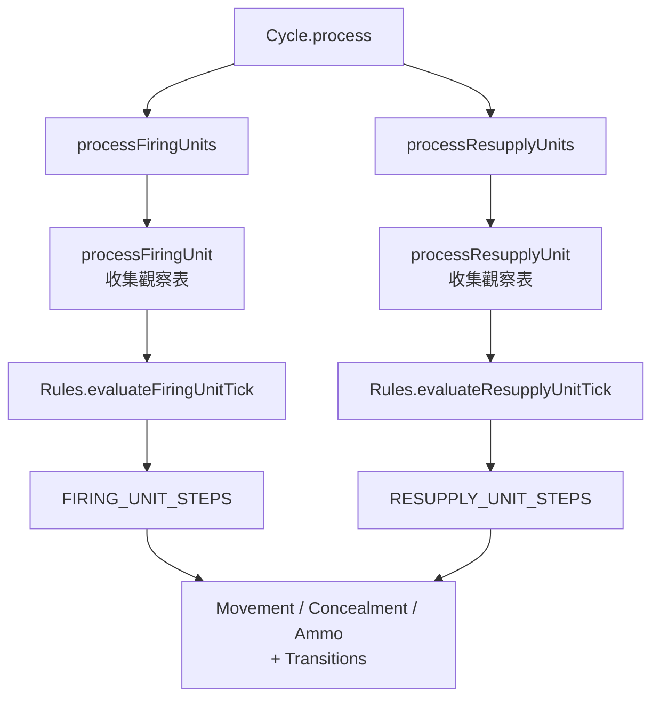

# cycle.lua

補給流程主引擎，負責定時檢查機動發射車與彈藥補給車，驅動 stow → 機動 → 再裝填的狀態轉移。

> Source: `src/modules/missileSystem/cycle.lua`

責任摘要：每次定時檢查中，觀察每個機動發射車與彈藥補給車，向 [rules](rules.md) 要步驟並執行。

---

## 概觀

`Cycle.process` 是模組對外唯一進入點，內部分別跑 `processFiringUnits` 與 `processResupplyUnits`，逐一處理該飛彈系統中的所有機動發射車與彈藥補給車。

每個單位走同一個模式：

1. **觀察**：`processFiringUnit` / `processResupplyUnit` 收集觀察表（state、`Ammo.isLowAmmo`、`Meeting.hasMet*`、`Meeting.findUnitArea`、收車與裝填經過秒數、配對單位在不在）。
2. **判斷**：交給 [rules](rules.md) 的 `evaluateFiringUnitTick` / `evaluateResupplyUnitTick`，拿回有順序的步驟清單。所有條件（stow 等待、reload 完成、SAM 回 FP、補給車去 AHA）都寫在 rules，見 [rules](rules.md#主要機制)。
3. **執行**：依步驟呼叫 `FIRING_UNIT_STEPS` / `RESUPPLY_UNIT_STEPS` 的 handler。handler 對 CMO 下指令（`Movement`、`Concealment`、`Ammo`）、經 [transitions](transitions.md) 記錄狀態，並加一列 log。

`isAuto` 只影響判斷：自動模式才會啟動 stow 倒數與後續機動，「完成再裝填」在兩種模式都會執行。

---

## 主要機制

- 收車倒數的觸發來源有兩個：低於 `ammoThreshold`，或 FSP 射擊後 `strikePlanner/fireSupportPlan.lua` 呼叫 `MissileSystem.startStow` 寫入 `stowStartTime`。
- 裝填計時：觀察表裡沒有 `reloadStartTime` 時經過秒數當 0，`ENSURE_RELOAD_CLOCK` 一定是 RELOAD 的第一步，所以結果和「先補計時再算」相同。
- `HIDE_RESUPPLY_UNIT` 的 handler 自己檢查「補給車還有彈且在作戰區」，因為剩餘彈量要等 `COMPLETE_RELOAD` 做完才知道。
- 每個 handler 回傳的 log 列都放進 `stepCtx.results`，由 `Cycle.process` 併成單一陣列回給呼叫端（通常是 `scheduledReloadHideCheck` 系列腳本）。回傳結構固定為 `{ tag = "OK", fields = { unit = ..., action = ..., ... } }`；`system=` 由呼叫端 `init.lua` 私有的 `process` 補上，本模組只負責 unit 層級的欄位。

---

## 狀態寫入

本檔的狀態與計時器寫入都經 [transitions](transitions.md)：移動用 `Transitions.depart` 包住 `Movement.moveTo*`，指令成功才記成 `REPOSITIONING`；失敗時保持原狀態，留給下一輪或下一次事件。

## Public API

| 函式 | 參數 | 回傳 | 說明 |
|---|---|---|---|
| `Cycle.process` | `systemState: SBJ__MissileSystemState, runCtx: SBJ__CycleRunContext, sideName: string` | `SBJ__LogResult[]` | 對單一飛彈系統執行一次完整補給循環，回傳本次有實際進度的動作清單 |

---

## 回傳的日誌列

`Cycle.process` 回傳 `SBJ__LogResult[]`，由 [init](init.md) 補上 `system=` 後交給 `LogFormat.report`。`action` 由 producer 直接寫成 snake_case token，log 層不再做大小寫轉換。

| `action` | 觸發時機 |
|---|---|
| `stow_countdown_started` | 首次偵測到需要轉移，開始 stow 倒數 |
| `move_to_hide_area` / `move_to_firing_point` / `move_to_ammo_holding_area` | stow 完成後的移動指令 |
| `move_resupply_to_reload_point` / `move_firing_unit_to_reload_point` | 補給車與射擊單元前往 RL |
| `unload_from_hide_area` / `hide_resupply_unit` | 補給車進出遮蔽建築 |
| `missile_reload_finished` / `ammo_transload_finished` | 補給完成，帶 `loaded=` / `transferred=` 數量 |

移動指令失敗一律 `reason=command_failed`，`Movement` / `Concealment` 回傳的英文訊息放在 `detail=`。

---

## 關鍵 `config` / `constants` / `saveData` 引用

| 路徑 | 用途 |
|---|---|
| `systemState.reloadTime`（對應 `config.*.ground.missileSystemTypes.<type>.reloadTime`） | reload 倒數時長 |
| `systemState.stowTime`（對應 `config.*.ground.missileSystemTypes.<type>.stowTime`） | 射擊／低彈量後的 stow 等待時長 |
| `firingUnitState.ammoThreshold` | 低彈量觸發門檻，傳給 `Ammo.isLowAmmo` |
| `firingUnitState.weaponDBID` | 用來鎖定要回補的武器類別 |
| `firingUnitState.stowStartTime` / `reloadStartTime` | 倒數時間錨點，存在 `saveData.*.ground.missileSystemTypes.<system>.firingUnits[*]` |
| `resupplyUnitState.weaponCountCurrent` | 二級補給觸發條件 |

---

## 相關模組

- [rules](rules.md)
- [transitions](transitions.md)
- [init](init.md)
- [movement](movement.md)
- [meeting](meeting.md)
- [ammo](ammo.md)
- [concealment](concealment.md)
- [triggers](triggers.md)
- [../strikePlanner/fireSupportPlan](../strikePlanner/fireSupportPlan.md)
