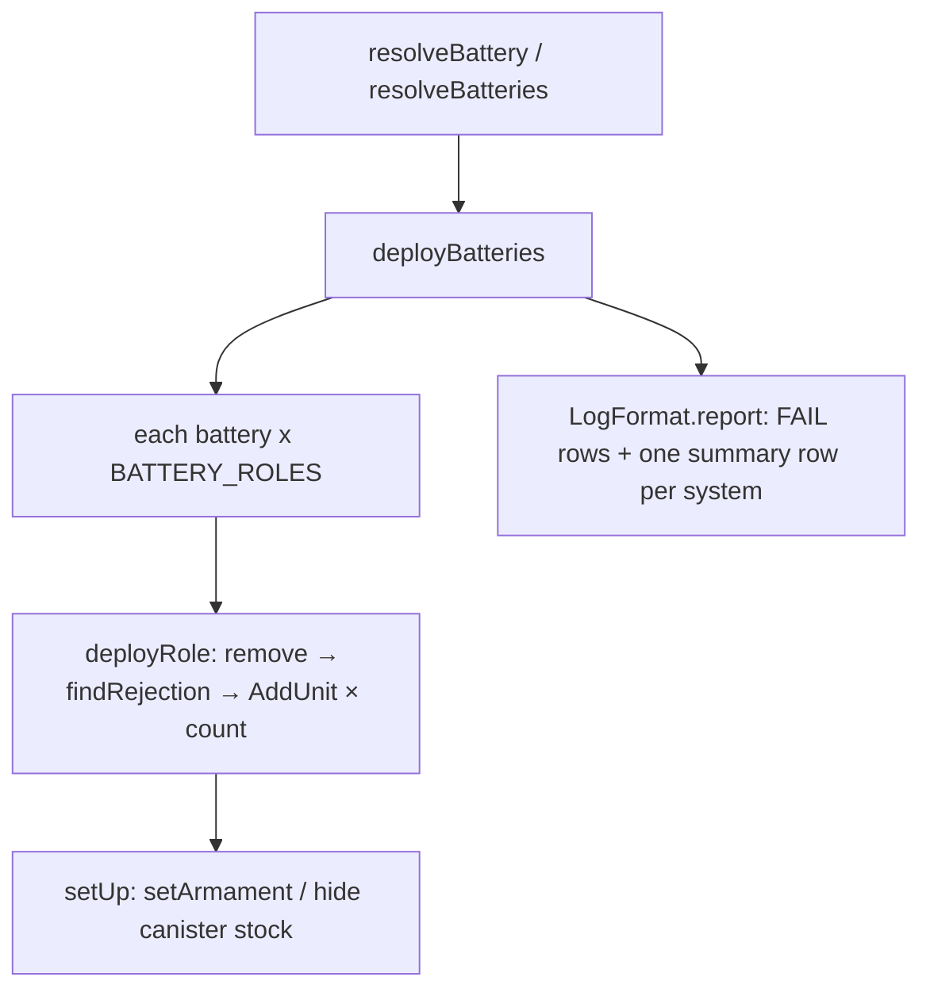

# deployment.lua

飛彈系統單位創建與部署模組。

> Source: `src/modules/missileSystem/deployment.lua`

責任摘要：把 config 的一連（發射車、補給車、彈罐庫存）組成 `SBJ__Battery`，在該連的陣地上建出單位並整理武器掛載。

---

## 概觀

一連 = firing + resupply + canister stock，照 config 的連結找：`firing.resupplyUnit` → resupply，`resupply.canisterStock` → canister stock。不從名字猜關係。`SBJ__Battery.operationalArea` 是這次要建在哪：`deploySide` 用 config 的陣地，控制面板部署用玩家選的陣地。descriptor 是 config 本身，只讀不寫。

三種單位的差別寫在 `BATTERY_ROLES` 表（platform DBID、要不要成群、哪種陣地缺了就拒絕、生成點、建好後的設定）。`deployRole` 是唯一的建單位迴圈：先刪舊單位，檢查陣地，再一台一台建。

- firing：SAM 從隨機一個 FP 生成，其餘從 HA[1]；建好後加 mount、`removeAndRedistributeWeapons`。
- resupply：從 RL[1] 生成。
- canisterStock：從 ATP[1] 生成，設成不可自動偵測。

firing 和 resupply 的車數都是 `battery.unitCount`（config 放在 resupply 上）。多台時以 descriptor 名為 group，成員名把序數放在 firing unit 名前面：`Ammo Sec, 1st Bn, X` → `Ammo Sec, 2nd Coy, 1st Bn, X`。`spec/core/missileSystemConfig_spec.lua` 保證每個名字都以 firing unit 名結尾、連結一對一。

summary row 是 `firing=a/b resupply=a/b ammo=a/b`；只要該 system 有 FAIL row 就標 FAIL。陣地被拒絕時 `b` 仍算計畫車數（例如 `0/2`）。

---

## Public API

| 函式 | 參數 | 回傳 | 說明 |
|---|---|---|---|
| `resolveBattery` | `missileSystemConfigMap, layout` | `SBJ__Battery\|nil` | 照 config 連結組出 layout 指名的那一連，放在 layout 的陣地；未知 system 或 firing unit 回 `nil` |
| `resolveBatteries` | `missileSystemConfigMap` | `SBJ__Battery[]` | config 的每一連，放在 config 的陣地 |
| `deployBatteries` | `sideName, batteries` | `nil` | 刪掉並重建這幾連的單位，輸出一份 report |

---

## 相關模組

- [shared](shared.md)
- [groundStateStore](groundStateStore.md)
- [init](init.md)
