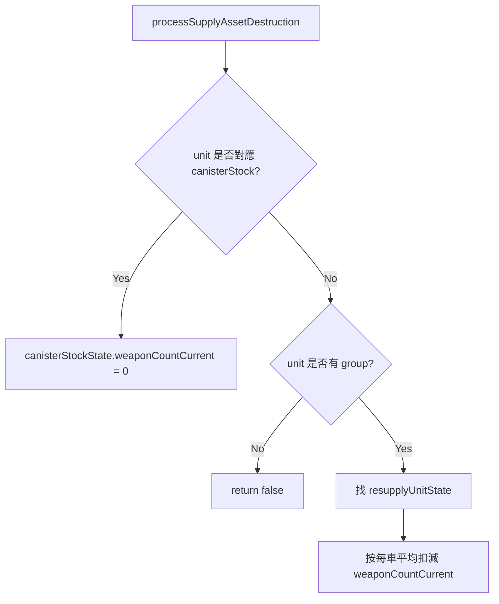

# groundStateStore.lua

飛彈模組 runtime state 建立與補給資產戰損處理模組。

> Source: `src/modules/missileSystem/groundStateStore.lua`

責任摘要：把 config 描述複製成 `saveData.*.ground.*` 形式，並在補給資產被擊毀時更新庫存。

---

## 概觀

`setBatteryStates` 只改傳進來的那幾連：深拷貝該連 firing、resupply、canister stock 的 config descriptor，firing 與 resupply 的 `operationalArea` 設成該連的陣地。其他連的 state 不動。state 是陣地唯一的家，`resolveOperationalArea` 讀它，還沒部署過才退回 config。

`processSupplyAssetDestruction` 會在分數腳本觸發時被呼叫：

- 若擊毀彈箱庫存（非 group），直接將對應 `canisterStockState.weaponCountCurrent = 0`
- 若擊毀彈藥補給車群組成員，按每車平均彈量扣減群組 `weaponCountCurrent`

---

## 主要機制

---

## Public API

| 函式 | 參數 | 回傳 | 說明 |
|---|---|---|---|
| `resolvePair` | `systemState, unitName` | `firingUnitState?, resupplyUnitState?, canisterStockState?` | 用任一端名稱找出整組配對，缺的一端為 nil |
| `processSupplyAssetDestruction` | `unit, systemState` | `boolean` | 補給資產戰損後同步修正庫存 |
| `setBatteryStates` | `groundState, batteries` | `nil` | 把這幾連的 runtime state 重設成 config 初值，放在該連的陣地 |
| `resolveOperationalArea` | `groundState, missileSystemType, firingUnitDescriptor` | `SBJ__OperationalArea` | 這一連現在的陣地：state 的，沒有 state 時用 config 的 |

---

## 相關模組

- [init](init.md)
- [deployment](deployment.md)
