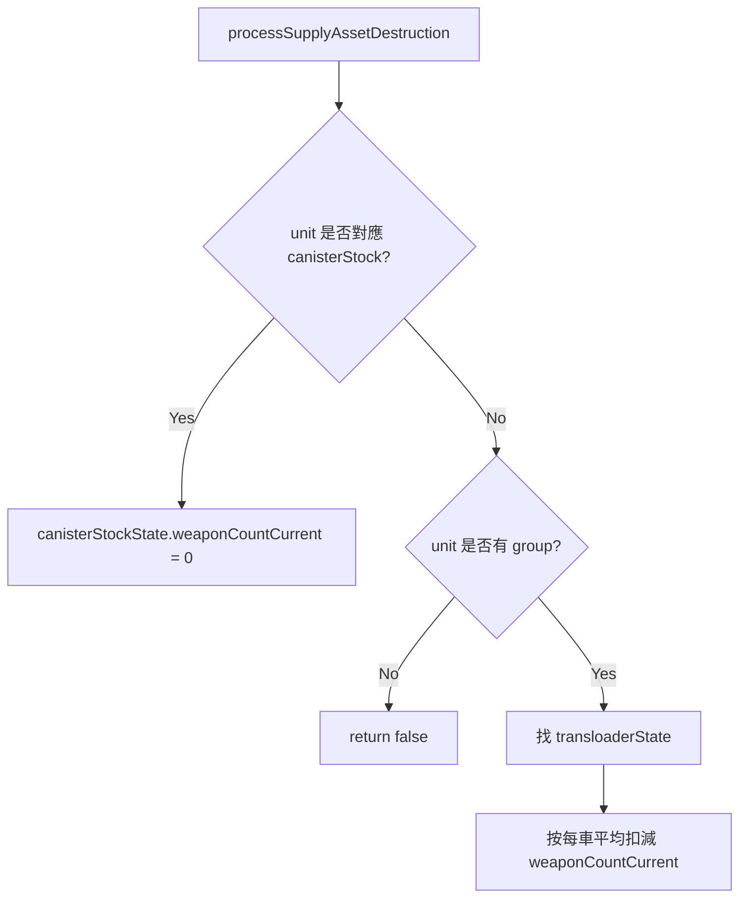

# groundStateStore.lua

飛彈模組 runtime state 建立與補給資產戰損處理模組。

> Source: `src/modules/missileSystem/groundStateStore.lua`

責任摘要：從 config descriptor 的起始值建 `saveData.*.ground.*` 的 runtime state，並在補給資產被擊毀時更新庫存。

---

## 概觀

`resetBatteryStates` 只改傳進來的那幾連：從該連 launcher、transloader、canister stock 的 config descriptor 取起始值，只寫 runtime 會改的欄位（名字、`state`、`operationalArea`、`weaponCountCurrent`），firing 與 resupply 的 `operationalArea` 設成該連陣地的拷貝。武器、彈量上限、車數、連結、訊息都不進 state，執行期以系統類型加單位名字回 config 查。其他連的 state 不動。state 是陣地唯一的家，`resolveOperationalArea` 讀它，還沒部署過才退回 config。

`processSupplyAssetDestruction` 會在分數腳本觸發時被呼叫：

- 若擊毀彈箱庫存（非 group），直接將對應 `canisterStockState.weaponCountCurrent = 0`
- 若擊毀彈藥補給車群組成員，按每車平均彈量扣減群組 `weaponCountCurrent`

---

## 主要機制

---

## Public API

| 函式 | 參數 | 回傳 | 說明 |
|---|---|---|---|
| `resolveDescriptors` | `systemConfig, unitName` | `launcher?, transloader?, canisterStock?` | 用發射車或補給車名稱照 config 連結找出整連的 descriptor；`Deployment.resolveBattery`、`resolvePair`、控制面板狀態都靠它，連結只在這裡走一次 |
| `findUnitSystem` | `groundState, missileSystemConfigMap, unitName` | `systemState?, missileSystemType?` | 找出把這個單位當發射車或補給車追蹤的啟用系統；沒有 config 的系統略過 |
| `resolvePair` | `systemConfig, systemState, unitName` | `launcherState?, transloaderState?, canisterStockState?` | 用任一端名稱照 config 連結找出整組配對；沒有 state 的一端為 nil |
| `processSupplyAssetDestruction` | `unit, systemConfig, systemState` | `boolean` | 補給資產戰損後同步修正庫存；每台車的份量用 config 的 `weaponCountDefault / unitCount` |
| `resetBatteryStates` | `groundState, batteries` | `nil` | 把這幾連的 runtime state 重設成 config 初值，放在該連的陣地 |
| `resolveOperationalArea` | `groundState, missileSystemType, launcherDescriptor` | `SBJ__OperationalArea` | 這一連現在的陣地：state 的，沒有 state 時用 config 的 |

---

## 相關模組

- [init](init.md)
- [deployment](deployment.md)
