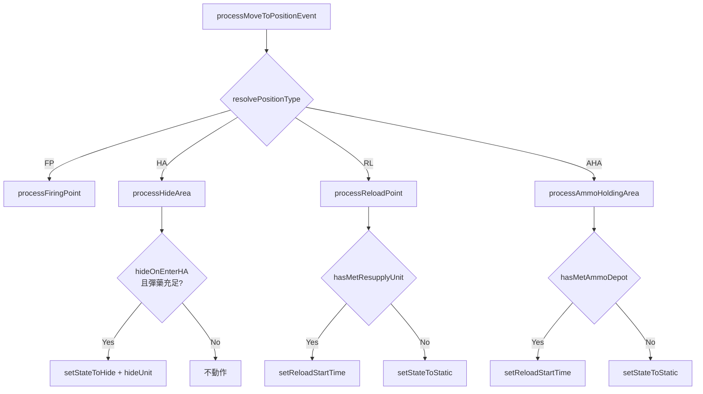

# init.lua

`missileSystem` 入口模組，提供對外 API 並統一處理 `UnitEntersArea` 事件。

> Source: `src/modules/missileSystem/init.lua`

責任摘要：封裝子模組並實作位置觸發分派（FP/HA/RL/AHA）。

---

## 概觀

`init.lua` 是外部腳本唯一需要 `require` 的門面層。定時檢查腳本呼叫 `processSide`（內部轉 `process`），場景事件腳本呼叫 `processUnitEntersArea`（內部轉私有的 `processMoveToPositionEvent`），其餘初始化與重建 API 也都由此轉發。

模組內將觸發流程拆成多個局部 handler：`processFiringPoint`、`processHideArea`、`processReloadPoint`、`processAmmoHoldingArea`，再透過 `forEachEnabledSystem` 套用到啟用中的類別（`mlrs/srbm/...`）。

此外，`behavior`（由 `processUnitEntersArea` 從陣營的 `ground.policy` 組出）允許不同陣營自訂流程，例如電腦控制陣營可在進入 HA 時自動 `hideUnit`（前提為彈藥充足），玩家控制陣營或低彈藥量單位則不做動作，以便接續前往 RL 補給。

---

## 主要機制

1. 由 `resolvePositionType(event)` 從 trigger description（`Arrive in (FP|HA|RL|AHA) ` 前綴）解析位置代碼。
2. 非 FP 事件會先 `dropUnitContact`，降低非必要接觸資訊。
3. 依陣地類型分派至對應 handler。
4. HA 流程僅在 `behavior.hideOnEnterHA` 啟用 **且** 機動發射車彈藥充足時，才會切換 `HIDE` 並執行 `hideUnit`；低彈單位保持原狀以便觸發後續補給流程。
5. RL/AHA 流程會先做 `Meeting` 判斷，成功才進入 `RELOAD` 計時；RL 無會合時 `setStateToStatic` 一律以手動 `runCtx`（`isAuto=false`）呼叫，避免短暫經過 RL 的機動發射車（例如重定位中途）被卡停。若 `behavior.hideResupplyOnRLNoMeeting` 啟用且對應機動發射車彈藥充足，會將彈藥車隱蔽。



---

## Public API

| 函式 | 參數 | 回傳 | 說明 |
|---|---|---|---|
| `getFiringUnitContext` | `groundCtx, missileSystem, firingUnitName` | `SBJ__FiringUnitContext?` | 依系統（大小寫皆可）與單位名稱取 runtime context |
| `isLowAmmo` | `firingUnitCtx, firingUnit` | `boolean` | 以 context 內的 `ammoThreshold`／`weaponDBID` 判斷低彈量 |
| `sendToFiringPoint` | `firingUnitCtx, firingUnit` | `boolean` | `HIDE` 且彈量足夠時卸出隱蔽區並前往 FP；回傳是否已在 FP（`STATIC`） |
| `startStow` | `groundCtx, missileSystem, firingUnits, opts?` | `nil` | 啟動 stow 倒數；SAM 略過、已有倒數保留；`opts.onlyDeployed` 只處理 `STATIC`／`REPOSITIONING` |
| `getAmmoInventory` | `groundCtx, missileSystem, sideName` | `SBJ__AmmoInventoryResult?` | 轉呼叫 `Ammo.getInventory`，系統不存在回傳 nil；供上層（例如 landingOps 火力閘門）判斷 |
| `process` | `groundCtx, missileSystemConfigMap, isAuto, sideName` | `nil` | 執行循環並輸出結果日誌 |
| `processSide` | `config, saveData, sideName` | `nil` | 依陣營取 ground 設定、狀態與 `ground.policy.isAuto`（包成 `runCtx`）後呼叫 `process`；`scheduledReloadHideCheck.lua` 的入口 |
| `processUnitEntersArea` | `config, saveData, unit, event` | `nil` | 依觸發單位陣營組出 policy／behavior，交給私有 `processMoveToPositionEvent`；`moveToPosition.lua` 的入口 |
| `processSupplyAssetDestruction` | `unit, groundCtx` | `boolean` | 走訪所有系統，找到擁有該補給資產的系統後扣彈並記錄 |
| `redeploy` | `missileSystemConfigMap, groundCtx, sideName, layouts` | `nil` | 套用玩家選的陣地（`SBJ__MissileSystemLayout[]`），重建 zone／trigger、單位與 context |
| `redeployFromControlPanel` | `config, saveData, sideName, entries` | `nil` | 把 control panel 送回的 entries 轉成 layouts 後呼叫 `redeploy` |
| `buildMissileSystemRows` | `config, sideName` | `table<string, SBJ__MissileSystemConfig>` | 產生 control panel 所需的系統設定副本（含 zone 頂點） |
| `deploySide` | `config, saveData, sideName` | `nil` | 以 `Deployment.addMissileSystems` 建立單位並初始化 context；`addMissileSystems.lua` special action 的入口 |
| `buildBatteryStatusRows` | `config, saveData, sideName` | `table<string, SBJ__BatteryStatusRow[]>` | 供狀態 UI 使用，依彈藥補給車名稱分組的電池狀態列 |
| `ensureGroundState` | `config, saveData, sideName` | `nil` | 自行解析該陣營的 ground 設定與狀態後轉呼叫 `Context.ensureGroundState` |
| `initSide` | `config, saveData, sideName` | `nil` | 自行解析該陣營的 ground 設定與狀態後轉呼叫 `Context.initMissileSystemContexts` |

`ensureGroundState` / `initSide` 取 `(config, saveData, sideName)` 而非現成的 slice，讓 `src/core/init.lua` 等外部呼叫端不需要知道「哪個 config 欄位、哪個 saveData slice 屬於哪個陣營」；[context](context.md) 內的同名函式仍維持 `(missileSystemConfigMap, groundCtx)`。

> 原本轉發 `Deployment.addMissileSystems` 的門面函式已刪除，外部改用 `deploySide`；`processMoveToPositionEvent` 改為私有，只經 `processUnitEntersArea` 進入。

---

## 日誌輸出

兩個批次流程各自建立一份 `LogFormat.report`，改成 per-row 分流：`FAIL`／`ERROR` 進 error sink，`OK`／`WARN` 留在 info log。

```
[missileSystem] side=China: Reload cycle mode=auto | total=3 ok=2 warn=1
  [OK]   system=SRBM unit=SRBM-FU-1 action=missile_reload_finished loaded=6
  [OK]   system=SRBM unit=SRBM-RU-1 action=move_resupply_to_reload_point
  [WARN] system=MRBM unit=MRBM-RU-2 action=move_resupply_to_reload_point reason=unit_not_found
```
```
（error sink）side=China: Reload cycle mode=auto | total=1 fail=1
  [FAIL] system=MLRS area=Fujian unit=MLRS-FU-3 action=move_to_hide_area reason=no_ha_defined
```

私有的 `processMoveToPositionEvent` 的 `position` 來自 event trigger，整批相同，因此放在 header 而非每一行：

```
[missileSystem] side=China: Position event mode=auto position=RL | total=2 ok=1 warn=1
  [OK]   system=SRBM unit=SRBM-FU-1 state=RELOAD action=reload_started startedAt=3600 triggerUnit=SRBM-RU-1
  [WARN] system=SRBM unit=SRBM-RU-2 action=resupply_concealment_failed pairedFiringUnit=SRBM-FU-2
         area=OPAREA-1 reason=no_buildings_in_mask
```

**行為變更：**此函式原本只要批次中出現任何 `WARN`／`FAIL`／`ERROR`，就把**整份** summary（含成功行）送 `Logger.warn`。改成 per-row 之後三個 WARN（`concealment_failed`／`resupply_concealment_failed`／`reload_not_started`）落在 info log，因此受 `config.logging.modules[missileSystem].verbose` 管控（目前為 `true`）。

`sendToFiringPoint` 的移動失敗與 `processSupplyAssetDestruction` 是單筆事件而非批次，走 `LogFormat.line` 並在呼叫端自行選 sink。

---

## 相關模組

- [cycle](cycle.md)
- [movement](movement.md)
- [meeting](meeting.md)
- [ammo](ammo.md)
- [concealment](concealment.md)
- [deployment](deployment.md)
- [context](context.md)
- [triggers](triggers.md)
