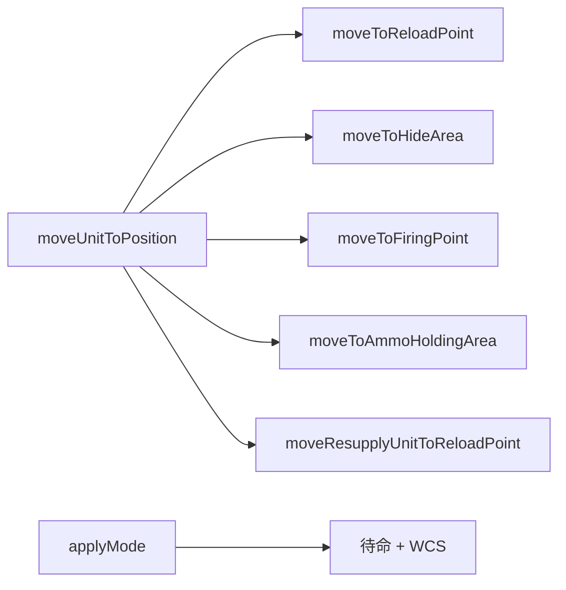

# movement.lua

機動車組的移動與待命指令模組。

> Source: `src/modules/missileSystem/movement.lua`

責任摘要：統一封裝到 FP/HA/RL/AHA 的移動命令，以及原地待命與武器管制（WCS）的設定。不改任何狀態；狀態由 [transitions](transitions.md) 記錄。

---

## 概觀

`movement.lua` 把路徑移動與武器管制設定集中處理，避免各流程重複拼接 `ScenEdit_SetUnit` / Doctrine 參數。所有移動最終都透過私有函式 `moveUnitToPosition` 執行。

`moveTo*` 只下指令並回傳成功與否；呼叫端用 `Transitions.depart` 包住它，指令成功才記成 `REPOSITIONING`。

---

## 主要機制

- 隨機挑選 `operationalArea` 中某個陣地並賦予 course。
- `applyMode` 依自動／手動模式設定原地待命，並套用指定的 WCS（SAM 用防空 WCS）。

---

## Public API

| 函式 | 參數 | 回傳 | 說明 |
|---|---|---|---|
| `moveToReloadPoint` | `unitState, unit` | `boolean, table?` | 移動至 RL |
| `moveToHideArea` | `firingUnitState, firingUnit` | `boolean, table?` | 移動至 HA |
| `moveToAmmoHoldingArea` | `resupplyUnitState, resupplyUnit` | `boolean, table?` | 移動至 AHA |
| `moveResupplyUnitToReloadPoint` | `resupplyUnitState, resupplyUnit` | `boolean, table?` | 彈藥補給車回 RL |
| `moveToFiringPoint` | `firingUnitState, firingUnit` | `boolean, table?` | 移動至 FP |
| `applyMode` | `unit, isAuto, wcs` | `nil` | 整個 group 依模式待命並套用 WCS |

移動失敗時第二個回傳值是 log 欄位表而非散文訊息，呼叫端直接併進自己的 row：

| `reason` | 附帶欄位 | 情境 |
|---|---|---|
| `no_positions_available` | `position`、`area` | 該陣地類型未設定任何位置 |
| `invalid_position_data` | `position`、`index`、`area` | 抽中的位置缺少 `course` |
| `no_ha_defined` | `area` | `operationalArea.HA` 未定義 |

這些 reason 由私有的 `moveUnitToPosition` 產生、經各 `moveTo*` 原樣回傳。欄位不含 `unit`：六個呼叫端都已自行標上 `unit=`，識別欄位歸呼叫端、失敗原因歸 producer。

---

## 相關模組

- [shared](shared.md)
- [transitions](transitions.md)
- [init](init.md)
- [cycle](cycle.md)
