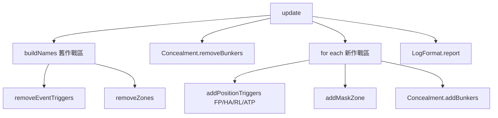

# positionZones.lua

陣地 zone、arrival trigger 與 mask zone 的清除與建立。

> Source: `src/modules/missileSystem/positionZones.lua`

---

## 概觀

`update` 先清掉電池離開的作戰區，再替新的作戰區建立 zone 與 trigger。

清除用名字找目標：依 [triggers](triggers.md) 的名稱協定，從舊作戰區的名字與各陣地數量算出 zone 與 trigger 名字，只刪掉存在的。bunker 由 `Concealment.removeBunkers` 清除，條件是舊 mask 區內的建築物。

建立時，每個陣地加一個 STANDARD zone 與一個 `UnitEntersArea` trigger，並把 zone 的 RP 名稱寫回 `position.area`。每個作戰區再加一個 mask zone（寫回 `operationalArea.mask.area`），以及 `Concealment.addBunkers` 放的 bunker。

---

## Public API

| 函式 | 參數 | 回傳 | 說明 |
|---|---|---|---|
| `update` | `sideName, operationalAreas, operationalAreasToRemove, positionTypes` | `nil` | 清除舊作戰區，建立新作戰區 |

---

## 相關模組

- [init](init.md)
- [triggers](triggers.md)
- [concealment](concealment.md)
