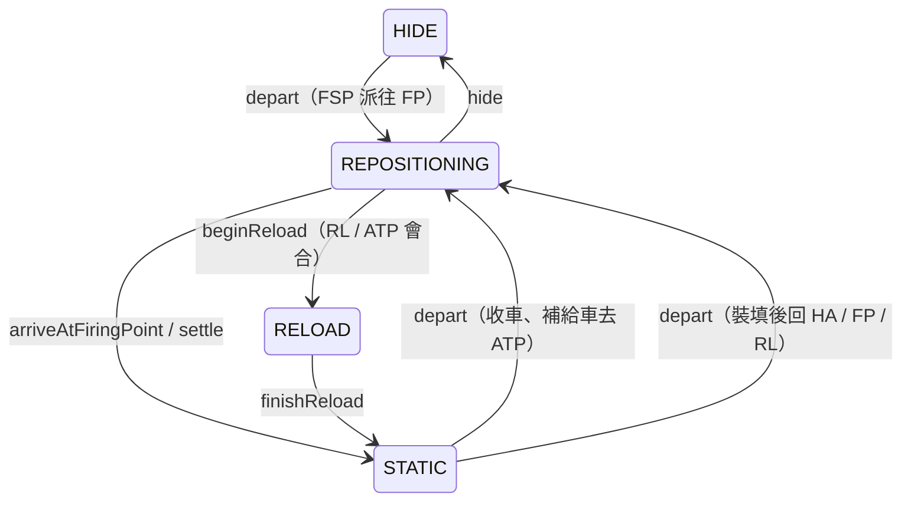

# transitions.lua

飛彈連狀態與計時器的唯一寫入者。

> Source: `src/modules/missileSystem/transitions.lua`

責任摘要：記錄機動發射車與彈藥補給車的狀態（`STATIC` / `REPOSITIONING` / `RELOAD` / `HIDE`）、裝填計時（`reloadStartTime`）與收車計時（`stowStartTime`）。其他檔案只對 CMO 下指令或計算彈藥，再呼叫這裡記錄指令代表的狀態。

---

## 概觀

狀態改變一律寫成有名字的轉換，事件路徑（[arrival](arrival.md)）與定時路徑（[cycle](cycle.md)）的步驟 handler 共用同一組函式，所以同一個轉換只有一種寫法。「什麼時候轉換」由 [rules](rules.md) 決定，本檔只負責寫入。

需要同時改 CMO 待命模式的轉換（抵達 FP、掩蔽、開始裝填、無會合轉靜止）會順便呼叫 `Movement.applyMode`；純計時與移動結果的轉換不碰 CMO。

---

## 主要機制

- **出發**：`depart` 照 `Movement.ORDER` 的一條路線下移動指令，指令成功才記成 `REPOSITIONING`；失敗時保持原狀態，避免單位沒動卻卡在 `REPOSITIONING`。兩種情況都回傳 log row 給呼叫端。
- **收車倒數**：`beginStow` 已有倒數就保留並回傳 false；`endStow` 在單位被送走後清掉（移動失敗也清，不重試）。
- **查詢**：`staysDeployed`（SAM）與 `isRepositioning` 已搬到 [rules](rules.md)。`movement.lua` 的 `AIR_WCS_DBIDS`（選防空或對地 WCS）不屬於狀態機。

---

## Public API

| 函式 | 參數 | 回傳 | 說明 |
|---|---|---|---|
| `depart` | `unitState, unit, order` | `SBJ__LogResult` | 下移動指令，成功才設 `REPOSITIONING`，回傳 log row |
| `arriveAtFiringPoint` | `launcherState, launcher, isAuto` | `nil` | `STATIC` + `WCS.FREE` |
| `hide` | `launcherState, launcher, isAuto` | `nil` | `HIDE` + `WCS.HOLD` |
| `beginReload` | `unitState, unit, isAuto` | `nil` | `RELOAD`、起始時間 + `WCS.HOLD` |
| `ensureReloadClock` | `unitState` | `nil` | `RELOAD` 卻沒有起始時間時補上 |
| `finishReload` | `unitState` | `nil` | `STATIC` 並清空裝填計時 |
| `settle` | `systemState, unit, isAuto` | `nil` | 依名稱找發射車（優先）或補給車，`STATIC`、清計時 + `WCS.HOLD` |
| `beginStow` | `launcherState` | `boolean` | 開始收車倒數；已有倒數回傳 false |
| `endStow` | `launcherState` | `nil` | 清空收車倒數 |

---

## 已知風險

自動模式下，發射車往 FP 途中若穿過 RL，RL 無會合的 `settle` 會把它轉成 `STATIC`；抵達 FP 時 `Rules.isRepositioning` 回傳 false，WCS 不會開成 FREE。只有 RL 剛好在路上才會發生。

---

## 相關模組

- [rules](rules.md)
- [arrival](arrival.md)
- [movement](movement.md)
- [ammo](ammo.md)
- [cycle](cycle.md)
- [init](init.md)
