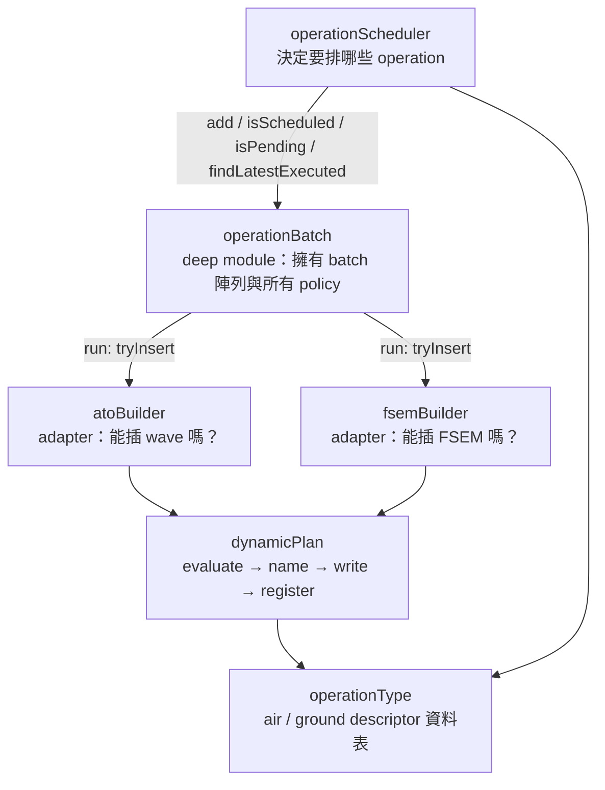

# 重構計畫：Operation batch 生命週期 + 動態計畫插入 pipeline

> 依據：`docs/architecture-review-2026-09-22.html` 問題 #1、#2
> 範圍：`src/modules/strikePlanner/` 內部，不動 saveData 形狀、不動 config
> 測試基線（2026-09-23）：`busted --lua=luajit spec` 983 通過、0 失敗

---

## 0. 現況一句話

「一個 operation 從 scheduled → 觀察窗 → executed / abandoned / expired」的 policy，現在住在四個檔案裡：

| 誰 | 管什麼 | 問題 |
|---|---|---|
| `dynamicState.lua` | 7 個小函式：篩選、觀察窗、executed、abandon、命名、登記 | interface 跟 implementation 一樣寬，什麼都沒藏 |
| `atoBuilder.lua:502-570` | driver loop 副本 A | 和 fsemBuilder 幾乎逐行相同 |
| `fsemBuilder.lua:501-577` | driver loop 副本 B | 同上 |
| `operationScheduler.lua:47-219` | `forEachOperation` / `isOperationScheduled` / `isOperationPending` / `findLatestExecutedOperation` / `getMostRecentOperationsAndNextTime` | 查詢邏輯跟 batch 陣列分家 |

air / ground 的分派同時有三種寫法：

1. `OPERATION_TYPE_TRAITS[type]` 資料表（operationScheduler）
2. `buildUniqueAirOperationName` / `buildUniqueGroundOperationName` 一對函式（dynamicState）
3. `addGeneratedOperation("air", ...)` 傳字串（兩個 builder 各自呼叫）

命名（2）和登記（3）是兩個獨立呼叫。漏掉任一個，名字唯一性就靜靜壞掉，沒有測試會抓到。

另外 `DynamicState.updateReconTriggeredOperationStatus` 在 `src/` 沒有任何呼叫者，只有 spec 在測它。

---

## 1. 目標形狀



兩個新 module、一個改名、一個刪除：

| 動作 | 檔案 | 模組 table |
|---|---|---|
| 新增 | `src/modules/strikePlanner/operationBatch.lua` | `OperationBatch` |
| 新增 | `src/modules/strikePlanner/operationType.lua` | `OperationType` |
| 新增 | `src/modules/strikePlanner/dynamicPlan.lua` | `DynamicPlan` |
| 刪除 | `src/modules/strikePlanner/dynamicState.lua` | `DynamicState` |

---

## 2. `OperationBatch`：batch 生命週期的 deep module

### 2.1 公開 API（只有這些）

```lua
---把一批 operation 排進 batches；OperationScheduler.schedule 改呼叫這裡
---@param batches SBJ__ReconTriggeredOperationBatch[]
---@param reconEntry SBJ__ReconQueueEntry
---@param operations SBJ__Operation[]
function OperationBatch.add(batches, reconEntry, operations)

---跑一個 tick：篩選 → 觀察窗 → 交給 adapter 試插 → 依結果 executed / observing / abandoned
---@param batches SBJ__ReconTriggeredOperationBatch[]
---@param operationType SBJ__OperationType
---@param adapter SBJ__OperationBatchAdapter
---@return SBJ__OperationBatchRunResult
function OperationBatch.run(batches, operationType, adapter)

---查詢，搬自 OperationScheduler，簽名不變
function OperationBatch.isScheduled(batches, templateName, operationType)
function OperationBatch.isPending(batches, templateName, operationType)
function OperationBatch.findLatestExecuted(batches, seriesPrefix, operationType)
function OperationBatch.findMostRecentSnapshot(batches)   -- 原 getMostRecentOperationsAndNextTime
```

### 2.2 新型別（加進 `src/core/schema.lua` Dynamic Operations 區）

```lua
---Builder 交給 OperationBatch.run 的回呼；只回答「現在能不能插這個 template」
---@class SBJ__OperationBatchAdapter: table
---@field currentTime integer
---@field windowSec number
---@field tryInsert fun(batchedOp: SBJ__BatchedOperation): SBJ__OperationProcessResult
---@field retryableReasonSet table<string, true>  -- 哪些 reason 留在窗內重試

---OperationBatch.run 的回傳；builder 只負責把 rows 丟進自己的 report
---@class SBJ__OperationBatchRunResult: table
---@field hasExecutedAny boolean
---@field rows SBJ__OperationBatchRow[]

---一個 operation 這個 tick 的結果，fields 已合併 operation= batch= reason= state=
---@class SBJ__OperationBatchRow: table
---@field tag string
---@field fields table<string, any>
---@field outcome SBJ__OperationProcessResult  -- 原始 outcome，atoBuilder 從這拿 timing
```

### 2.3 變成私有的東西

| 原 `DynamicState.*` | 去向 |
|---|---|
| `OBSERVATION_STATE` | 私有常數，只有 `run` 用 |
| `evaluateObservationWindow` | 私有 |
| `filterOperationsByType` | 私有 |
| `checkOperationBatchCompleted` | 私有，改名 `settleBatch`（避開 `check*` 例外） |
| `setOperationExecuted` | 私有 |
| `abandonOperation` | 私有 |
| `updateReconTriggeredOperationStatus` | **刪除**，無呼叫者 |
| `buildUniqueAirOperationName` / `buildUniqueGroundOperationName` / `addGeneratedOperation` | 搬到 `DynamicPlan`（第 3 節） |

| 原 `OperationScheduler.*` | 去向 |
|---|---|
| `forEachOperation` / `findFirstOperation` / `isTemplateMatch` | `OperationBatch` 私有 |
| `isOperationScheduled` | `OperationBatch.isScheduled` |
| `isOperationPending` | `OperationBatch.isPending` |
| `findLatestExecutedOperation` | `OperationBatch.findLatestExecuted` |
| `getMostRecentOperationsAndNextTime` | `OperationBatch.findMostRecentSnapshot` |
| `schedule` 裡的 `table.insert(operationBatches, {...})` | `OperationBatch.add` |

`OperationScheduler` 留下：`buildNextOperation`、`buildFirstWaveOperation`、`buildNextWaveOperation`、`buildOperationsForReconObjective`、`logSchedule`、`schedule`。它只決定「要排什麼」，不再碰 batch 內部。

### 2.4 `run` 的 policy（從兩個 builder 抽出，逐字一致）

```text
for each (batch, op) where not batch.executed and op.type == type and not op.executed:
  state = window(currentTime, batch.time + batch.delay, windowSec)
  PRE_TRIGGER → 靜默跳過（不產 row）
  EXPIRED     → outcome = { success=false, tag="WARN", reason="observation_window_expired" }
  IN_WINDOW   → outcome = adapter.tryInsert(batchedOp)

  success                      → op.executed = true; settleBatch(batch); state="executed"
  retryableReasonSet[reason]   → state="observing"（留在 batch）
  else                         → 從 batch 移除; settleBatch(batch); state="abandoned"

  row.fields = merge({ operation=template.name or "unknown", batch=type.."@"..time }, outcome.fields)
  row.fields.reason = outcome.reason
```

`observation_window_expired` 這個 reason 字串從 builder 的 `PROCESS_REASON` 搬進 `OperationBatch`，兩邊各刪一份。

### 2.5 builder 縮成 adapter 之後長什麼樣

```lua
-- atoBuilder.lua
function AtoBuilder.build(config, saveData, contacts)
  if not saveData.c.dynamicOperations.enabled then return false end

  local freeAircraftCache = {}   -- 仍是 pass-scoped local，理由不變
  local result = OperationBatch.run(
    saveData.c.dynamicOperations.reconTriggeredOperationBatches,
    "air",
    {
      currentTime = GameApi.ScenEdit_CurrentTime(),
      windowSec = config.c.recon.observationWindowSec,
      retryableReasonSet = RETRYABLE_REASON,
      tryInsert = function(batchedOp)
        return processAirOperation(config, saveData, contacts, batchedOp, freeAircraftCache)
      end
    }
  )

  local opReport = LogFormat.report(...)
  local timingReport = LogFormat.report(...)
  for _, row in ipairs(result.rows) do
    opReport.add(row.tag, row.fields, row.outcome.details)
    timingReport.addAll(row.outcome.timing)
  end
  opReport.emit(); timingReport.emit()
  return result.hasExecutedAny
end
```

`fsemBuilder.build` 同形，差別只剩：先跑 `retireStaleMatrices`、`passCtx` 在 retirement 之後建立、沒有 timing report。這三點就是「兩個 builder 真正不同的部分」。

---

## 3. `OperationType` + `DynamicPlan`：一條插入 pipeline，兩個 descriptor

### 3.1 `OperationType`：把三種分派收成一張表

搬 `operationScheduler.lua:13-24` 的 `OPERATION_TYPE_TRAITS` 出來，補上插入路徑需要的欄位：

```lua
---@class SBJ__OperationTypeDescriptor: table
---@field templateSource string            -- config.c 底下的 key："packageTemplates" / "fireSupportTaskTemplates"
---@field templateField string             -- template 內的陣列欄位："packages" / "fireSupportTasks"
---@field registryKey string               -- generatedOperations 的 key："air" / "ground"
---@field resolvePlan fun(saveData): table -- 回 saveData.c.air.airTaskingOrder / saveData.c.ground.fireSupportPlan
---@field resolveDefaultInterval fun(config): number

OperationType.DESCRIPTORS = { air = {...}, ground = {...} }

---@param operationType string
---@return SBJ__OperationTypeDescriptor|nil
function OperationType.resolve(operationType)
```

`OperationScheduler` 改用 `OperationType.resolve(type)`，行為不變。

### 3.2 `DynamicPlan`：evaluate → name → write → register

```lua
---評估 template 內每個 package / task 的目標；兩個 builder 的 evaluateTargetsFromTemplate 合併成這一個
---@param config SBJ__Config
---@param saveData SBJ__SaveData
---@param contacts CMO__Contact[]
---@param operationType SBJ__OperationType
---@param template SBJ__WaveTemplate|SBJ__FireSupportExecutionMatrixTemplate
---@return table<integer, string[]> targetsByIndex
---@return integer qualifiedCount
function DynamicPlan.evaluateTargets(config, saveData, contacts, operationType, template)

---命名、寫入 plan、登記 generatedOperations，一次呼叫做完
---buildPlan 收到唯一名稱，回傳要寫入的 wave / matrix
---@param saveData SBJ__SaveData
---@param operationType SBJ__OperationType
---@param templateName string
---@param reconType string
---@param buildPlan fun(planName: string): table
---@return string planName
function DynamicPlan.insert(saveData, operationType, templateName, reconType, buildPlan)
```

`insert` 內部：

```text
descriptor = OperationType.resolve(operationType)
ensureGeneratedOperations(saveData)
registrySet = saveData.c.dynamicOperations.generatedOperations[descriptor.registryKey]
plan = descriptor.resolvePlan(saveData)
name = buildUniqueOperationName(templateName, reconType, registrySet, plan)   -- 原 dynamicState 私有函式，原樣搬來
plan[name] = buildPlan(name)
registrySet[name] = true
return name
```

「生成的名字一定被登記」這個 invariant 只住在這 3 行裡。

### 3.3 builder 端呼叫點

```lua
-- atoBuilder.lua createAndInsertATOWaveFromTemplate，原 440-443 四行 → 一行
local waveName = DynamicPlan.insert(saveData, "air", waveTemplate.name, reconType, function(name)
  return buildATOWave(waveTemplate, name, validPackages)
end)

-- fsemBuilder.lua createAndInsertMatrixFromTemplate，原 374-377 四行 → 一行
local matrixName = DynamicPlan.insert(saveData, "ground", matrixTemplate.name, reconType, function(name)
  return buildMatrix(matrixTemplate, name, fireSupportTasks, currentTime)
end)
```

air 端 `if not next(targetsByPackageIndex)` 改成 `if qualifiedCount == 0`，跟 ground 端一致。

---

## 4. 測試計畫

| Spec | 動作 |
|---|---|
| `spec/modules/strikePlanner/operationBatch_spec.lua` | **新增**。吸收 `dynamicState_spec` 的窗口 / executed / abandon 案例，加 `run` 的 policy 表格測試（PRE_TRIGGER 不產 row、EXPIRED 移除、retryable 留下、非 retryable 移除、executed 後 batch settle）。吸收 `operationScheduler_spec` 裡對 `isOperationScheduled` / `isOperationPending` / `findLatestExecutedOperation` / `getMostRecentOperationsAndNextTime` 的案例。 |
| `spec/modules/strikePlanner/dynamicPlan_spec.lua` | **新增**。`evaluateTargets` 兩種 type 各一組；`insert` 測：名字唯一、序號遞增、跟既有 plan 撞名時跳號、寫入與登記同時發生、`buildPlan` 收到的名字就是回傳的名字。 |
| `spec/modules/strikePlanner/operationType_spec.lua` | **新增**，小。`resolve` 對未知型別回 nil；兩個 descriptor 欄位齊全。 |
| `spec/modules/strikePlanner/dynamicState_spec.lua` | **刪除**（703 行），內容已被上面兩個接手。 |
| `spec/modules/strikePlanner/atoBuilder_spec.lua` | 拿掉 41 處 `DynamicState` stub。改成餵真的 `reconTriggeredOperationBatches` fixture，斷言 batch 狀態與 `saveData.c.air.airTaskingOrder` 內容。`stubDynamicStateSuccess` helper 刪除。 |
| `spec/modules/strikePlanner/fsemBuilder_spec.lua` | 同上，拿掉 39 處。 |
| `spec/modules/strikePlanner/operationScheduler_spec.lua` | 拿掉對 `OperationScheduler.isOperationScheduled` / `findLatestExecutedOperation` / `buildNextOperation` 的 self-stub（10 處），改餵 batch fixture。查詢案例搬去 `operationBatch_spec`。 |

每個 phase 結束都要 `busted --lua=luajit spec` 全綠，數字只能比 983 多或相等（刪掉純搬家的重複案例可以少，但要在 commit message 說明）。

---

## 5. 執行順序（每步一個 commit，每步全綠）

branch：`refactor/operation-batch-lifecycle`（從目前 `refactor/naming-conventions` 合回 main 之後再開；若等不及，就從 `refactor/naming-conventions` 開）

### Phase 1：`OperationBatch` 接手 driver loop

1. 新增 `operationBatch.lua`：私有 helper 從 `dynamicState.lua` 原樣搬入，寫 `add` / `run`；`OperationScheduler` 的四個查詢與 `forEachOperation` 搬入改名。schema 加 `SBJ__OperationBatchAdapter` / `SBJ__OperationBatchRunResult` / `SBJ__OperationBatchRow`。新增 `operationBatch_spec.lua`。
   commit：`refactor(strikePlanner): add OperationBatch owning batch lifecycle and queries`
2. `operationScheduler.lua` 改呼叫 `OperationBatch.add` / `isScheduled` / `isPending` / `findLatestExecuted` / `findMostRecentSnapshot`，刪掉本地查詢。`operationScheduler_spec` 拿掉 self-stub。
   commit：`refactor(strikePlanner/operationScheduler): delegate batch queries to OperationBatch`
3. `atoBuilder.build` 改用 `OperationBatch.run`；`atoBuilder_spec` 拿掉 DynamicState stub。
   commit：`refactor(strikePlanner/atoBuilder): drive operations through OperationBatch.run`
4. `fsemBuilder.build` 同上。
   commit：`refactor(strikePlanner/fsemBuilder): drive operations through OperationBatch.run`

到這裡 `dynamicState.lua` 只剩命名 / 登記三個函式還有人用。

### Phase 2：`OperationType` + `DynamicPlan` 接手插入

5. 新增 `operationType.lua`，`OPERATION_TYPE_TRAITS` 搬出並補欄位；`operationScheduler.lua` 改用。新增 `operationType_spec.lua`。
   commit：`refactor(strikePlanner): extract OperationType descriptors`
6. 新增 `dynamicPlan.lua`（`evaluateTargets` + `insert`），命名私有函式從 `dynamicState.lua` 搬入。新增 `dynamicPlan_spec.lua`。
   commit：`refactor(strikePlanner): add DynamicPlan insert pipeline`
7. 兩個 builder 改用 `DynamicPlan.evaluateTargets` / `DynamicPlan.insert`；各刪本地 `evaluateTargetsFromTemplate`。
   commit：`refactor(strikePlanner): route plan insertion through DynamicPlan`
8. 刪 `dynamicState.lua`、`dynamicState_spec.lua`；schema 裡 `SBJ__BatchedOperation` 註解改指向 `OperationBatch`。
   commit：`refactor(strikePlanner): remove DynamicState`

### Phase 3：文件

9. `docs/strikePlanner/`：刪 `dynamicState.md`，新增 `operationBatch.md`、`dynamicPlan.md`、`operationType.md`；更新 `README.md`、`atoBuilder.md`、`fsemBuilder.md`、`operationScheduler.md` 的相關段落與連結。
   `docs/naming.md` 第 126 行「`checkOperationBatchCompleted` 例外」刪除（函式已私有且改名）。
   commit：`docs(strikePlanner): document OperationBatch / DynamicPlan / OperationType`
10. `bash bin/build.sh -t -i` 確認 bundler 排序與依賴分析吃得下新 module（`tools/build_lua_scenario.py` 靠 `require` 分析排序，新檔案要能被走到）。

---

## 6. 不做的事

- 不動 `saveData.c.dynamicOperations` 的形狀。`reconTriggeredOperationBatches`、`generatedOperations` 兩個 key 與內容一字不改，舊存檔可直接載入。
- 不動 `SBJ__ReconTriggeredOperationBatch` / `SBJ__Operation` / `SBJ__BatchedOperation` 型別。
- 不動 log 輸出。row 的 tag、fields 順序、reason 字串全部維持，好讓現有 log grep 繼續有效。
- 不碰 review #3（saveData seam）、#4（missileSystem 前門）、#6（strikePlanner/init.lua）。#6 的 `processDynamicGroundOperations` / `processDynamicAirOperations` 轉發保留原樣。
- 不改 `retireStaleMatrices` 與 `stowStartTime` 寫入（屬 #4 範圍）。

---

## 7. 風險與對策

| 風險 | 對策 |
|---|---|
| `run` 抽出時兩個 builder 的 loop 有細微差異被抹平 | 動手前先 diff `atoBuilder.lua:527-565` 與 `fsemBuilder.lua:536-572`；目前唯一差異是 air 的 `operation.template and operation.template.name or "unknown"` 防禦。`run` 保留這個防禦，兩邊都受惠。 |
| bundler 把 `operationBatch.lua` 排在 builder 後面 | `build_lua_scenario.py` 依 `require` 依賴排序；builder 檔頭 `require` 新 module 就會被排前面。步驟 10 驗證。 |
| builder spec 從 stub 改成 fixture，案例數暴增或漏掉分支 | 對照舊 spec 的 `describe` 清單逐條對應，每個舊案例在新 spec 找得到對應者才刪。 |
| `retryableReasonSet` 傳錯導致該重試的被 abandon | `operationBatch_spec` 直接測 policy 表格；builder spec 各留一個「retryable 留在 batch」案例當整合測試。 |
