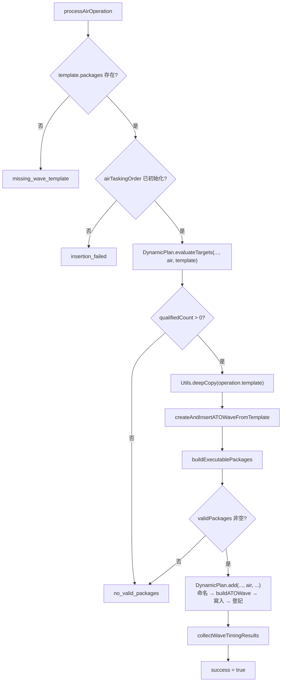

# atoBuilder — 動態 ATO Wave 生成

> 原始碼：`src/modules/strikePlanner/atoBuilder.lua`

**職責**：消費偵察觸發的 `air` operation，評估目標與機隊資源，產生可由 `airTaskingOrder` 執行的動態 ATO Wave。

---

## 概述

`atoBuilder` 是 Strike Planner 的動態空中打擊生成層。它不建立 CMO mission，也不派遣飛機，而是從 `saveData.c.dynamicOperations.reconTriggeredOperationBatches` 找出尚未執行且已到觸發時間的 `air` operation，把其中的 `SBJ__WaveTemplate` 轉成執行態 `SBJ__Wave`，寫入 `saveData.c.air.airTaskingOrder`。真正建立任務、指派飛機的是後續 tick 才跑的 [airTaskingOrder](airTaskingOrder.md)。

模組的主要工作分成三段：先透過 [targetingProcess](targetingProcess.md) 依每個 package 的 target template 取得可打擊目標；再檢查各角色基地是否有足夠且未被任務占用的指定 DBID 飛機，並支援 `baseGUIDCandidates` 跨基地 fallback；最後委派 [packageTiming](packageTiming.md) 依支援角色飛行時間、striker 武器射程與 `strikeInterval` 產生所有角色的 `startTime` / `endTime`。

插入 Wave 的命名、寫入與登記由 [dynamicPlan](dynamicPlan.md) 一次做完，避免後續 tick 產生同名任務。觀察窗、重試與放棄不在本模組決定：[operationBatch](operationBatch.md) 驅動每個 tick，本模組只回答「現在能不能插這個 Wave」。目標尚未偵測到或基地飛機暫時被占用時回報可重試的 reason，operation 留在窗內等下一個 tick；缺 template、ATO 尚未初始化這類不可重試的狀況則被 operationBatch 從 batch 移除，讓 [operationScheduler](operationScheduler.md) 在下次偵察完成時重開同一波。

---

## 主要機制

### 主流程：adapter 與 report

```mermaid
flowchart TD
    ENTRY["AtoBuilder.build"]
    ENABLED{"dynamicOperations enabled?"}
    STOP["return false"]
    CACHE["建立 freeAircraftCache"]
    RUN["OperationBatch.process(batches, air, params)"]
    TRY["tryInsert = processAirOperation"]
    ENTRIES["逐筆 entry：opReport.add + timingReport.addAll"]
    EMIT["opReport.emit + timingReport.emit"]
    RETURN["return result.hasExecutedAny"]

    ENTRY --> ENABLED
    ENABLED -->|否| STOP
    ENABLED -->|是| CACHE --> RUN
    RUN -.->|每個到期 operation| TRY -.-> RUN
    RUN --> ENTRIES --> EMIT --> RETURN
```



本模組交給 `OperationBatch.process` 的 `params` 只有四樣：目前時間、`observationWindowSec`、`RETRYABLE_REASON`，以及 `tryInsert`。篩選 operation、判定觀察窗、標記 executed、移除放棄的 operation、合併 `operation=` / `batch=` / `state=` 欄位，全在 [operationBatch](operationBatch.md) 內完成；本模組拿回 entries 後只負責餵兩份 report。沒有到期 operation 時 entries 為空，report 零列不輸出。

### 單一 operation：processAirOperation 的建構決策



四個出口節點就是 `reason` token 本身，對應的 tag 與後續處理見下方[結果分類與 log](#結果分類與-log)。`no_valid_packages` 有兩個來源——目標全數不足，以及目標夠但機隊驗證後一個 package 都留不下來——兩者回傳同一個 reason，也因此共用同一條重試路徑。

### 觀察窗與重試

觸發時間到達後，operation 進入 `config.c.recon.observationWindowSec` 長度的觀察窗，窗口起點是 `operationBatch.time + operationBatch.delay`。窗口狀態由 [operationBatch](operationBatch.md) 判定，air 與 ground 共用同一套判定與同一個設定值；本模組只提供 `RETRYABLE_REASON`。

| 狀態 | 行為 |
|---|---|
| `pre_trigger` | operationBatch 靜默跳過，`tryInsert` 不會被呼叫 |
| `in_window` | 每個 tick 重新評估目標與機隊；`no_valid_packages` 是唯一的可重試原因，operation 保持在 batch 內並記 `state=observing` |
| `expired` | operationBatch 以 `reason=observation_window_expired` 移除 operation |

### 為什麼失敗要移除 operation，而不是標記 executed

不可重試的失敗（缺 template、ATO 未初始化、未知原因）不等窗口逾時，`OperationBatch.process` 在同一個 tick 就把 operation 從 batch 陣列移除。

移除而非標記 `executed`，是為了讓排程器把同一波重新排一次，而不是把沒打成的波次當成推進基準跳過去。`executed` 因此有嚴格語義：**只代表「Wave 真的插進計畫了」**，不代表飛機起飛。細節見 [operationBatch](operationBatch.md) 與 [operationScheduler](operationScheduler.md) 的排程不變式。

### 目標評估與 package 篩選

`DynamicPlan.evaluateTargets()` 依 `waveTemplate.packages` 順序處理每個 package，呼叫 `TargetingProcess.processTargets(config, plannerState, { contacts, targetConfig = packageData.target }, { isFirstWave })` 取得候選目標。目標數達到 `packageData.target.minTargetCount` 時，該 package index 才會被記進 `targetsByPackageIndex`，`qualifiedCount` 同時加一。

`buildExecutablePackages()` 只處理已通過目標門檻的 package。它把 `package.target.list` 改成實際目標清單，並在機隊驗證成功後委派 `PackageTiming.createPackageWithTiming()` 補齊 timing 與 `loadoutStatus`。時序串接以「前一個**有效** package」為基準，因此即使原始第 1 個 package 被跳過，第 1 個成功建立的 package 仍會被視為第一個有效 package。

### 為什麼深拷貝擺在目標門檻之後

上游模板會被同一系列的後續波次重複使用，而執行態的 `target.list` 與解析後的 `baseGUID` 絕不能寫回模板，所以 `processAirOperation()` 一定要 deep copy。

但拷貝刻意擺在 `qualifiedCount == 0` 檢查**後面**：沒有任何目標的 tick 完全不用付這個成本。觀察窗內重試的作戰每個 tick 都會走這條路，而其中多數 tick 就是因為還沒偵測到目標才在重試。`atoBuilder_spec` 有一條「should not copy the template when no package has targets」的測試釘住這個順序。

### 機隊資源驗證

機隊驗證依 `PACKAGE_ROLES` 固定順序檢查：

```text
striker -> escort -> wildWeasel -> jammer -> tanker
```

`validateAircraftRole()` 把 `roleData.baseGUID` 與 `roleData.baseGUIDCandidates` 串成候選基地清單，依序尋找可用飛機。可用飛機由 `getFreeAircraftCount()` 計算，條件是基地 `embarkedUnits.Aircraft` 中的 aircraft `dbid` 符合 `roleData.unitDBID`，且 `aircraft.mission == ""` 或 `nil`。

```text
預約 key       = baseGUID .. "#" .. unitDBID
可用餘額 spare = getFreeAircraftCount(cache, baseGUID, unitDBID) - reservedAircraft[key]

接受條件： spare >= roleData.unitCount * config.c.air.minimumStrengthRatio
預訂量：   math.min(spare, roleData.unitCount)
```

`minimumStrengthRatio` 決定「基地至少要能出幾成的兵才值得派」。低於門檻整個 package 跳過，達到門檻就以現有兵力出擊——半數兵力的打擊還是勝過不打。預設 `0.5`；調成 `1` 就是只接受滿編，調低則允許更零星的出擊。

候選基地通過門檻時，模組把 `roleData.baseGUID` 改寫為實際選定基地，並把預訂量累加到 package 專用的暫存表。**只有所有已設定角色都通過驗證時**，暫存預約才會提交至 `reservedAircraft`；任一角色失敗就丟棄整包暫存，避免未執行的 package 占用後續 package 的飛機。`roleData.unitCount` 不會因未達滿編而改寫，實際派遣數仍由下游 [airTaskingOrder](airTaskingOrder.md) 依可用飛機處理。

`collectReservedAircraft()` 另外掃描既有 `saveData.c.air.airTaskingOrder`，統計所有 `isActivated == true`、`hasLaunched ~= true` 且 package 尚未 launched 的 role `unitCount`，避免動態插入時和既有 active Wave 重複占用機隊。

若 tanker 的 `missionCreationParams` 使用陣列，建立 Wave 前會額外驗證陣列非空、任務名稱有效且不重複，以及 `unitCount` 可被任務數整除。機隊容量與預訂量仍使用 tanker 的總 `unitCount`，不會因任務拆分而重複計算。

### 為什麼預約帳本要以 (基地, 機型) 為 key

預約 key 由 `buildReservationKey(baseGUID, unitDBID)` 產生，形如 `BASE-1#100`。單純以 baseGUID 記帳會出錯：把某基地的戰機全部訂走，不該讓同一基地的加油機或電戰機看起來也沒了。既有波次同樣以 (基地, 機型) 記帳，所以某基地的戰機被前一波訂滿，不會連帶擋掉這一波的其他機型。

### 為什麼快取只活一次 execute()

`getBaseFreeAircraft()` 對一個基地做**一次掃描**，回傳 `dbid -> 閒置架數`；`getFreeAircraftCount()` 把結果存進 `execute()` 建立的 `freeAircraftCache` 並在整趟共用。這取代了原本按 dbid 分次掃描的作法——同一基地的 5 個角色以前會把掛載機清單各讀一遍，現在讀一次就答完所有機型。

快取的生命週期**剛好是一次 `execute()`**，理由是這段期間基地機隊是恆定的：本模組只讀不寫遊戲狀態，而 CMO 的事件腳本執行期間模擬時間不前進。機場被炸、飛機被指派任務、玩家操作都發生在兩次 `execute()` 之間，每趟重建剛好涵蓋。

因此 `freeAircraftCache` **必須是 `execute()` 的區域變數**。打包後模組 table 會變全域，把它提到 module scope 會讓快取跨 tick 存活、繼續計入已被摧毀的飛機。`atoBuilder_spec` 的「should read a base only once per pass」與「should re-read a base on the next pass」兩條測試分別釘住快取有效與快取不得跨 tick。

### 飛行時間與任務時序

機隊驗證通過後，`buildExecutablePackages()` 逐一委派 `PackageTiming.createPackageWithTiming()`，以前一個有效 package 為時序基準計算各角色的 `startTime` / `timeOnStation` / `endTime`。飛行時間估算、支援角色戰術提前量、加油機受油協調，以及依 `timeToReady` 與 `strikeInterval` 的整組平移約束，皆封裝於 [packageTiming](packageTiming.md)；本模組只負責串接前後 package 並提供 `strikeInterval`。

timing log 的收集範圍與機隊驗證共用 `PACKAGE_ROLES`，`reconUAV` 刻意不在其中：`PackageTiming` 不替它排時間，收進 timing log 只會得到一列 `unknown`，它的航程由 recon 佇列計時。`atoBuilder_spec` 有「should not emit timing rows for reconUAV」釘住這點。

### 結果分類與 log

`processAirOperation()` 回傳 `SBJ__AirOperationProcessResult`。`success` 與 `reason` 供 `OperationBatch.process()` 判斷該 operation 是標記已執行、留在窗內重試，還是從 batch 移除。`reason` 的字串同時是控制流程的判斷值與 log 的 `reason=` 內容，所以任何一行 log 都能直接反查到產生它的分支。

| reason | tag | 條件 | 後續處理 |
|---|---|---|---|
| `missing_wave_template` | `ERROR` | operation 缺 `template` 或 `template.packages` | 移除，附 `state=abandoned` |
| `no_valid_packages` | `SKIP` | 目標不足或機隊驗證後沒有有效 package | 保留重試，附 `state=observing` |
| `insertion_failed` | `FAIL` | `airTaskingOrder` 未初始化 | 移除，附 `state=abandoned` |
| `observation_window_expired` | `WARN` | 觀察窗逾時，由 operationBatch 產生，不經 `tryInsert` | 移除，附 `state=abandoned` |
| `nil` | `OK` | Wave 成功插入 | 標記 executed，另外輸出 timing report |

`RETRYABLE_REASON` 只收錄 `no_valid_packages`，其餘（含未預期的未知 reason）一律走移除路徑——預設保守，不讓沒對應到的失敗永遠卡在窗內。

tag 由產生分支直接寫入結果，不經 reason → tag 對照表。`OperationBatch.process()` 把 operation 識別欄位與 `outcome.fields` 合併成 entry，`AtoBuilder.build()` 再交給 `LogFormat.report`，格式化、info／error 分流與空輸出抑制全部由 report 負責。

log 分成 `dynamicAirOperations` 與 `dynamicAirTiming` 兩份 report，tag 都是 `constants.TAGS.DYNAMIC_OPERATIONS`。package 驗證失敗會成為 operation 行底下縮排一層的 detail 行，歸屬清楚且不計入 header 的 `total`：

```text
[DYNAMIC_OPERATIONS] dynamicAirOperations: Process operations | total=2 ok=1 skip=1
  [OK]   operation=AIR/STRIKE/AB/1 wave=AIR/STRIKE/AB/1/DYN-SAT-01 batch="satellite@2026-02-14 00:00:00" packages=2/3 targets=8
    [SKIP] package=3 role=striker available=1 bases=2 required=4 reason=insufficient_aircraft
  [SKIP] operation=AIR/STRIKE/CD/1 batch="uav@2026-02-14 03:00:00" packages=0/2 targets=0 state=observing reason=no_valid_packages
    [SKIP] package=1 role=striker available=1 bases=3 required=4 reason=insufficient_aircraft
```

`emit()` 會把 `FAIL` 與 `ERROR` 行拆到 error sink，其餘（`OK`／`SKIP`／`WARN`）留在 info sink，兩邊各自算 rollup。因此 `total` 是**該 sink 內的父行數**，不是本次處理的 operation 總數；只有在沒有 `FAIL`／`ERROR` 時兩者才相等。

---

## 型別與寫入副作用

本模組操作的型別（`SBJ__WaveTemplate`、`SBJ__Wave`、`SBJ__Package`、`SBJ__PackageTemplate`、`SBJ__MissionDeploymentDescriptor`、`SBJ__TankerMissionDeploymentDescriptor`、`SBJ__BatchedOperation`、`SBJ__AirOperationProcessResult`）欄位定義一律以 `src/core/schema.lua` 為準。

| 路徑或 API | 行為 |
|---|---|
| `saveData.c.air.airTaskingOrder[wave.name]` | 成功建立 Wave 時透過 `DynamicPlan.add()` 寫入新的 `SBJ__Wave`。 |
| `saveData.c.dynamicOperations.generatedOperations.air[wave.name]` | 同一次 `DynamicPlan.add()` 呼叫內登記。 |
| `operation.executed`、`operationBatch.operations`、`operationBatch.executed` | 本模組不寫；由 [operationBatch](operationBatch.md) 依 `tryInsert` 的 outcome 更新。 |
| `roleData.baseGUID` | 機隊驗證選定候選基地時，就地改寫拷貝後的 package template。 |

本模組**不寫任何遊戲狀態**，只透過 `GameApi.ScenEdit_GetUnit()` 讀取基地與掛載飛機。

---

## Public API

| 函數 | 參數 | 回傳 | 說明 |
|---|---|---|---|
| `AtoBuilder.build(config, saveData, contacts)` | `SBJ__Config`, `SBJ__SaveData`, `CMO__Contact[]` | `boolean` | 處理所有落在觀察窗內的未執行 air operations；至少成功插入一個 ATO Wave 時回傳 `true`。 |

### 呼叫者與觸發方式

| 呼叫者 | 觸發 |
|---|---|
| `StrikePlanner.process()` | `src/modules/strikePlanner/init.lua`；`saveData.c.dynamicOperations.enabled` 時在 `FsemBuilder.build` 之後呼叫本模組。 |
| `src/scripts/china/scheduledStrikePlanner.lua` | 定時腳本呼叫 `StrikePlanner.process`。 |
| [airTaskingOrder](airTaskingOrder.md) | 不呼叫本模組；它在後續 tick 執行本模組插入的 active Wave。 |

---

## config 與 constants 參考

本模組直接讀取：

| 類型 | 路徑 | 使用方式 |
|---|---|---|
| `config` | `config.c.air.minimumStrengthRatio` | 基地至少要能供應該角色幾成的請求架數才接受；預設 `0.5`。 |
| `config` | `config.c.recon.observationWindowSec` | 動態作戰觀察窗長度，與 [fsemBuilder](fsemBuilder.md) 共用；目前配置為 `30 * 60` 秒。 |
| `constants` | `constants.TAGS.DYNAMIC_OPERATIONS` | 兩份 report 的 log tag。 |

以下設定不由本模組讀取，但會影響它產出的 Wave：`config.c.packageTemplates`（[operationScheduler](operationScheduler.md) 據此建立 air operation template，最終攜帶 `SBJ__WaveTemplate` 進入本模組）、`config.c.air.timing` 與 package template 的 `timeToReady`（本模組把 `config` 原樣轉交 [packageTiming](packageTiming.md) 消費）。

---

## 相依模組

| 模組 | 用途 |
|---|---|
| `src.modules.strikePlanner.operationBatch` | `run()` 驅動每個 tick：篩選 air operations、判定觀察窗、依 outcome 標記或移除 operation。 |
| `src.modules.strikePlanner.dynamicPlan` | `evaluateTargets()` 依 package target template 取得可打擊目標；`insert()` 命名、寫入 `airTaskingOrder` 並登記 generated operation。 |
| `src.modules.strikePlanner.packageTiming` | 機隊驗證後計算 package 內各角色時序、加油機受油協調與整組平移。 |
| `src.modules.strikePlanner.tankerMission` | `normalizeCreationParams()` 正規化 tanker `missionCreationParams`，供多任務加油機設定驗證。 |
| `src.utils.gameApi` | `ScenEdit_CurrentTime()` 取目前時間、`ScenEdit_GetUnit()` 讀基地與掛載飛機。 |
| `src.utils.utils` | `deepCopy()`，用於模板拷貝與預約暫存。 |
| `src.utils.logFormat` | `merge()` 合併欄位、`report()` 產生 operation 與 timing 兩份摘要。 |
| `src.core.constants` | 提供 log tag。 |

---

## 相關模組

- [airTaskingOrder](airTaskingOrder.md) — 執行本模組插入的 ATO Wave。
- [packageTiming](packageTiming.md) — 機隊驗證後計算 package 各角色時序與加油機受油協調。
- [targetingProcess](targetingProcess.md) — 動態目標評估與 BDA 過濾（經 dynamicPlan 呼叫）。
- [operationBatch](operationBatch.md) — recon-triggered operation batch 的生命週期，驅動本模組的 `tryInsert`。
- [dynamicPlan](dynamicPlan.md) — 目標評估與計畫插入 pipeline。
- [operationScheduler](operationScheduler.md) — 偵察完成後建立 air operation template。
- [fsemBuilder](fsemBuilder.md) — 對應的動態地面 FSEM 生成流程。
- [系統架構](README.md)
