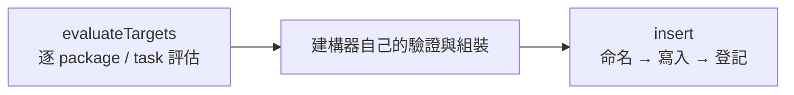

# dynamicPlan — 動態計畫插入 pipeline

> 原始碼：`src/modules/strikePlanner/dynamicPlan.lua`

**職責**：air 與 ground 共用的「評估目標 → 命名 → 寫入計畫 → 登記名稱」路徑。型別差異由 [operationType](operationType.md) 的 descriptor 提供，本模組不分支在 `"air"` / `"ground"` 字串上。

---

## 概述

[atoBuilder](atoBuilder.md) 與 [fsemBuilder](fsemBuilder.md) 中間那段真正不同的工作（機隊驗證、發射單元驗證）留在各自模組；前後兩段一樣的工作收進這裡：



---

## `evaluateTargets`

`DynamicPlan.evaluateTargets(config, saveData, contacts, operationType, template)` 依 descriptor 的 `templateField`（`packages` 或 `fireSupportTasks`）走訪 template，對每一筆呼叫 `TargetingProcess.processTargets(config, saveData, contacts, entry.target, template.isFirstWave)`。目標數達到 `entry.target.minTargetCount` 的那筆才進結果。

`processTargets` 的第二個回傳值是追蹤請求。`evaluateTargets` 把**每一筆** entry 的請求收齊（未達門檻的也算），迴圈結束後呼叫一次 `Recon.trackTargets(saveData.red.recon, requests)`。recon queue 的寫入因此只發生在 [recon](recon.md)。

回傳兩個值：

| 回傳 | 內容 |
|---|---|
| `targetsByIndex` | 以 template 陣列索引為 key 的目標清單，只有達標的索引存在 |
| `qualifiedCount` | 達標筆數；建構器以 `qualifiedCount == 0` 判定 `no_valid_packages` / `insufficient_targets` |

以索引為 key 是刻意的：建構器隨後用同一份陣列組裝 package / FST，索引穩定對齊；若以名稱為 key，同名 FST 會互相覆蓋。

---

## `insert`

`DynamicPlan.add(saveData, operationType, templateName, reconType, buildPlan)` 一次做完三件事，回傳生成的名稱：

1. 產生唯一名稱，同時檢查 `generatedOperations[registryKey]` 與目標計畫表，兩邊都沒撞名才用
2. 呼叫 `buildPlan(planName)` 拿到 wave / matrix，寫進 `descriptor.resolvePlan(saveData)[planName]`
3. `generatedOperations[registryKey][planName] = true`

「生成的名字一定被登記」這個不變式只住在這個函式裡。以前命名與登記是兩個獨立呼叫，漏掉任一半名字唯一性就靜靜壞掉。

### 名稱格式

```text
<templateName>/DYN-<SOURCE>-<NN>
```

| 片段 | 來源 |
|---|---|
| `templateName` | 原樣保留，含波次號，讓下游的 `/N` 解析不受影響 |
| `SOURCE` | `constants.RECON_SOURCE_ABBREVIATIONS[reconType]`，查無則 `string.upper(reconType)` |
| `NN` | 從 `01` 起遞增，跳過已登記或已存在於計畫表的名稱 |

範例：`AIR/STRIKE/AB/W/2` + `satellite` → `AIR/STRIKE/AB/W/2/DYN-SAT-01`；同 template 第二次插入得到 `-02`。

`generatedOperations` 缺省時會補成 `{ air = {}, ground = {} }`，舊存檔可直接載入。

---

## Public API

| 函數 | 參數 | 回傳 |
|---|---|---|
| `evaluateTargets(config, saveData, contacts, operationType, template)` | `SBJ__Config`, `SBJ__SaveData`, `CMO__Contact[]`, `SBJ__OperationType`, `SBJ__WaveTemplate\|SBJ__FireSupportExecutionMatrixTemplate` | `table<integer, string[]>`, `integer` |
| `insert(saveData, operationType, templateName, reconType, buildPlan)` | `SBJ__SaveData`, `SBJ__OperationType`, `string`, `string`, `fun(planName: string): table` | `string` |

未知的 `operationType` 兩個函式都會 `error()`，這是程式錯誤，不是執行期狀況。

---

## 寫入副作用

| 路徑 | 行為 |
|---|---|
| `saveData.red.air.airTaskingOrder[name]` 或 `saveData.red.ground.fireSupportPlan[name]` | `insert` 寫入 `buildPlan` 的回傳值，由 descriptor 決定哪一張表 |
| `saveData.red.dynamicOperations.generatedOperations[air\|ground][name]` | `insert` 登記 |

不碰遊戲狀態；目標評估透過 [targetingProcess](targetingProcess.md) 讀 contacts。

---

## 相關模組

- [operationType](operationType.md) — 提供 `templateField`、`registryKey`、`resolvePlan`
- [atoBuilder](atoBuilder.md) — 用 `evaluateTargets` 篩 package、用 `insert` 寫 Wave
- [fsemBuilder](fsemBuilder.md) — 用 `evaluateTargets` 篩 FST、用 `insert` 寫 FSEM
- [targetingProcess](targetingProcess.md) — 目標評估本體
- [系統架構](README.md)
