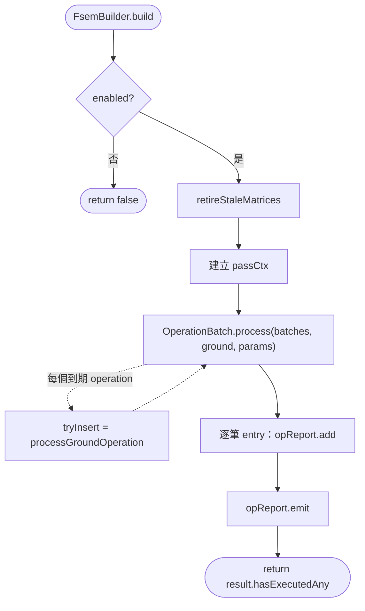

# fsemBuilder — 動態 FSEM 生成

> 原始碼：`src/modules/strikePlanner/fsemBuilder.lua`

**職責**：退役過期的 active FSEM，並在偵察觸發的觀察窗內把 ground operation 轉成 FSEM 寫入 `saveData.red.ground.fireSupportPlan`。

---

## 概述

`fsemBuilder` 是 Strike Planner 的動態地面打擊生成層，對應空中側的 [atoBuilder](atoBuilder.md)。它不發射任何武器，只消費 `saveData.red.dynamicOperations.reconTriggeredOperationBatches` 中尚未執行的 `ground` operation，依即時 contacts 與 FSEM template 產出 `SBJ__FireSupportExecutionMatrix`，交由 [fireSupportPlan](fireSupportPlan.md) 在後續 tick 執行。

模組以觀察窗控制重試。operation 在窗內每個 tick 重新評估目標與發射單元；只是目標不足或發射單元暫時被佔用時保持 pending，等下一個 tick 再試。窗外逾時或遇到終止性失敗則把 operation 從 batch 移除。`operation.executed` 因此只代表「FSEM 真的插進計畫了」，不代表任務發射過。

除了生成之外，模組還負責過期 FSEM 的退役。FSEM 被插入後不保證會發射：目標 GUID 可能在等待期間失效，`AttackManager.attackContacts()` 回傳 `0`，`task.isFinished` 永遠不會被設為 true，matrix 也永遠不會完成，其發射旅被無限期佔用。`retireStaleMatrices()` 為這個情況提供超時處理。

---

## 主要機制

### 主流程



`enabled` 為否是唯一不建立 report 的出口；其餘路徑（包含「沒有任何 ground operation」）都會走到 `emit()`，退役列因此永遠不會被吞掉。篩選 operation、判定觀察窗、標記 executed、移除放棄的 operation，全在 [operationBatch](operationBatch.md) 內完成；本模組只交出 `RETRYABLE_REASON` 與 `tryInsert`，拿回 entries 後餵 report。

觀察窗與 atoBuilder 共用同一份 operationBatch 實作與同一個 `observationWindowSec`；`pre_trigger` 靜默略過，`tryInsert` 不會被呼叫，也不產生任何 log 列。

### 為什麼退役排在建立 passCtx 之前

`retireStaleMatrices()` 只在 `enabled` 檢查之後執行，**早於**任何 pending operation 被看到。

卡住的 FSEM 不會有任何東西幫它解鎖：它的任務永遠不會被標記完成，沒有其他流程會釋放它的發射單元。若把退役綁在「有 operation 等著處理」的前提下，安靜的 tick 就不退役，那些旅會被永久佔用——而 FSEM 卡住的典型情境（目標全滅、沒有新偵察）恰好就是安靜的 tick。

`passCtx` 的建立必須排在退役**之後**。被退役 matrix 釋放出來的發射單元要能在同一個 tick 內立刻被新的 operation 重新分配；若先建立 assignment map，那些單元在本 tick 仍會被判定為已分配。

### 為什麼快取只活一次 execute()

`passCtx`（`SBJ__FsemPassContext`）逐層傳進 `processGroundOperation()` → `createAndInsertMatrixFromTemplate()` → `buildExecutableTasks()` → `filterAvailableLaunchers()` → `evaluateLauncherReadiness()`，內含兩個只活一趟的快取：

| 欄位 | 取代的行為 |
|---|---|
| `launcherCache` | 每次驗證都直接呼叫 `GameApi.ScenEdit_GetUnit()`。該 API 對名稱查詢固定是兩次 CMO round-trip（先 `{guid=}` 再 `{unitname=}`），查無單位時還會 `error()` 並輸出一整段 stack trace。`false` 是刻意的 negative sentinel：`nil` 表示尚未查過，`false` 表示這趟查過且不存在，讓已被摧毀的發射旅在同一 tick 只噴一筆 error。 |
| `assignedLauncherNames` | 每個 operation 各自重掃一次整份 `fireSupportPlan`（該表只增不減）。改成整趟只掃一次，後續 `setLaunchersAssigned()` 就地增量寫入同一張表，同 tick 內的跨 operation 防重與「先寫 FSP 再登記 generated operation」的既有防護重疊而不衝突。 |

快取的生命週期**剛好是一次 `execute()`**：本模組執行期間 CMO 模擬時間不前進，單位被摧毀、狀態轉換、彈量變化都發生在兩次 tick 之間，每趟重建剛好涵蓋。

因此兩者**必須是 `execute()` 的區域變數**。打包後模組 table 會變成全域，提到 module scope 會讓快取跨 tick 存活，把早已不存在或已被別的 FSEM 佔用的單位當成可用。`fsemBuilder_spec` 的「should look up each launcher at most once per pass across FSTs」與「should share the launcher cache and assignment map across operations in one pass」兩條測試釘住這個行為。

### 為什麼先 GetUnit 再比對 state

`MissileSystem.evaluateReadiness()` 刻意維持「先查 CMO unit，再比對 `state`」的順序，而不是把便宜的 state 比較提前。

把 state 提前雖然省一次查詢，但已被摧毀且狀態非 `HIDE` 的單位會從 `unit_not_found` 變成 `bad_state`——日誌上就丟失了「這個旅已經沒了」的訊號，只剩一個看起來像暫時性問題的狀態碼。重複查詢的成本改由 `launcherCache` 消除。

### Launcher 驗證與日誌欄位

`filterAvailableLaunchers()` 逐一驗證 `taskTemplate.launchers`，把結果累計進 `SBJ__LauncherReadinessCount`，`formatReadinessCount()` 再把非零計數展開成 log 欄位。零值不輸出，全零時只輸出 `launchers=none`。

看到這些欄位時的判讀方向：

| Log 欄位 | 代表的問題 |
|---|---|
| `launcherAvailable` | 通過驗證、已寫入 FST 的數量。 |
| `launcherAssigned` | 被其他 active FSEM 或本趟先前的 FST 佔用；等前一個 FSEM 完成或退役即可。 |
| `launcherNotFound` | CMO 裡已無此單位，通常是被摧毀。template 的發射單元名單需要檢討。 |
| `launcherContextNotFound` | `saveData.red.ground.missileSystemTypes[<missileSystemType>].launchers` 缺這個 key；多半是 template 名稱與 saveData 初始化不一致。 |
| `launcherBadState` | 單位不在 `HIDE`，正在部署、移動或再裝填中。 |
| `launcherLowAmmo` | 彈量低於該單元 context 的 `ammoThreshold`。 |

`SBJ__Launcher.name` 是 schema 的必填不變條件，因此沒有獨立的 missing name 狀態。萬一 template 破壞這個條件，`MissileSystem.evaluateReadiness()` 會以 nil key 讀取 runtime state 而得到 nil（Lua 只有寫入 nil key 才會拋錯），該筆歸入 `launcherContextNotFound` 並被排除，不會流入任何分配表。

### 為什麼目標以 FST 索引為 key

`DynamicPlan.evaluateTargets()` 回傳的 `targetsByTaskIndex` 以 FST 的陣列索引為 key，而非 FST 名稱。

`DynamicPlan.evaluateTargets()` 與 `buildExecutableTasks()` 走同一份 `fireSupportTasks` 陣列，索引因此能穩定對齊（`Utils.deepCopy` 逐 key 複製，整數索引原樣保留）。若以名稱為 key，同名 FST 會互相覆蓋。

只有目標數達到 `taskTemplate.target.minTargetCount` 的 FST 會進入這張表。`targetQualifiedTaskCount` 為零時 `processGroundOperation()` 直接回傳 `insufficient_targets`，不進入發射單元驗證——這也是該分支要帶 `launchers=none` 而非完整計數的原因。

### 為什麼生成的 FSEM 把 strikeInterval 歸零

`buildMatrix()` 一律把 `matrix.strikeInterval` 設為 `0`，即使 template 帶了非零值。

間隔在生成當下就被 `buildTaskStartTime()` 吃掉，烘進每個 FST 的 `startTime`（`matrixStartTime + slotIndex * strikeInterval`，`slotIndex` 從 1 起算，因此第一個 FST 落在 `currentTime + strikeInterval`）。`fireSupportPlan` 執行時只讀 `task.startTime`，完全不看 `matrix.strikeInterval`，留著非零值只會讓存檔看起來像還有待套用的間隔。

`slotIndex` 對每個**目標達標**的 FST 遞增，不論它後來是否因為缺發射單元而被丟棄。被丟棄的 FST 會在時序上留下一個空檔，其餘 FST 的相對間隔維持 template 的順序不變。

實務上這條路徑目前是惰性的：[operationScheduler](operationScheduler.md) 對 ground operation 的 `resolveDefaultInterval` 回傳 `0`（地面 FSEM 採 TOT 導向，與空中 wave 的錯開發射相反），所以動態生成的 FSEM 內所有 FST 共用同一個 `startTime`。`buildTaskStartTime()` 是保留給 template 明確指定間隔時使用的通用機制。

### 為什麼失敗要移除 operation，而不是標記 executed

終止性失敗由 `OperationBatch.process()` 把 operation 從 batch 陣列移除，而不是設 `executed = true`。本模組只透過 `RETRYABLE_REASON` 告訴它哪些 reason 該留下。

`executed` 的語義是「計畫已插入」。若失敗也標記 executed，[operationScheduler](operationScheduler.md) 會認為這一波已經打完並推進波次計數，同一波再也不會被重開；移除則讓 batch 在下次偵察完成時重新產生同一波。`insufficient_targets` 與 `no_available_launchers` 屬於可重試原因，兩者都不動 batch。

未列在 `RETRYABLE_REASON` 的 reason（包含未來新增而漏登記的）一律落到移除分支。這是刻意的預設值：漏登記會造成一次多餘的重排，比讓 operation 卡在窗內每 tick 重試到逾時要安全。

### 過期 FSEM 退役

| 項目 | 行為 |
|---|---|
| 判定條件 | `matrix.isActivated and not matrix.isFinished`，且 `currentTime - matrix.createdAt > config.red.recon.fsemStaleAfterSec`。缺 `createdAt` 的舊存檔永不過期。 |
| 退役動作 | 設 `matrix.isFinished = true`。matrix 保留在 FSP 內供命名唯一性檢查，不刪除。 |
| 單元處置 | 掃描未完成的 FST，呼叫 `MissileSystem.abortFireTask(...)`：非 SAM 且已離開隱蔽區（`STATIC`／`REPOSITIONING`）的發射單元啟動 stow 倒數，由 [missileSystem](../missileSystem/README.md) 的 cycle 送回隱蔽區。已有倒數的單元保留原時戳。 |
| 日誌 | 每退役一個 matrix 輸出一列 `[WARN] matrix=<name> reason=fsem_stale_timeout ageSec=<age>`。 |

`isFinished = true` 同時達成兩件事：釋放發射單元回可分配池，並讓 `FireSupportPlan.strike` 停止指揮這些單位，避免與 stow 倒數形成重複指令。

`STOW_ON_RETIRE_STATE` 只收 `STATIC` 與 `REPOSITIONING`——已部署到（或正前往）發射點卻始終沒發射的單位。`HIDE` 本就在隱蔽區且可立即再分配，`RELOAD` 位於再裝填流程中，該流程結尾已包含返回隱蔽區的動作，兩者都不需要另外的倒數。

SAM 任務依慣例排除在 stow 之外。

### 結果分類與 log

`processGroundOperation()` 回傳 `SBJ__OperationProcessResult`；觀察窗逾時則由 [operationBatch](operationBatch.md) 直接組出同型結果，讓兩條路徑共用同一個輸出流程。log tag 由產生分支直接寫進結果，不經過 reason → tag 對照表。`state=observing` 與 `state=abandoned` 由 `OperationBatch.process()` 在決定保留或移除的同一個分支加上，控制流程與 log 欄位共用一組判斷。

| reason | Tag | operation 去向 | 說明 |
|---|---|---|---|
| `nil`（成功） | `[OK]` | 標記 executed | FSEM 已插入 FSP。 |
| `insufficient_targets` | `[SKIP]` | 保留重試 | 沒有 FST 達到 `minTargetCount`，附 `state=observing`、`launchers=none`。 |
| `no_available_launchers` | `[SKIP]` | 保留重試 | 有目標但每個達標 FST 都缺發射單元，附 `state=observing` 與完整計數。 |
| `observation_window_expired` | `[WARN]` | 移除 | 觀察窗逾時，附 `state=abandoned`，不帶計數欄位。 |
| `no_valid_tasks` | `[FAIL]` | 移除 | 終止性防禦分支，見下。 |
| `fsem_stale_timeout` | `[WARN]` | 不適用 | 由 `retireStaleMatrices()` 產生，帶 `matrix=` 與 `ageSec=`，與 operation 無關。 |

`no_valid_tasks` 在目前的控制流下不可達：`DynamicPlan.evaluateTargets()` 與 `buildExecutableTasks()` 走同一份 FST 陣列，任何目標達標的 FST 若組不出任務，必然是因為缺發射單元而累加 `launcherBlockedTaskCount`，因此會落在 `no_available_launchers`。它作為終止性 fallback 保留，讓「有目標卻完全組不出任務」這類未來的新失敗模式有一個 FAIL 出口，而不會被誤判成可重試。也因為不可達，它沒有測試覆蓋。

`NO_LAUNCHERS_FIELDS` 是 `insufficient_targets` 與 `formatReadinessCount()` 共用的同一份唯讀 table。安全的前提是 `LogFormat.merge()` 回傳新 table，`fields.reason = ...` 改的是合併結果而非這份共用常數。

`build()` 建立單一 `LogFormat.report(constants.TAGS.DYNAMIC_OPERATIONS, "dynamicGroundOperations", "Process operations")`，退役列先進去，`OperationBatch.process()` 回傳的 entries 逐筆 `add` 後 `emit()`；格式化、info／error 分流與空輸出抑制全部由 report 負責（`src/utils/logFormat.lua`）。

```text
[DYNAMIC_OPERATIONS] dynamicGroundOperations: Process operations | total=2 ok=1 skip=1
  [OK]   operation=GND/STRIKE/C2/N/1 batch="satellite@2026-02-14 00:00:00" launcherAvailable=2
  [SKIP] operation=GND/STRIKE/INFRA/ALL/1 batch="uav@2026-02-14 00:10:00" state=observing launchers=none reason=insufficient_targets
```

---

## 型別與寫入副作用

本模組操作的型別（`SBJ__FireSupportExecutionMatrixTemplate`、`SBJ__FireSupportExecutionMatrix`、`SBJ__FireSupportTaskTemplate`、`SBJ__FireSupportTask`、`SBJ__Launcher`、`SBJ__LauncherState`、`SBJ__BatchedOperation`、`SBJ__OperationProcessResult`、`SBJ__LauncherReadinessCount`、`SBJ__FsemPassContext`）欄位定義一律以 `src/core/schema.lua` 為準。

| 路徑或 API | 行為 |
|---|---|
| `saveData.red.ground.fireSupportPlan[matrix.name]` | 成功時透過 `DynamicPlan.add()` 寫入新的 `SBJ__FireSupportExecutionMatrix`。 |
| `saveData.red.ground.fireSupportPlan[*].isFinished` | 過期 FSEM 退役時設為 true。 |
| `saveData.red.ground.missileSystemTypes[<missileSystemType>].launchers[*].stowStartTime` | 退役時為部署中的非 SAM 單元啟動 stow 倒數。 |
| `saveData.red.dynamicOperations.generatedOperations.ground[matrix.name]` | 同一次 `DynamicPlan.add()` 呼叫內登記。 |
| `operation.executed`、`operationBatch.operations`、`operationBatch.executed` | 本模組不寫；由 [operationBatch](operationBatch.md) 依 `tryInsert` 的 outcome 更新。 |

本模組**不寫任何遊戲狀態**，只透過 `GameApi.ScenEdit_CurrentTime()` 取時間、`GameApi.ScenEdit_GetUnit()` 讀發射單元。

---

## Public API

| 函數 | 參數 | 回傳 | 說明 |
|---|---|---|---|
| `FsemBuilder.build(config, saveData, contacts)` | `SBJ__Config`, `SBJ__SaveData`, `CMO__Contact[]` | `boolean` | 退役過期 FSEM，再處理落在觀察窗內的未執行 ground operations；至少成功插入一個 FSEM 時回傳 `true`。退役本身不影響回傳值。 |

### 呼叫者與觸發方式

| 呼叫者 | 觸發 |
|---|---|
| `StrikePlanner.process()` | `src/modules/strikePlanner/init.lua`；`saveData.red.dynamicOperations.enabled` 時在 `AtoBuilder.build` 之前呼叫本模組，不檢查回傳值。 |
| `src/scripts/china/scheduledStrikePlanner.lua` | 定時腳本呼叫 `StrikePlanner.process`。 |
| [fireSupportPlan](fireSupportPlan.md) | 不呼叫本模組；它在後續 tick 執行本模組插入的 active FSEM。 |

---

## config 與 constants 參考

本模組直接讀取：

| 類型 | 路徑 | 使用方式 |
|---|---|---|
| `config` | `config.red.recon.observationWindowSec` | 動態作戰觀察窗長度，與 [atoBuilder](atoBuilder.md) 共用；目前配置為 `30 * 60` 秒。 |
| `config` | `config.red.recon.fsemStaleAfterSec` | FSEM 退役時限，目前配置為 `30 * 60` 秒，刻意與觀察窗對齊（競爭中的 operation 最多等 30 分鐘）並與 `config.red.ground.missileSystemTypes.srbm.contactAge` 一致（更舊的目標資料本來就過期）。 |
| `constants` | `constants.MISSILE_UNIT_POSTURE.HIDE` | 發射單元必須處於此狀態才可被選用。 |
| `constants` | `constants.MISSILE_UNIT_POSTURE.STATIC`／`REPOSITIONING` | 構成 `STOW_ON_RETIRE_STATE`。 |
| `constants` | `constants.DATE_FORMAT` | FST `startTime` 的 UTC 格式。 |
| `constants` | `constants.TAGS.DYNAMIC_OPERATIONS` | report 的 log tag。 |

`config` 也被原樣轉交 [targetingProcess](targetingProcess.md) 消費。以下設定不由本模組讀取，但決定它產出什麼：`config.red.fireSupportTaskTemplates`（[operationScheduler](operationScheduler.md) 據此組出攜帶 FST 清單的 `SBJ__FireSupportExecutionMatrixTemplate`）。

---

## 相依模組

| 模組 | 用途 |
|---|---|
| `src.modules.strikePlanner.operationBatch` | `run()` 驅動每個 tick：篩選 ground operations、判定觀察窗、依 outcome 標記或移除 operation。 |
| `src.modules.strikePlanner.dynamicPlan` | `evaluateTargets()` 依 FST target template 取得可打擊目標；`insert()` 命名、寫入 `fireSupportPlan` 並登記 generated operation。 |
| `src.modules.missileSystem.init` | `evaluateReadiness()` 判斷發射單元能否派任務（runtime state、存在、`HIDE`、彈量），回傳值即日誌計數鍵；`abortFireTask()` 退役 FSEM 時收車。 |
| `src.utils.gameApi` | `ScenEdit_CurrentTime()` 取目前時間、`ScenEdit_GetUnit()` 驗證發射單元是否仍存在。 |
| `src.utils.utils` | `deepCopy()`，用於 matrix 與 FST template 拷貝。 |
| `src.utils.logFormat` | `report()` 收集並輸出處理摘要。 |
| `src.core.constants` | 提供飛彈系統狀態、日期格式與 log tag。 |

---

## 相關模組

- [fireSupportPlan](fireSupportPlan.md) — 執行本模組插入的 FSEM。
- [operationBatch](operationBatch.md) — recon-triggered operation batch 的生命週期，驅動本模組的 `tryInsert`。
- [dynamicPlan](dynamicPlan.md) — 目標評估與計畫插入 pipeline。
- [targetingProcess](targetingProcess.md) — 依 target template 與 contacts 解析可打擊目標（經 dynamicPlan 呼叫）。
- [operationScheduler](operationScheduler.md) — 偵察完成後建立 ground operation template。
- [atoBuilder](atoBuilder.md) — 對應的動態空中 Wave 生成流程。
- [missileSystem](../missileSystem/README.md) — 發射單元狀態、彈量與 stow／隱蔽循環。
- [Strike Planner 系統架構](README.md)
