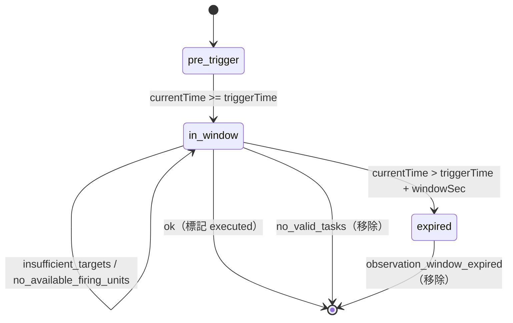
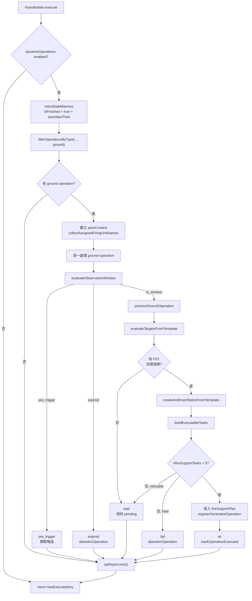

# fsemBuilder — 動態 FSEM 生成

> 原始碼：`src/modules/strikePlanner/fsemBuilder.lua`

**職責**：在偵察觸發後的觀察窗內評估 ground operations，當目標與發射單元可用時產生 FSEM 並插入 `saveData.c.ground.fireSupportPlan`。

---

## 概述

`fsemBuilder` 是 Strike Planner 的動態地面打擊生成層。它不直接發射武器，而是消費 `saveData.c.dynamicOperations.reconTriggeredOperationBatches` 中尚未執行的 `ground` operation，依即時 contacts 與 FSEM template 建立新的 `SBJ__FireSupportExecutionMatrix`。

模組以 observation window 控制重試行為。當情境時間進入 `operationBatch.time + operationBatch.delay` 到 `config.c.recon.observationWindowSec` 的區間後，operation 會每個 tick 重新評估目標與 firing units；若只是目標不足或發射單元暫不可用，operation 會保持 pending。

成功建立 FSEM 時，模組會寫入 `saveData.c.ground.fireSupportPlan`，並透過 [dynamicState](dynamicState.md) 登記 generated ground operation 名稱。無可用 FST、觀察窗逾時或未知失敗則會把 operation 從 batch 移除，既避免無限重試，也讓 [operationScheduler](operationScheduler.md) 在下次偵察完成時重開同一波。`executed` 因此只代表「FSEM 真的插進計畫了」。

模組同時負責過期 FSEM 的退役。`retireStaleMatrices()` 在 `enabled` 檢查之後、pending operation 的提前返回之前執行，因此即使當下沒有任何待處理 operation 也會執行，避免發射旅被永遠卡在已無目標的 FSEM 上。

---

## 相依與角色

| 相依 | 用途 |
|---|---|
| `src.modules.strikePlanner.targetingProcess` | 依 FST target template 與 contacts 產生可打擊目標 GUID 清單。 |
| `src.modules.strikePlanner.dynamicState` | 篩選 ground operations、判定觀察窗狀態、產生唯一 FSEM 名稱、登記 generated operation、標記或移除 operation。 |
| `src.modules.missileSystem.init` | 透過 `isLowAmmo()` 檢查發射單元彈量是否低於門檻。 |
| `src.utils.gameApi` | 取得目前情境時間、查詢實際 CMO unit。 |
| `src.utils.utils` | `deepCopy()` template、解析偵察時間字串。 |
| `src.utils.logger` / `src.utils.logFormat` | 輸出動態地面作戰處理摘要。 |
| `src.core.constants` | 使用 `MISSILE_SYSTEM_STATE.HIDE`／`STATIC`／`REPOSITIONING` 與 `TAGS.DYNAMIC_OPERATIONS`。 |

---

## Local Constants

| 名稱 | 類型 | 說明 |
|---|---|---|
| `FIRING_UNIT_STATUS` | enum table | firing unit 驗證狀態，value 採 lower snake case。 |
| `FIRING_UNIT_STATUS_ORDER` | array table | 狀態的唯一列舉來源，同時決定 counter 的 key 集合與 log 欄位順序。 |
| `FIRING_UNIT_STATUS_LOG_FIELD` | map table | 將 firing unit 狀態映射成 log 欄位。 |
| `PROCESS_REASON` | enum table | 流程失敗原因：`insufficient_targets`、`no_available_firing_units`、`no_valid_tasks`、`observation_window_expired`。value 同時是 log 的 `reason=` 內容。 |
| `RETRYABLE_REASON` | set table | 可重試 reason，`execute()` 保留 operation 在 batch 內並附加 `state=observing`。 |
| `LOG_SCOPE`／`LOG_ACTION` | string | report 的 scope `dynamicGroundOperations` 與 action `Process operations`。 |
| `NO_FIRING_UNITS_FIELDS` | table | 沒有 firing unit 計數可回報時的替代欄位 `firingUnits=none`，由 `processGroundOperation()` 與 `formatFiringUnitStatusCounter()` 共用同一份唯讀 table。 |
| `STOW_ON_RETIRE_STATE` | set table | 退役時需要啟動 stow 倒數的狀態集合：`STATIC` 與 `REPOSITIONING`。 |

型別 `SBJ__FiringUnitStatusCounter` 與 `SBJ__FsemPassContext` 定義於 `src/core/schema.lua`，不在本模組內宣告。

觀察窗狀態常數 `OBSERVATION_STATE` 與判定函數改由 [dynamicState](dynamicState.md) 提供，與 [atoBuilder](atoBuilder.md) 共用同一份實作。

---

## 主要機制

### 觀察窗處理

`DynamicState.evaluateObservationWindow(currentTime, operationBatch, windowSec)` 以 `operationBatch.time + operationBatch.delay` 計算觸發時間。`pre_trigger` 靜默略過；`in_window` 會嘗試建立 FSEM；`expired` 會呼叫 `abandonOperation(operationBatch, operation)` 把 operation 移出 batch，並以 `reason = observation_window_expired`、`state = abandoned` 輸出 `[WARN]`。



### 目標評估

`evaluateTargetsFromTemplate()` 逐一處理 `matrixTemplate.fireSupportTasks`，每個 FST 呼叫 `TargetingProcess.processTargets(config, saveData, contacts, taskTemplate.target, matrixTemplate.isFirstWave)`。只有目標數量達到 `taskTemplate.target.minTargetCount` 的 FST 會進入 `targetsByTaskIndex`。

key 採 FST 陣列索引而非 FST 名稱：`evaluateTargetsFromTemplate()` 與 `buildExecutableTasks()` 走同一份 `fireSupportTasks` 順序，索引因此能穩定對齊；若以名稱為 key，同名 FST 會互相覆蓋。

若沒有任何 FST 達標，`processGroundOperation()` 回傳 `PROCESS_REASON.INSUFFICIENT_TARGETS`。這是可重試原因，`execute()` 不會標記 operation executed，而是讓它留在觀察窗內等待下一個 tick。

### Firing Unit 驗證

`selectAvailableFiringUnits()` 直接接收完整 `taskTemplate`，使用 `taskTemplate.missileSystem` 與 `taskTemplate.firingUnits` 解析 runtime context。lookup 由 `getFiringUnitContext()` 處理，驗證則由 `validateFiringUnitStatus()` 專注檢查 assigned、CMO unit、state 與 ammo。

| 狀態碼 | 觸發條件 | Log 欄位 |
|---|---|---|
| `available` | CMO unit 存在、context 存在、狀態為 `HIDE`、彈量足夠 | `firingAvailable` |
| `assigned` | 名稱已存在於 active FSEM 或本輪已分配清單 | `firingAssigned` |
| `unit_not_found` | `GameApi.ScenEdit_GetUnit(firingUnitName)` 回傳 nil | `firingUnitNotFound` |
| `context_not_found` | `saveData.c.ground[string.lower(missileSystem)].firingUnits[firingUnitName]` 不存在 | `firingContextNotFound` |
| `bad_state` | firing unit context 的 `state ~= constants.MISSILE_SYSTEM_STATE.HIDE` | `firingBadState` |
| `low_ammo` | `MissileSystem.isLowAmmo(actualUnit, ammoThreshold, weaponDBID)` 回傳 true | `firingLowAmmo` |

`SBJ__FiringUnit.name` 為 schema 必填欄位，因此沒有獨立的 missing name 狀態。萬一 template 破壞這個不變條件，`getFiringUnitContext()` 會以 nil key 讀取而回傳 nil（Lua 只有寫入 nil key 才會拋錯），該筆歸入 `context_not_found` 並被排除，不會流入任何分配表。

### 為什麼快取只活一次 execute()

`execute()` 在 `retireStaleMatrices()` 之後建立 `passContext`，內含兩個只活一趟的快取，逐層傳進 `processGroundOperation()` → `createAndInsertMatrixFromTemplate()` → `buildExecutableTasks()` → `selectAvailableFiringUnits()` → `validateFiringUnitStatus()`：

| 欄位 | 內容 | 取代的行為 |
|---|---|---|
| `firingUnitCache` | `firingUnitName -> CMO__Unit \| false` | 每次驗證都直接呼叫 `GameApi.ScenEdit_GetUnit()`。該 API 對名稱查詢固定是兩次 CMO round-trip（先 `{guid=}` 再 `{unitname=}`），查無單位時還會 `error()` 並輸出一整段 stack trace。`false` 是刻意的 negative sentinel：`nil` 表示尚未查過，`false` 表示這趟查過且不存在，讓已被摧毀的發射旅在同一 tick 只噴一筆 error。 |
| `assignedFiringUnitNames` | `collectAssignedFiringUnitNames(saveData)` 的結果 | 每個 operation 各自重掃一次整份 `fireSupportPlan`（該表只增不減）。現在整趟只掃一次，後續的 `markFiringUnitsAssigned()` 就地增量寫入同一張表，同 tick 內的跨 operation 防重與「先寫 FSP 再登記 generated operation」的既有防護重疊而不衝突。 |

seeding 順序有意義：`assignedFiringUnitNames` 必須在 `retireStaleMatrices()` **之後**才建立，否則被退役 matrix 釋放出來的發射單元在本 tick 仍會被視為已分配。

快取的生命週期**剛好是一次 `execute()`**：本模組執行期間 CMO 模擬時間不前進，單位被摧毀、狀態轉換、彈量變化都發生在兩次 tick 之間，每趟重建剛好涵蓋。因此兩者**必須是 `execute()` 的區域變數**——打包後模組 table 會變全域，提到 module scope 會讓快取跨 tick 存活，把早已不存在的單位當成可用。`fsemBuilder_spec` 的「should look up each firing unit at most once per pass across FSTs」與「should share the firing unit cache and assignment map across operations in one pass」兩條測試釘住這個行為。

檢查順序刻意維持「先 `GetUnit` 再 `state`」而非把便宜的 state 比較提前：把 state 提前雖然更省，但已被摧毀且非 `HIDE` 的單位會從 `unit_not_found` 變成 `bad_state`，丟失「這個旅已經沒了」的日誌訊號。重複成本改由快取消除。

### FSEM 組裝

`buildExecutableTasks()` 是 FST 建構的 orchestration 層。它依通過目標評估的 FST 選出可用 firing units（已分配名稱由 `passContext` 提供），最後以 `Utils.deepCopy(taskTemplate)` 複製 template 並補上 runtime 欄位：`firingUnits`、`startTime`、`isFinished = false`、`target.list = targets`。

FSEM 名稱由 `DynamicState.generateUniqueGroundOperationName()` 生成，會同時檢查 `generatedOperations.ground` 與既有 `fireSupportPlan`。`createAndInsertMatrixFromTemplate()` 隨即以 `buildMatrix()` 組出 matrix 並直接寫入 `saveData.c.ground.fireSupportPlan[matrix.name]`，並呼叫 `registerGeneratedOperation("ground", matrix.name, saveData)`。matrix 上的 `createdAt` 記錄建立當下的情境時間，供後續退役判定使用。

### 過期 FSEM 退役

FSEM 建立後不保證一定會發射：目標 GUID 可能在等待期間失效，`AttackManager.attackContacts()` 回傳 `0`，`task.isFinished` 因此永遠不會被設為 true，matrix 也就永遠不會完成，其發射旅被無限期佔用。`retireStaleMatrices()` 為這個情況提供超時處理。

| 項目 | 行為 |
|---|---|
| 執行時機 | `enabled` 檢查通過後立即執行，**早於** pending operation 的提前返回；沒有待處理 operation 的 tick 也照樣退役。 |
| 判定條件 | `matrix.isActivated and not matrix.isFinished`，且 `currentTime - matrix.createdAt > config.c.recon.fsemStaleAfterSec`。缺 `createdAt` 的舊存檔永不過期。 |
| 退役動作 | 設 `matrix.isFinished = true`。matrix 保留在 FSP 中供命名唯一性檢查，不刪除。 |
| 單元處置 | 逐一掃描未完成的 FST，對非 SAM 且 `state` 落在 `STOW_ON_RETIRE_STATE`（`STATIC`／`REPOSITIONING`）的發射單元蓋上 `stowStartTime`，由 [missileSystem](../missileSystem/README.md) 的 cycle 送回隱蔽區。已有倒數的單元保留原時戳。 |
| 日誌 | 每退役一個 matrix 輸出一列 `[WARN] matrix=<name> reason=fsem_stale_timeout ageSec=<age>`。 |

`HIDE` 與 `RELOAD` 刻意排除：前者本就在隱蔽區且可立即再分配，後者位於再裝填流程中，該流程結尾已包含返回隱蔽區的動作。

退役先於 `passContext` 建立的順序有意義：被釋放的發射單元必須在同一個 tick 內就能被新的 operation 重新分配。

### 日誌輸出

`processGroundOperation()` 回傳 `SBJ__OperationProcessResult`（`success`、`tag`、`reason`、`fields`）；觀察窗逾時則由 `execute()` 直接組出 `tag = WARN`、`reason = observation_window_expired` 的同型結果，讓兩條路徑走同一個輸出流程。

log tag 由產生分支直接寫進結果，不再經過 reason → tag 對照表。尚未進入 firing unit 驗證的分支自行決定要不要帶計數欄位：`observation_window_expired` 不帶（log 行只有 `reason=` 與 `state=`），`insufficient_targets` 帶 `firingUnits=none`，其餘帶完整 firing unit 計數。`state=observing` 與 `state=abandoned` 由 `execute()` 在決定保留或移除的同一個分支加上，控制流程與 log 欄位共用一組判斷。

`execute()` 建立單一 `LogFormat.report(constants.TAGS.DYNAMIC_OPERATIONS, LOG_SCOPE, LOG_ACTION)`，逐筆 `add` 後 `emit()`；格式化、info／error 分流與空輸出抑制全部由 report 負責。退役列與 operation 列共用同一份 report，因此沒有 pending operation 的提前返回路徑也必須呼叫 `emit()`。詳見 [logFormat](../logFormat.md)。

| reason | Log tag | Logger | operation 去向 | 說明 |
|---|---|---|:-:|---|
| `nil`（成功） | `[OK]` | `Logger.log(constants.TAGS.DYNAMIC_OPERATIONS, ...)` | 標記 executed | FSEM 已插入 FSP。 |
| `insufficient_targets`／`no_available_firing_units` | `[SKIP]` | `Logger.log(constants.TAGS.DYNAMIC_OPERATIONS, ...)` | 保留重試 | 留在觀察窗內，附 `state=observing`。 |
| `observation_window_expired` | `[WARN]` | `Logger.log(constants.TAGS.DYNAMIC_OPERATIONS, ...)` | 移除 | 觀察窗逾時，附 `state=abandoned`。 |
| `fsem_stale_timeout` | `[WARN]` | `Logger.log(constants.TAGS.DYNAMIC_OPERATIONS, ...)` | 不適用 | 由 `retireStaleMatrices()` 產生，帶 `matrix=` 與 `ageSec=`，與 operation 無關。 |
| `no_valid_tasks` | `[FAIL]` | `Logger.error(...)` | 移除 | 有目標但無任何 FST 能組出可執行任務。 |

輸出範例：

```text
[DYNAMIC_OPERATIONS] dynamicGroundOperations: Process operations | total=2 ok=1 skip=1
  [OK]   operation=GND/STRIKE/C2/N/1 batch="satellite@2026-02-14 00:00:00" firingAvailable=2
  [SKIP] operation=GND/STRIKE/INFRA/ALL/1 batch="uav@2026-02-14 00:10:00" state=observing firingUnits=none reason=insufficient_targets
```

---

## 流程圖



---

## saveData 結構

```text
saveData.c
├── dynamicOperations
│   ├── enabled: boolean
│   ├── generatedOperations
│   │   └── ground: table<string, boolean>
│   └── reconTriggeredOperationBatches: SBJ__ReconTriggeredOperationBatch[]
│       └── ReconTriggeredOperationBatch
│           ├── time: string
│           ├── type: string
│           ├── delay: number
│           ├── executed: boolean
│           └── operations: SBJ__Operation[]
│               └── Operation
│                   ├── type: "ground"
│                   ├── executed: boolean
│                   └── template: SBJ__FireSupportExecutionMatrixTemplate
└── ground
    ├── fireSupportPlan: table<string, SBJ__FireSupportExecutionMatrix>
    │   └── generated FSEM
    │       ├── name
    │       ├── isActivated = true
    │       ├── isFinished = false（退役時改為 true）
    │       ├── isFirstWave
    │       ├── allFiringUnitsInPosition = false
    │       ├── createdAt: integer（建立時的情境時間，退役判定基準）
    │       ├── strikeInterval = 0
    │       └── fireSupportTasks: SBJ__FireSupportTask[]
    │           ├── firingUnits
    │           ├── startTime
    │           ├── isFinished = false
    │           └── target.list
    └── <missileSystemKey>
        └── firingUnits
            └── [firingUnitName]: SBJ__FiringUnitContext
                ├── name
                ├── state
                ├── stowStartTime
                ├── ammoThreshold
                └── weaponDBID
```

### 讀寫與副作用

| 類型 | 路徑 / API | 行為 |
|---|---|---|
| 讀取 | `saveData.c.dynamicOperations.enabled` | 判斷模組是否啟用。 |
| 讀取 | `saveData.c.dynamicOperations.reconTriggeredOperationBatches` | ground operation 來源。 |
| 讀取 | `saveData.c.ground.fireSupportPlan` | 掃描 active FSEM，避免 firing unit 重複分配。 |
| 讀取 | `saveData.c.ground[missileSystemKey].firingUnits[firingUnitName]` | 取得 firing unit runtime context。 |
| 寫入 | `saveData.c.ground.fireSupportPlan[matrix.name]` | 插入新 FSEM。 |
| 寫入 | `saveData.c.ground.fireSupportPlan[*].isFinished` | 過期 FSEM 退役時標記為 true。 |
| 寫入 | `saveData.c.ground[missileSystemKey].firingUnits[*].stowStartTime` | 退役時為部署中的非 SAM 單元啟動 stow 倒數。 |
| 寫入 | `saveData.c.dynamicOperations.generatedOperations.ground[matrix.name]` | 登記 generated operation 名稱。 |
| 寫入 | `operation.executed` | FSEM 成功插入時標記。 |
| 寫入 | `operationBatch.operations` | 放棄的 operation 由 `abandonOperation()` 從陣列移除。 |
| Game API | `GameApi.ScenEdit_CurrentTime()` | 取得觀察窗、FSEM start time 與退役判定的時間基準。 |
| Game API | `GameApi.ScenEdit_GetUnit(firingUnitName)` | 驗證 firing unit 實體是否仍存在。 |

---

## Public API

| 函數 | 參數 | 回傳 | 呼叫者 | 說明 |
|---|---|---|---|---|
| `FsemBuilder.execute(config, saveData, contacts)` | `SBJ__Config`, `SBJ__SaveData`, `CMO__Contact[]` | `boolean` | `StrikePlanner.processDynamicGroundOperations()` → `src/scripts/china/scheduledStrikePlanner.lua` | 退役過期 FSEM，再處理尚未執行的 ground operations；若至少插入一個 FSEM，回傳 `true`。退役本身不影響回傳值。 |

---

## config / constants 參考

| 類型 | 路徑 | 用途 |
|---|---|---|
| `config` | `config.c.recon.observationWindowSec` | 動態作戰觀察窗長度，與 [atoBuilder](atoBuilder.md) 共用；目前配置為 `30 * 60` 秒。 |
| `config` | `config.c.recon.fsemStaleAfterSec` | FSEM 退役時限；超過此秒數仍未完成的 active FSEM 會被強制退役，目前配置為 `30 * 60` 秒。 |
| `config` | `config.c.fireSupportTaskTemplates` | ground operation template 的上游來源，由 scheduler 掛入 `operation.template`。 |
| `constants` | `constants.MISSILE_SYSTEM_STATE.HIDE` | firing unit 必須處於 HIDE 狀態才可被選用。 |
| `constants` | `constants.MISSILE_SYSTEM_STATE.STATIC`／`REPOSITIONING` | 退役時需要啟動 stow 倒數的狀態，構成 `STOW_ON_RETIRE_STATE`。 |
| `constants` | `constants.TAGS.DYNAMIC_OPERATIONS` | 動態地面作戰 summary log 的 tag。 |

---

## 相關模組

- [targetingProcess](targetingProcess.md) — 依 target template 與 contacts 解析可打擊目標。
- [dynamicState](dynamicState.md) — 管理 recon-triggered operation 狀態、命名與 generated operation 登記。
- [fireSupportPlan](fireSupportPlan.md) — 執行本模組插入的 FSEM。
- [operationScheduler](operationScheduler.md) — 依偵察結果建立 ground operation template。
- [missileSystem](../missileSystem/README.md) — 提供 firing unit 狀態與彈量檢查相關功能。
- [Strike Planner 系統架構](README.md)
