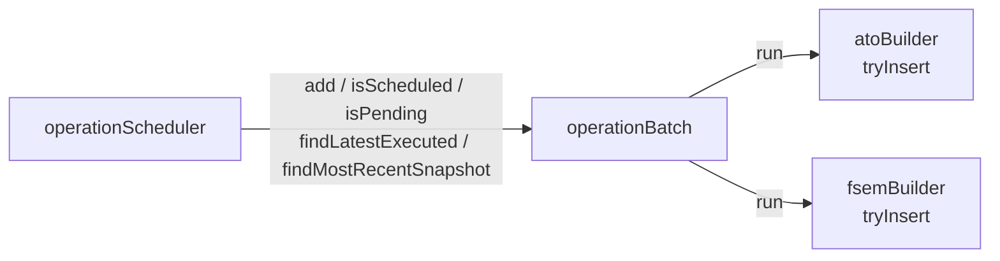
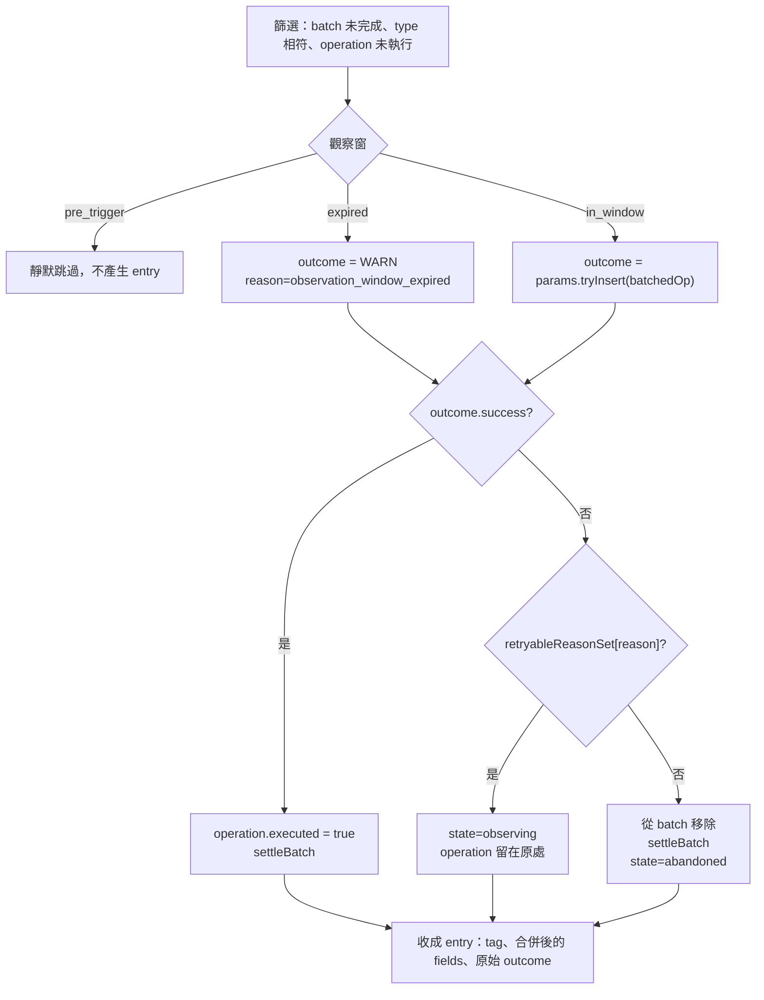

# operationBatch — 偵察觸發作戰批次的生命週期

> 原始碼：`src/modules/strikePlanner/operationBatch.lua`

**職責**：擁有 `saveData.c.dynamicOperations.reconTriggeredOperationBatches`。排程、每 tick 的執行決策（觀察窗、重試、放棄、逾時）、batch 完成判定，以及排程器需要的查詢，全部只住在這裡。

---

## 概述

一個 operation 從「排入 batch」到「計畫真的被插進去」或「被放棄」的整段過程，只有本模組會改寫 batch 內容。兩個建構器（[atoBuilder](atoBuilder.md)、[fsemBuilder](fsemBuilder.md)）縮成 adapter：它們只回答「現在能不能把這個 template 插進計畫」，不碰 batch 陣列、不判斷觀察窗、不標記 `executed`。[operationScheduler](operationScheduler.md) 則只透過 `add` 與四個查詢接觸 batch。

---

## 排程：`add`

`OperationBatch.add(batches, reconEntry, operations)` 在陣列尾端追加一個 `SBJ__ReconTriggeredOperationBatch`，`time` 與 `type` 直接沿用偵察 entry 的 `endTime` 與 `type`，`delay` 固定為 `0`，`executed` 為 `false`。建構器的 log 列以 `type@time` 標記 batch，觀察窗也從 `time + delay` 起算。

---

## 執行：`run`

`OperationBatch.run(batches, operationType, params)` 跑一個 tick。`params` 是 `SBJ__OperationBatchRunParams`：

| 欄位 | 用途 |
|---|---|
| `currentTime` | 目前劇本時間 |
| `windowSec` | 觀察窗長度，兩個建構器都傳 `config.c.recon.observationWindowSec` |
| `retryableReasonSet` | 哪些 `reason` 讓 operation 留在窗內重試 |
| `tryInsert(batchedOp)` | 建構器的插入嘗試，回傳 `SBJ__OperationProcessResult` |

回傳 `SBJ__OperationBatchRunResult`：`hasExecutedAny` 與 `entries[]`。每筆 entry 的 `fields` 已經合併 `operation=`、`batch=`、`reason=`、`state=`，建構器只要 `opReport.add(entry.tag, entry.fields, entry.outcome.details)`。

### 觀察窗

窗口起點是 `batch.time + batch.delay`（`delay` 缺省視為 0），長度 `windowSec`，邊界含頭含尾。

| 狀態 | 條件 | 行為 |
|---|---|---|
| `pre_trigger` | `currentTime < 起點` | 不呼叫 `tryInsert`、不產生 entry，operation 等下一個 tick |
| `in_window` | `起點 <= currentTime <= 起點 + windowSec` | 呼叫 `tryInsert`，依結果分派 |
| `expired` | `currentTime > 起點 + windowSec` | 直接組出 `WARN` outcome，走放棄路徑 |

### 為什麼放棄是移除而不是標記

`executed` 只有一個意思：**計畫真的插進去了**。放棄的 operation 從 `batch.operations` 以 identity 比對移除，所以 [operationScheduler](operationScheduler.md) 看到的只有「已插入」與「仍在重試」兩種狀態：

- 首波被移除 → `isScheduled` 判定沒排過 → 下次偵察完成時重開首波
- 第 N 波被移除 → `findLatestExecuted` 仍是第 N-1 波 → 重新產生第 N 波，不會跳到第 N+1 波

`retryableReasonSet` 沒收錄的 reason（含未知 reason、缺 reason）一律走移除。這是刻意的預設：漏登記造成一次多餘的重排，比讓 operation 卡在窗內每 tick 重試到逾時安全。

### batch 完成判定

`settleBatch` 在 operation 執行或被移除後檢查父 batch：所有 operation 都 `executed`，或 `operations` 被清空，就把 `batch.executed` 設為 `true`，之後的 tick 不再掃描它。

---

## 查詢

四個查詢原本住在 operationScheduler，搬來這裡是因為它們走的是 batch 陣列的內部形狀。

| 函數 | 回答的問題 |
|---|---|
| `isScheduled(batches, templateName, operationType)` | 這個 mapping 排過了嗎？完整名稱比對，**不限執行狀態** |
| `isPending(batches, templateName, operationType)` | 同名波次是否已排入但還沒打？**只收未執行** |
| `findLatestExecuted(batches, seriesPrefix, operationType)` | 有沒有可以推進的前導波次？前綴＋數字後綴，**只收已執行**，取波次號最大者，同號比批次時間 |
| `findMostRecentSnapshot(batches)` | 時間已過的最近批次裡有哪些 air / ground operation，下一個批次何時？**只看批次時間**，不看執行狀態 |

---

## Public API

| 函數 | 參數 | 回傳 |
|---|---|---|
| `add(batches, reconEntry, operations)` | `SBJ__ReconTriggeredOperationBatch[]`, `SBJ__ReconQueueEntry`, `SBJ__Operation[]` | 無 |
| `run(batches, operationType, params)` | `SBJ__ReconTriggeredOperationBatch[]`, `SBJ__OperationType`, `SBJ__OperationBatchRunParams` | `SBJ__OperationBatchRunResult` |
| `isScheduled(batches, templateName, operationType)` | `SBJ__ReconTriggeredOperationBatch[]`, `string`, `string` | `boolean` |
| `isPending(batches, templateName, operationType)` | 同上 | `boolean` |
| `findLatestExecuted(batches, seriesPrefix, operationType)` | 同上，第二參數是以 `/` 結尾的系列前綴 | `SBJ__Operation\|nil` |
| `findMostRecentSnapshot(batches)` | `SBJ__ReconTriggeredOperationBatch[]` | `SBJ__OperationBatchSnapshot` |

觀察窗判定、篩選、標記、移除、`settleBatch` 都是私有函式，只能透過 `run` 觸發。

---

## 型別與寫入副作用

型別定義以 `src/core/schema.lua` 為準：`SBJ__ReconTriggeredOperationBatch`、`SBJ__Operation`、`SBJ__BatchedOperation`、`SBJ__OperationBatchRunParams`、`SBJ__OperationBatchRunEntry`、`SBJ__OperationBatchRunResult`、`SBJ__OperationBatchSnapshot`。

| 路徑 | 行為 |
|---|---|
| `reconTriggeredOperationBatches[]` | `add` 追加 |
| `operation.executed` | `run` 在 `tryInsert` 成功時設為 `true` |
| `batch.operations` | `run` 在放棄或逾時時移除該 operation |
| `batch.executed` | `settleBatch` 在最後一個 operation 離開時設為 `true` |

`findMostRecentSnapshot` 透過 `GameApi.ScenEdit_CurrentTime()` 讀時間；其餘函式不碰遊戲狀態。

---

## 相關模組

- [operationScheduler](operationScheduler.md) — 用 `add` 排入作戰、用查詢決定開首波還是推進
- [atoBuilder](atoBuilder.md) — 以 `tryInsert` 回答「能不能插 ATO Wave」
- [fsemBuilder](fsemBuilder.md) — 以 `tryInsert` 回答「能不能插 FSEM」
- [dynamicPlan](dynamicPlan.md) — 建構器在 `tryInsert` 內用它命名、寫入、登記計畫
- [系統架構](README.md)
