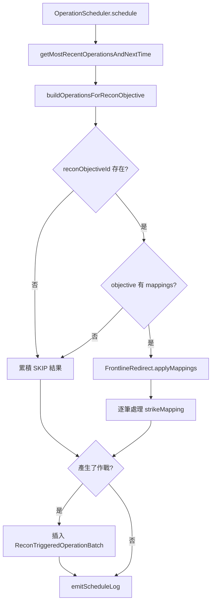
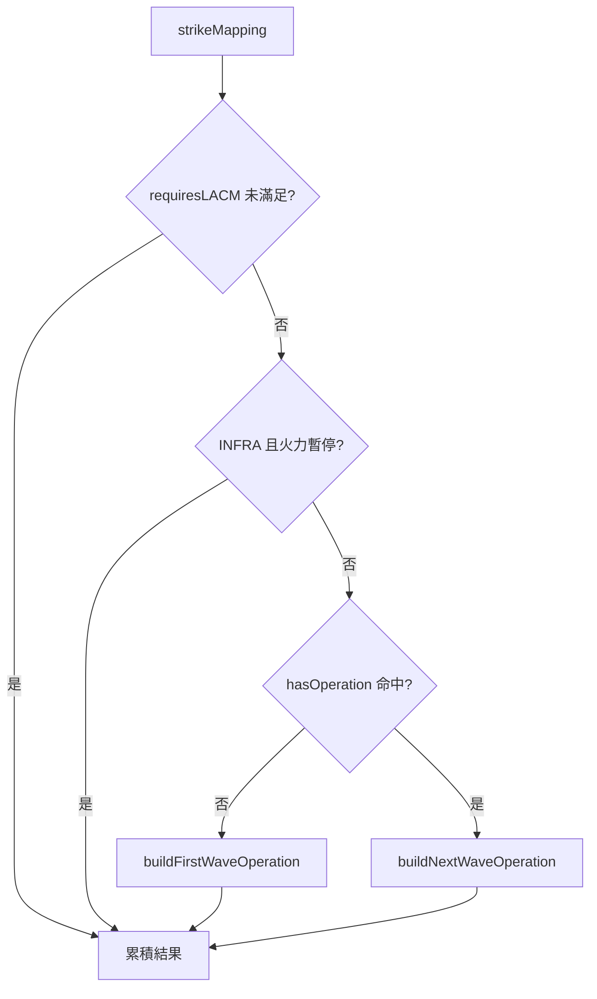

# operationScheduler — 偵察觸發作戰排程

> 原始碼：`src/modules/strikePlanner/operationScheduler.lua`

**職責**：偵察任務成功完成後，依 `reconObjectiveId` 建立後續 air/ground operations，寫入 `reconTriggeredOperationBatches`

---

## 概述

`operationScheduler` 是 [recon](recon.md) 從偵察生命週期拆出的動態作戰排程層。它不處理 UAV 發射、航線監控或衛星任務完成判定，只接收 `SBJ__ReconQueueProcessingContext` 與已完成且成功的 `SBJ__ReconQueueEntry`，把偵察目標轉換成 `SBJ__Operation`（型別定義見 `src/core/schema.lua`）。

模組依 `reconEntry.reconObjectiveId` 查詢 `config.c.recon.strikeMappingsByReconObjective`，逐筆決定該 mapping 要開首波還是推進既有序列。排程結果新增為一個 `SBJ__ReconTriggeredOperationBatch` 並寫入呼叫端傳入的 `reconTriggeredOperationBatches`。

後續由 [atoBuilder](atoBuilder.md) 取出 `air` operation 生成 ATO Wave，[fsemBuilder](fsemBuilder.md) 取出 `ground` operation 生成 FSEM。批次上的 `time` 與 `type` 直接沿用偵察 entry 的 `endTime` 與 `type`，下游用它們標記日誌並判斷觀測窗。

`OPERATION_TYPE_TRAITS` 是模組保持對 air/ground 泛型的關鍵：它以 operation type 為鍵，供給兩個建構函式所需的每型別事實（模板來源表名、寫入 `operation.template` 的欄位名、模板未帶 `strikeInterval` 時的預設值）。新增 operation type 只需在此表加一列。

---

## 排程生命週期

排程主流程（`OperationScheduler.schedule`）：



兩道早退分別輸出 `[SKIP] reason=recon_objective_not_assigned` 與 `[SKIP] reason=strike_mapping_not_found`。`SNAPSHOT` 在插入批次**之前**取得，反映的是這次排程所見的狀態。若 `reconContext.frontlineRedirected == true`，`REDIRECT` 會改寫 mapping 名稱，使後續空中打擊改用 AAR 編組模板，詳見 [frontlineRedirect](frontlineRedirect.md)。

`LOOP` 內每一筆 mapping 的決策：



兩道閘門分別輸出 `[SKIP] reason=lacm_not_committed` 與 `[HOLD] reason=fire_support_on_hold`。`FIRST` 與 `NEXTWAVE` 各自都可能不產生作戰而只回報結果（原因見下方各節），但無論成功與否都回傳一筆 `SBJ__LogResult`，呼叫端不必從「沒有回傳值」反推發生了什麼。`NEXT` 之後回到 `LOOP` 取下一筆 mapping。

---

## 為什麼首波與後續波互斥

每筆 mapping 只走一條路徑：同名作戰不存在就建立首波，已存在就嘗試推進下一波。

早期實作在建立首波後仍會接著呼叫推進路徑。該路徑幾乎必然無效（首波剛建立，不可能有已執行的前導波次），但存在一個病態情形：`/1` 不存在而已執行的 `/2` 存在時，同一次偵察會同時排出 `/1` 與 `/3`。互斥化消除了這個組合。

---

## 為什麼 REUSED_CURRENT 也要去重

推進路徑呼叫 `generateNextOperation` 生成 `/N+1`，接著以 `hasPendingOperation` 檢查同名波次是否已排入但尚未執行，若已存在輸出 `[SKIP] reason=already_pending`。

這道檢查**必須同時涵蓋 `FOUND_NEXT` 與 `REUSED_CURRENT`**。曾經只擋 `FOUND_NEXT`，理由是「`REUSED_CURRENT` 本來就要重跑同一波」——但那讓沒有 `/N+1` 模板的 mapping 在每次偵察完成時各疊一份待執行副本。實測連續三次偵察完成會累積三份。

副本能共存的原因在下游：`fsemBuilder` 對可重試原因（目標不足、發射單位不可用）會**刻意保留 pending**，地面作戰因此可能長時間掛著，期間新的偵察完成就疊上一份，等目標出現時全部一起發射。

去重不會封死重跑：`REUSED_CURRENT` 沿用已執行來源 `/N` 的名稱，而 `hasPendingOperation` 只比對未執行的作戰，所以只有先前重複排入的待執行副本會被擋，該副本執行完仍會重新排入。

---

## 為什麼推導不出下一波時不排程

`generateNextOperation` 的 `PARSE_ERROR`（名稱結尾不是 `/N`）與 `UNKNOWN_TYPE`（type 不在 `OPERATION_TYPE_TRAITS` 內）這兩種狀態下，它會回傳**來源 operation 的 deep copy**。

這是個容易誤用的回傳契約：直接排入就等於重複一個已執行的波次。`buildNextWaveOperation` 因此不排程，改輸出 `[WARN] reason=parse_error` 或 `[WARN] reason=unknown_type`。

---

## 為什麼作戰一定要有可解析的樣板

模板表以 mapping 名稱轉出的鍵查詢（`/` 換成 `_`），是動態 key 查 map，本來就可能查無。查無時 `buildFirstWaveOperation` 輸出 `[ERROR] reason=template_not_found` 並拒絕排程；type 不在 `OPERATION_TYPE_TRAITS` 內則輸出 `[ERROR] reason=unknown_operation_type`。

不能放行的原因在下游：`atoBuilder` 與 `fsemBuilder` 都會無條件巡訪 `template.packages` / `template.fireSupportTasks`，缺模板的作戰若排入會讓整個 tick 中斷。這是模組的不變量——**進入批次的作戰必定帶著可用的模板**。

---

## 為什麼 LACM 閘門放在 mapping 迴圈層級

帶 `requiresLACM = true` 的 mapping 只有在 `LACMContext.enabled == true` 時才處理，否則輸出 `[SKIP] reason=lacm_not_committed`。

閘門刻意放在 mapping 迴圈，**不放在建構函式內**。放在建構函式只擋得到首波：一旦首波已存在，流程走的是推進路徑，閘門完全不會被諮詢，後續波就繞過了限制。

`LACMContext.enabled` 是 sticky 旗標——CSG 就位時設 true 後不再清除，語義是「LACM 兵力已投入」而非「齊射待發」。齊射與否由 `hasLaunched` 記錄（見 `src/scripts/china/scheduledStrikePlanner.lua`），因此齊射後閘門仍然放行。

另有 `fireSupportOnHold == true` 時跳過所有 `GND/STRIKE/INFRA/*` mapping（`[HOLD] reason=fire_support_on_hold`），避免 SRBM 彈藥被重點基礎設施打擊消耗。

---

## 日誌輸出

三個 producer（`buildFirstWaveOperation`、`buildNextWaveOperation`、`buildOperationsForReconObjective`）直接回傳 `SBJ__LogResult`，`emitScheduleLog` 只負責建立 `LogFormat.report`、`addAll` 後 `emit()`，中間沒有轉換層。詳見 [logFormat](../logFormat.md)。

批次層級的排程快照（`endTime`、`scheduled`、`airOps` 等）以 `LogFormat.fields()` 接在 report 的 action 之後，因此不進入 entry rollup —— `total` 恆等於本次處理的 mapping 數。該快照在插入新批次**之前**取得，反映的是這次排程所見的狀態。

```text
[DYNAMIC_OPERATIONS] dynamicOperationScheduling: Schedule dynamic operations endTime=... scheduled=1 airOps=0 groundOps=0 mostRecentTime=none nextOperationBatchTime=none | total=2 ok=1 skip=1
  [OK]   operation=AIR/STRIKE/AB/W/1 type=air action=schedule_new
  [SKIP] operation=GND/STRIKE/C2/N/2 type=ground reason=already_pending
```

沒有任何 mapping 產生結果時，report 補上一筆 `[SKIP] reason=no_operations_to_schedule`，避免整批靜默。`NEXT_OPERATION_STATUS` 的值是 `generateNextOperation` 公開契約的一部分（大寫），寫進 log 時以 `string.lower()` 轉成 token。

---

## Public API

只有 `schedule` 有跨模組呼叫端（`recon.lua`）。其餘四個掛在模組表上，一是供單元測試直接驗證，二是讓內部呼叫點可被 stub。

| 函數 | 參數 | 回傳 | 說明 |
|---|---|---|---|
| `schedule(processingContext, reconEntry)` | `SBJ__ReconQueueProcessingContext`, `SBJ__ReconQueueEntry` | 無 | 依完成偵察 entry 建立後續作戰，必要時新增批次並輸出 log |
| `getMostRecentOperationsAndNextTime(operationBatches)` | `SBJ__ReconTriggeredOperationBatch[]` | snapshot table | 取時間已過的最近批次，依 type 分類其作戰，並回報下一個批次時間。**只看批次時間，不看執行狀態** |
| `hasOperation(operationBatches, templateName, operationType)` | `SBJ__ReconTriggeredOperationBatch[]`, `string`, `string` | `boolean, operation?, batch?` | `templateName` 以 `/` 結尾走前綴搜尋（取波次號最大者，**僅限已執行**），否則精確比對（不限執行狀態） |
| `hasPendingOperation(operationBatches, templateName, operationType)` | 同上 | `boolean` | 是否已有同名且**未執行**的作戰 |
| `generateNextOperation(operation, config)` | `SBJ__Operation`, `SBJ__Config` | `SBJ__Operation, string` | 遞增波次號生成下一波；查無下一波模板則沿用當前模板。狀態見上方「為什麼推導不出下一波時不排程」 |

`processingContext` 欄位：

| 欄位 | 用途 |
|---|---|
| `config` | 讀取 recon objective mappings 與兩張模板表 |
| `reconContext` | 讀取 `frontlineRedirected` sticky 旗標並套用 mapping rewrite |
| `reconTriggeredOperationBatches` | 查詢既有/待執行作戰，並在有新作戰時追加批次 |
| `LACMContext` | 讀取 sticky 的 `enabled`，判斷帶 `requiresLACM` 的 mapping 是否可排程 |
| `fireSupportOnHold` | 暫停 `GND/STRIKE/INFRA/*` mapping |

---

## config / constants / saveData 參考

| 類型 | 路徑 | 用途 |
|---|---|---|
| `config` | `config.c.recon.strikeMappingsByReconObjective` | 依 `reconObjectiveId` 取得後續 strike mappings；mapping 可帶 `requiresLACM` 宣告 LACM 前提 |
| `config` | `config.c.recon.frontlineRedirect` | 交由 `FrontlineRedirect.applyMappings` 判斷是否改寫 mapping 名稱 |
| `config` | `config.c.packageTemplates` | `air` operation 的模板來源，鍵為 mapping 名稱的 `/` 換 `_` |
| `config` | `config.c.fireSupportTaskTemplates` | `ground` operation 的模板來源，鍵同上 |
| `config` | `config.strikeInterval` | `air` 作戰的預設 `strikeInterval`；`ground` 固定為 `0` |
| `saveData` | `saveData.c.dynamicOperations.reconTriggeredOperationBatches` | 寫入偵察觸發作戰批次；同時作為既有/待執行作戰查詢來源 |
| `saveData` | `saveData.c.recon.frontlineRedirected` | 由 `FrontlineRedirect.applyMappings` 讀取；本模組不直接改寫 |
| `saveData` | `saveData.c.surface.lacm` | 以 `LACMContext` 傳入，讀取 sticky 的 `enabled` |
| `saveData` | `saveData.c.amphibOps.fireSupportOnHold` | 以 `fireSupportOnHold` 傳入 |
| `constants` | `constants.TAGS.DYNAMIC_OPERATIONS` | 輸出排程 report |

---

## 相關模組

- [recon](recon.md) — 偵察任務完成後呼叫 scheduler
- [frontlineRedirect](frontlineRedirect.md) — 提供 sticky redirect 後的 mapping 改寫
- [dynamicState](dynamicState.md) — 提供執行端共用的狀態、命名與 generated operation 登記
- [atoBuilder](atoBuilder.md) — 消費 `air` operation，生成 ATO Wave
- [fsemBuilder](fsemBuilder.md) — 消費 `ground` operation，生成 FSEM
- [系統架構](README.md)
